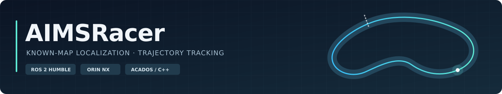

# AIMSRacer



[English](README.md) · [简体中文](README.zh-CN.md)

**PolyU AIMS Lab** ROS 2 racing stack: FAST-LIO2, rear-axle EKF, NDT map localization and native acados/C++ MPCC.

Orin NX 16 GB · Ubuntu 22.04 · ROS 2 Humble · KKPIT ZQR 1/7 · Livox MID360 · VESC · ELRS

<a id="navigation"></a>
## Current workflows

| Task | Current guide / source |
|---|---|
| Install and build | [Deployment](docs/deployment/README.md) · [NX](docs/deployment/orin.md) |
| Drive, map, MPCC | [Bringup](docs/operations/bringup.md) · [Known-map operation](docs/operations/known-map-mpcc.md) |
| 后轴／质心 VX、VY、AX、AY、yaw rate | [计算、话题与启动](docs/operations/state-observer.zh-CN.md) · [现场脚本](src/aims_racer_system/field/README.zh-CN.md) |
| 纵向电流 A/B/C | [操作指南](docs/operations/calibration.zh-CN.md#current-calibration) · [longitudinal_current](src/calibration/longitudinal_current/README.zh-CN.md) · [离线拟合／查询](src/calibration/longitudinal_current/docs/wheel-current-model.zh-CN.md) |
| 自动横向附着标定 | [lateral_grip](src/calibration/lateral_grip/README.zh-CN.md) · [AY 校对](docs/operations/lateral-acceleration-calibration.zh-CN.md) |
| 动捕校对：状态／FastLIO／执行器 | [mocap_validation](src/calibration/mocap_validation/README.zh-CN.md) · [现场配置](docs/operations/mocap-validation.zh-CN.md) |
| Maps and reference editing | [Reference tools](tools/reference/README.md) · [Editor](tools/reference/editor/README.md) |
| Recording and verification | [Recording](docs/operations/recording.md) · [Verification](verification/README.md) |
| Current documentation | [Docs](docs/README.md) |

<a id="quick-start"></a>
## Build and launch

Install the deployment dependencies, pinned sources and acados first. Source the same workspace in each terminal:

```bash
source /opt/ros/humble/setup.bash
export MAKEFLAGS="-j2 -l2"
colcon build --packages-up-to aims_racer_system aims_mpcc_rt --executor sequential \
  --cmake-args -DCMAKE_BUILD_TYPE=Release -DROS_EDITION=ROS2 -DDISTRO_ROS=humble
src/calibration/build.sh
source install/setup.bash
```

Vehicle operation also requires the actual map, reference/bundle and device configuration. These site inputs are outside the source repository; use the workflow guides above.

<a id="calibration"></a>
## Calibration and mocap

The [calibration group](src/calibration/README.zh-CN.md) contains `longitudinal_current`, `lateral_grip` and `mocap_validation`. Continuous calibration/estimation nodes use C++; startup configuration and offline analysis use Python. Longitudinal and lateral trials share one command channel and remain explicitly enabled. Offline wheel-current tools do not automatically replace the selected B/C model.

<a id="architecture"></a>
## Interfaces and responsibilities

`base_link` is the rear-axle midpoint; TF is `map → odom → base_link → livox_frame`. The independent observer uses corrected IMU and raw LIO poses to publish rear-axle and CG states. MPCC wiring is unchanged and still consumes navigation VX. See [architecture](docs/architecture.md) and the [native controller](src/aims_mpcc_rt/README.md).

<a id="defaults"></a>
Defaults are defined by [vehicle.yaml](src/controller/config/vehicle.yaml), [system parameters](src/aims_racer_system/params/) and the built launches. NX site settings and generated bundles require a separate check.

<a id="results"></a>
[Current evidence and pending acceptance](docs/reports/latest-results.md): independent mocap accuracy and actual grip limits remain unvalidated. Retired runtimes and superseded tutorials are excluded from operating navigation.

<a id="credits"></a>
## Acknowledgements and licenses

Attribution and license materials are retained in the [model NOTICE](src/controller/NOTICE.md), [native runtime NOTICE](src/aims_mpcc_rt/NOTICE.md) and individual packages. Dependency versions and patches are recorded in [the manifest](dependencies/manifest.json).

This project builds on contributions from:

- [ForzaETH Race Stack](https://github.com/ForzaETH/race_stack)
- [QUTMS Driverless](https://github.com/QUT-Motorsport/QUTMS_Driverless)
- [Original upstream system package](https://github.com/f1tenth/f1tenth_system)
- [ros2_crsf_receiver](https://github.com/AndreyTulyakov/ros2_crsf_receiver.git)
- [ackermann_mux](https://github.com/z1047941150/ackermann_mux.git)
- [Veddar VESC Interface](https://github.com/f1tenth/vesc)
- [FAST-LIO2_ROS2 maintained fork](https://github.com/EleSheep-moving/FASTLIO2_ROS2.git)

Hardware and basic software were developed at PolyU AIMS Lab. Currently pursuing MPhil at PolyU AIMS Lab, with ongoing development in progress.
