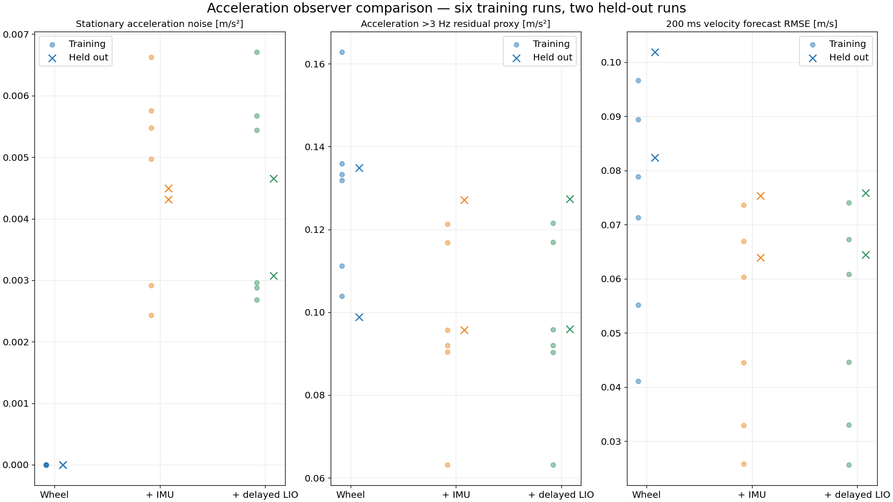
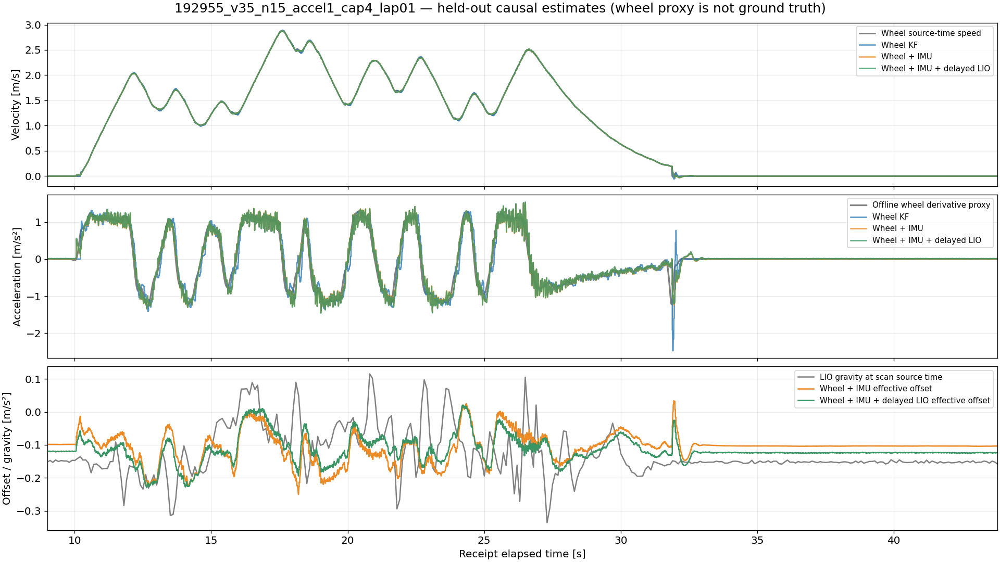
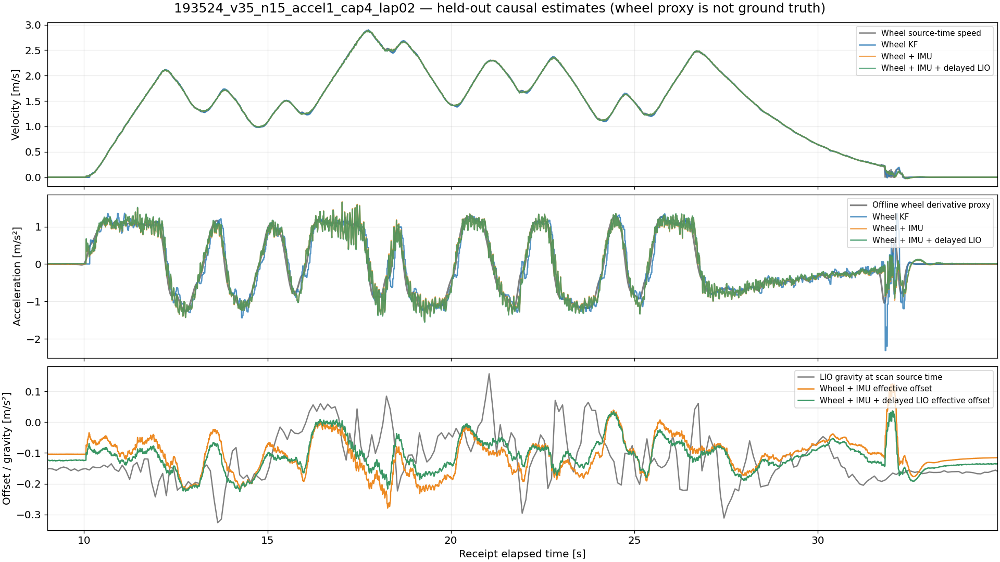

# Causal longitudinal acceleration comparison

Date: 2026-10-12 · [简体中文](2026-10-12-longitudinal-acc-observer.zh-CN.md) · [Implementation / commands](../../verification/acceleration/README.md)

## Conclusion

**Wheel speed + rear IMU is the preferred candidate for the next runtime estimation test.** On the two held-out recordings its 200 ms wheel-speed forecast RMSE improves by **22.3% and 26.0%** over the independently tuned wheel-only observer. Stationary acceleration standard deviation is **0.00450 / 0.00432 m/s²**. The additional delayed LIO gravity constraint provides no consistent forecast improvement and introduces a stationary mean around **+0.010 m/s²** on these recordings; leave that option disabled initially.

This establishes a useful causal estimate on recorded inputs, not independently measured acceleration accuracy or readiness for acceleration closed-loop control. No production ROS node, navigation EKF, MPCC, FAST-LIO or VESC setting was changed by this experiment. At this offline experiment snapshot, the preceding source-time rear-adapter fixes were separate pending changes. They have since been preserved in commit `ab0374a`; see the [runtime guide](../operations/longitudinal-acceleration.md) for the subsequent opt-in ROS integration.

## Compared models

| Candidate | State | Measurements |
|---|---|---|
| Wheel | `[v,a]` | Wheel speed |
| Wheel + IMU | `[v,a,d]` | Wheel speed, corrected rear longitudinal specific force |
| Wheel + IMU + LIO | `[v,a,d]` | Above plus historical longitudinal gravity from LIO attitude |

The process is `dv/dt=a`, white-jerk acceleration and random-walk disturbance. Measurement equations are `v_wheel=v+noise`, `f_x=a+d+noise`, and optional `−g_body,x≈d+noise`. Body-speed derivative `a` differs from inertial longitudinal acceleration by rotation terms. Here `d` contains `−g_body,x`, accelerometer bias and `(ω×v)x`; treating LIO gravity as the whole disturbance is an approximation.

Input rotation is identity Livox/base mounting, with the existing rear-axle lever correction already applied by the frozen C++ force replay. LIO quaternion is body-to-world, xyzw; historical projection is `9.80665 × 2(qx qz − qw qy)`. This is a scalar historical constraint, not pose/attitude propagation. LIO and force share the same IMU and are not independent truth sources.

## Time policy and provenance

- Eight completed runs from the archived `2026-10-11/longitudinal-acceleration` extracts. Force comes from `2026-10-11/imu-source-time-alignment`, not the old adapter's attitude-dependent availability flag.
- Verify each NPZ hash, force-output hash and linkage to the original extract; record metadata hashes for window labels and force provenance. Raw database provenance contains paths/size/mtime, not newly computed hashes of multi-GB original bags.
- Replay **bag receipt order**. Preserve integer source nanoseconds. Late observations enter only after receipt, update their historical source state and replay its suffix. Earlier emitted outputs are immutable.
- Estimate scalar states at each rear IMU **receipt time**, using only measurements received by then. These are predicted estimates, not restamped source observations. No output waits for LIO. No new `/rear_axle/imu_aligned` or LIO pose prediction.
- Retain 10 seconds before `RUNNING` and 3 seconds after `COMPLETE`; score the controller active window. This is not a measured lap-duration definition.
- History is bounded by 2 seconds and 4,096 observations plus one posterior anchor. Excessively old optional observations do not stop live snapshots. All 24 final replays have **zero** invalid observations, numerical failures, too-old observations and count-bound trims. Largest history is 523 measurements.
- Force uses exact raw/rear source-time intersections. Recorded streams can omit historical inputs, so this does not reconstruct every original runtime callback; that uncertainty remains in the frozen force replay.

## Selection and metric definitions

Six runs train settings; two V35 runs are held out with no retuning. Run names describe configured target speed, not measured vehicle speed. The first search hit parameter boundaries; it is preserved in `initial-search/`. A wider training-only search evaluates 20 wheel, 36 fusion and 12 gravity configurations: **408 run/configuration trials**.

Selected parameters:

| Parameter | Wheel | + IMU | + IMU + LIO |
|---|---:|---:|---:|
| Jerk PSD | 100 | 30 | 30 |
| Wheel variance, (m/s)² | 0.01 | 0.01 | 0.01 |
| Force variance, (m/s²)² | unused | 16 | 16 |
| Disturbance PSD | unused | 0.1 | 0.1 |
| Gravity variance, (m/s²)² | unused | unused | 1.0 |

These are effective tuning values, **not independently calibrated sensor noise**. The finite grid does not establish a global optimum; Wheel variance, IMU variance and gravity variance select their upper tested boundaries; the fusion jerk multiplier selects its lower tested boundary (0.3). The improvement compares complete tuned configurations and includes process tuning differences: wheel jerk testing did not include the fusion-selected value 30, so it does not isolate the contribution of IMU alone. Process PSD units are m²/s⁵ for jerk and m²/s⁵ for disturbance random walk. Initial zero-mean variances are `[1,4]` or `[1,4,4]` in the corresponding state units. Emitted covariance is model uncertainty and has not been calibrated against field truth.

Metric grid is 200 Hz. Hold latest already-received output with a 20 ms coverage limit **for evaluation only**; do not interpolate estimator future values. Offline wheel interpolation excludes gaps over 60 ms. The wheel acceleration proxy uses a centered **165 ms Savitzky–Golay derivative**, order 3, followed by zero-phase second-order 3 Hz filtering; it is noncausal and used only in scoring.

- Stationary segments: outside active window ±1 s, `|v_wheel|<0.03`, gyro norm `<0.08 rad/s`, LIO speed `<0.05 m/s`; contiguous duration ≥1 s. Sigma pools within-segment mean-subtracted residuals; mean is reported separately.
- High-frequency proxy: acceleration minus its zero-phase second-order 3 Hz trend, RMS inside active window. It includes true fast motion and filter-transition effects, so it is not isolated sensor noise.
- Forecast: `v_est(t)+h a_est(t)` versus future source-time wheel speed for `h=0.1 / 0.2 s`. Future targets never enter the observer.
- Onset: reference crosses ±0.25 m/s² for ≥100 ms; estimate crosses the same signed threshold for ≥50 ms. Match nearest unused crossing within ±500 ms, reference events separated by ≥750 ms. Require known prior below-threshold coverage; reject window/coverage boundary artifacts. Signed lags are relative to the noncausal proxy, **not physical hardware delay**; misses are retained.
- Training score averages `RMSE_v100² + RMSE_v200² + (0.05 sigma_static)² + (0.015 RMS_high_frequency)²` per training run. These are engineering tradeoff weights, not a closed-loop acceptance criterion.

## Per-run 200 ms forecast RMSE

Units: m/s. All values are against a shared wheel sensor, not independent ground truth.

| Run | Role | Wheel | + IMU | + IMU + LIO |
|---|---|---:|---:|---:|
| 175129_v10_lap01 | training | 0.0411 | 0.0258 | 0.0256 |
| 185351_v12_n15_independent_lap01 | training | 0.0552 | 0.0330 | 0.0330 |
| 190404_v15_n15_cap4_lap01 | training | 0.0713 | 0.0445 | 0.0446 |
| 190848_v18_n15_accel1_cap4_lap01 | training | 0.0789 | 0.0604 | 0.0608 |
| 192020_v22_n15_accel1_cap4_lap02_clockfix | training | 0.0894 | 0.0669 | 0.0673 |
| 192725_v26_n15_accel1_cap4_lap01 | training | 0.0967 | 0.0736 | 0.0740 |
| 192955_v35_n15_accel1_cap4_lap01 | held out | 0.0824 | 0.0640 | 0.0644 |
| 193524_v35_n15_accel1_cap4_lap02 | held out | 0.1018 | 0.0754 | 0.0758 |

Held-out detail:

| Metric | Wheel, run 1 / 2 | + IMU, run 1 / 2 | + IMU + LIO, run 1 / 2 |
|---|---|---|---|
| Stationary sigma, m/s² | approximately 0 / 0 | 0.00450 / 0.00432 | 0.00308 / 0.00465 |
| Stationary mean, m/s² | approximately 0 / 0 | −0.00061 / −0.00051 | +0.01046 / +0.01018 |
| High-frequency residual, m/s² | 0.0988 / 0.1349 | 0.0957 / 0.1271 | 0.0959 / 0.1274 |
| 100 ms forecast RMSE, m/s | 0.0381 / 0.0483 | 0.0290 / 0.0358 | 0.0291 / 0.0358 |
| Acceleration onset median, ms | +60 / +65 | −10 / +5 | −5 / −10 |
| Braking onset median, ms | +55 / +60 | +45 / +55 | +50 / +55 |

Stationary wheel-only noise approaches zero because recorded wheel speed is exactly zero, not because it measures body acceleration perfectly. Coverage is 99.64% / 99.83%, stationary windows approximately 10.9 / 10.8 s. Run 1 has 9 acceleration and 11 braking events; run 2 has 10 and 11. Fusion misses one acceleration event in run 2; wheel-only misses none. Detailed straight/curved, acceleration/braking proxy residuals and all onset P95/miss counts are in `metrics.csv`.

## NX reproduction and timing

Copied only this verification package into `/home/aims/aimsracer-data/code/longitudinal-acc-observer`. No ROS or hardware processes were launched. NX: aarch64 Linux 5.15.199-tegra, Python 3.10.12, NumPy 1.21.5, SciPy 1.8.0, 8 CPU cores; `OPENBLAS_NUM_THREADS=1`. This was serial offline processing under a lightly loaded system, not simultaneous localization/controller load.

**27 tests pass on desktop and NX.** All **24** frozen-config output arrays reproduce within **1.16×10⁻¹⁴** maximum absolute difference. The final review rerun changes none of the numerical estimates; it corrects onset reporting and verifies current code.

| NX metric across eight runs | Wheel | + IMU | + IMU + LIO |
|---|---:|---:|---:|
| Highest admitted wheel-update P95, ms | 0.199 | 0.206 | 0.207 |
| Admitted IMU-update P95 range, ms | n/a | 0.436–0.441 | 0.438–0.442 |
| Admitted LIO-update P95 range, ms | n/a | n/a | 5.745–6.874 |
| Mean summed processing elapsed ms / recorded second | 27.3 | 73.9 | 117.0 |
| Maximum individual elapsed update, ms | 23.26 | 24.42 | 11.47 |

Timers include receive/replay and, for IMU events, current snapshot; elapsed intervals include OS scheduling. The summed metric is **not measured CPU utilization**. Maxima expose scheduler/outlier costs; aggregate mixed-event P95 would hide rare LIO replay. Disabled-observation calls appear only in the aggregate totals, not admitted per-kind timings. No ROS transport, adapter computation or downstream executor cost is included.

## Recommended next step and evidence

Use **wheel + IMU, LIO gravity disabled** for a separate runtime acceleration estimator evaluation. Preserve raw specific force, LIO source-time odometry and the current navigation EKF behavior. Verify slope transitions, wheel slip, vibration and concurrent load before any acceleration-feedback controller uses this estimate. Wheel-slip acceleration can still mislead both the wheel anchor and these evaluation targets; current recordings do not independently resolve it.

Local evidence: `/home/elesheep/aimsracer-data/sessions/2026-10-12/longitudinal-acc-observer`; NX evidence: `/home/aims/aimsracer-data/sessions/2026-10-12/longitudinal-acc-observer`. `metrics.csv`, `selected-configs.json`, `training-trials.json`, `inputs.json`, `nx-reproduction.json`, test logs and `artifact-manifest.json` define the reproducible result. Desktop uses image `aimsracer-mpcc:main-dev-20261011`, ID `sha256:3676c0ca530001721902be873285131a502e81955f88e077bf22a9d70a498942`.
