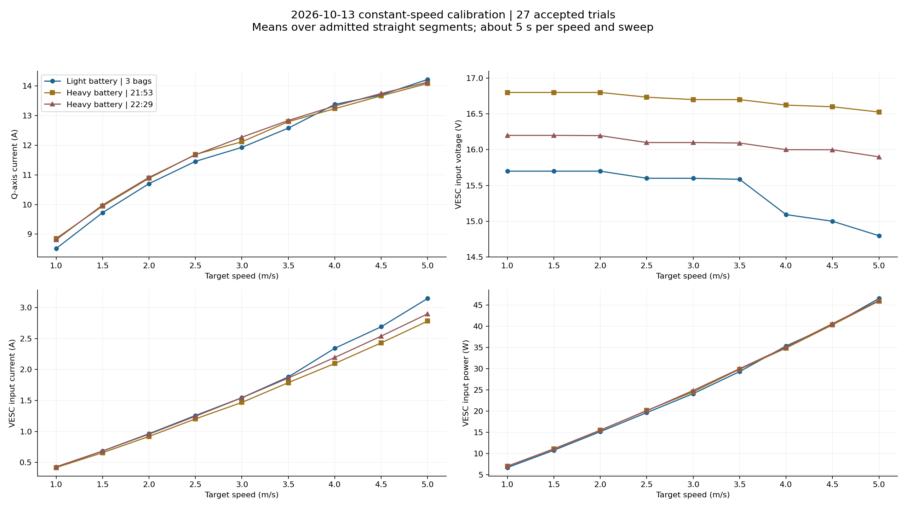
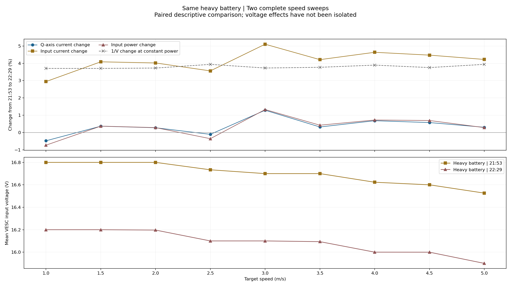
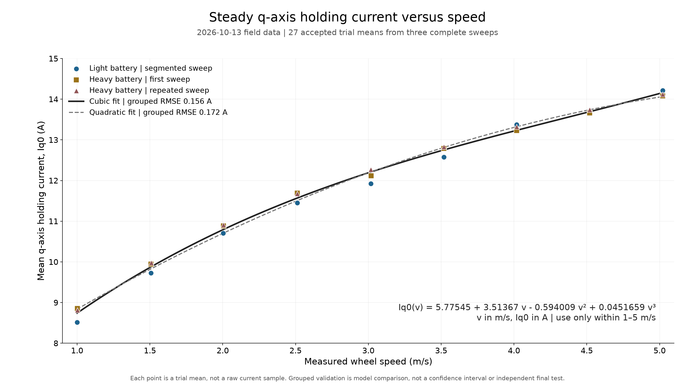
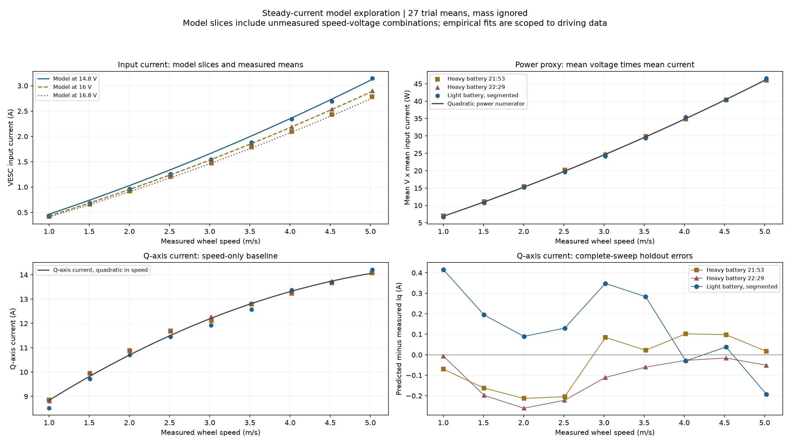

# Steady q-axis current, voltage and speed

**English** · [简体中文](2026-10-13-steady-current-voltage-model.zh-CN.md)

Corrected on 2026-10-14. The earlier `current_motor` fit is withdrawn as a torque/holding-current baseline. Original telemetry, bags and acquisition results remain unchanged. All holding-current coefficients and B/C baselines below use measured **`avg_iq`**. Battery-input power still uses `voltage_input × current_input`.

## 1. What each current means

| `/sensors/core.state` field | Use |
| --- | --- |
| `avg_iq` | Signed q-axis current; torque approximation and A/B/C current tracking |
| `avg_id` | d-axis current; diagnostic for operating regime and field weakening |
| `current_motor` | Separate motor-current telemetry; retained diagnostic, never substituted for Iq |
| `current_input` | Battery-side VESC input current; input power and energy |
| `voltage_input` | Voltage at VESC input; measurement context and available voltage |

Iq is a rotating-frame current component, not an arbitrary phase-current RMS value. In the inspected VESC FOC source, the current command sets the q-axis target; motor-current and Iq averages have separate telemetry paths. The board's firmware configuration still determines physical limits. See [VESC FOC source](https://github.com/vedderb/bldc/blob/master/motor/mcpwm_foc.c), [telemetry aggregation](https://github.com/vedderb/bldc/blob/master/motor/mc_interface.c), and the [native command contract](../vesc-command.md).

## 2. Torque demand and voltage capability

For a PMSM,

\[
T_e=\frac32p\left[\psi_m I_q+(L_d-L_q)I_dI_q\right].
\]

When the reluctance contribution is small, torque is approximately proportional to Iq. This is a conditional approximation, not a measured torque constant for this vehicle. At steady speed the required torque balances rolling, aerodynamic, driveline, slope and steering loads. Therefore holding current is primarily a load-versus-speed relationship. See the [PMSM torque equation](https://www.mathworks.com/help/mcb/ref/pmsmtorqueestimator.html).

The voltage equations explain a different relationship:

\[
v_d=R_sI_d+L_d\dot I_d-\omega_eL_qI_q,\qquad
v_q=R_sI_q+L_q\dot I_q+\omega_e(L_dI_d+\psi_m).
\]

Higher speed increases back EMF. With enough bus-voltage headroom, the controller can increase modulation as voltage falls and maintain the same Iq. Near voltage saturation, attainable Iq/torque changes; negative Id for field weakening also changes the current budget. Thus **do not apply a universal `Iq ∝ 1/V` holding-current correction**. Separate required `Iq0(v, load)` from achievable `Iq_max(v, V, temperature, limits)`. See [voltage limits and field weakening](https://www.mathworks.com/help/mcb/gs/field-weakening-control-mtpa-pmsm.html).

For longitudinal motion, a useful local approximation is `m_eff * a = K_w * Iq - F_res(v)`, where `K_w` includes gearing, tire radius and efficiency. Thus `Iq < Iq0(v)` can decelerate the car even when Iq remains positive. Zero Iq coasts; negative Iq opposes forward motion. Negative torque does not guarantee unrestricted battery regeneration: losses and battery/DC-voltage limits still matter. A commanded Iq is distinct from actual achieved Iq.

Input current follows power instead. Approximately, at fixed speed and load, `Vdc × I_input` supplies mechanical power plus losses; lowering Vdc can increase input current without substantially increasing Iq. Power statistics here use each paired sample, `mean(V_k × I_input,k)`, rather than assuming the product of means is identical. This is VESC input power, not total vehicle power.

## 3. Reconstructed field evidence

Five usable bags form three complete 1–5 m/s sweeps. The light-battery sweep spans three bags; two heavy-battery sweeps are complete single sessions. The comparison contains **27 accepted trials, 57 admitted straight segments, 6,733 samples and 135.258 effective seconds**. One unsuccessful trial is excluded. Preparation/malformed sessions are retained outside the fit.

Original wheel/telemetry source-time boundaries determine the exact admitted samples. Raw bag telemetry already contains Iq and Id; no motor-current conversion or invented Iq was needed. Reconstruction verified 168 evidence-file hashes and five raw-archive hashes, and exactly reconciled the original motor statistics. This reconciliation verifies sample selection, not that the two currents are interchangeable.



At 5 m/s:

| Sweep | Mean V | Mean Iq A | Mean input A | Mean paired input power W |
| --- | ---: | ---: | ---: | ---: |
| Light, segmented | 14.798 | 14.215 | 3.148 | 46.577 |
| Heavy, 21:53 | 16.526 | 14.080 | 2.782 | 45.969 |
| Heavy, 22:29 | 15.900 | 14.123 | 2.899 | 46.099 |

Between the two heavy-battery sweeps, paired Iq changes range from **−0.48% to +1.29%**; input current increases **2.94%–5.10%**; paired input power changes **−0.73% to +1.33%**. These are descriptive comparisons. Mass, temperature, route segments, speed error and ascending-speed/time order confound a causal voltage estimate.

The repeated heavy sweep has mean Id between about −0.0085 and +0.0203 A and reported duty between 0.062 and 0.243. These measurements provide no evidence of substantial mean field weakening in those admitted steady segments. They do not establish the available 100 A capability or a universal saturation threshold.



## 4. Fits and complete-sweep validation

Fit the 27 trial means with equal trial weight and measured wheel speed. Train on two complete sweeps and predict the third, rotating all three folds. Correlated messages are not thousands of independent trials. Model comparison on these three folds is not an independent final test.

| Iq model | Group-held-out RMSE A |
| --- | ---: |
| Linear speed | 0.323 |
| Quadratic speed | 0.172 |
| Cubic speed | **0.156** |
| Quadratic speed + voltage | 0.200 |
| Quadratic speed + voltage + interaction | 0.234 |
| Quadratic numerator divided by voltage | 0.700 |

For studying `Iq0(v)`, the current speed-only candidate with lowest complete-sweep held-out RMSE is the cubic:

\[
I_{q,0}(v)\approx5.775448+3.513670v-0.594009v^2+0.0451659v^3\quad[\mathrm A].
\]

Use it only for nominal 1–5 m/s driving conditions. Its training RMSE is 0.114 A, grouped RMSE is 0.156 A, and grouped maximum absolute error is 0.348 A. It remains monotonically increasing throughout this interval. This is a descriptive empirical fit, not a validated controller feedforward or independent ground truth. The 5.775 A intercept is an extrapolation and has no standstill interpretation.



[Fit coefficients and validation](assets/2026-10-13-steady-current/curve-fit-iq-v2/iq0_speed_fit.json) · [Nominal-speed predictions](assets/2026-10-13-steady-current/curve-fit-iq-v2/iq0_speed_predictions.csv) · Reproducible curve source（原始分析附件留在外部实验目录：`docs/reports/assets/2026-10-13-steady-current/curve-fit-iq-v2/fit_iq0_curve.py`） · [SVG](assets/2026-10-13-steady-current/curve-fit-iq-v2/iq0_speed_curve.svg)

A simple provisional descriptive curve is

\[
I_{q,0}(v)\approx6.60464+2.41870v-0.185854v^2\quad[\mathrm A],\qquad 1\le v\le5\ \mathrm{m/s}.
\]

The cubic has lower grouped RMSE; quadratic is retained only as a compact reference, not declared the validation winner. **Runtime B/C use measured baseline points**, not this polynomial. Added voltage terms do not improve this dataset's held-out prediction; this does not prove voltage can never affect Iq.

The unchanged battery-current empirical fit is

\[
I_{\rm input}(v,V)\approx\frac{-0.516192+6.918272v+0.476891v^2}{V}\quad[\mathrm A].
\]

Its grouped RMSE is 0.02016 A. This fit uses trial means, is limited to measured driving conditions (about 14.8–16.8 V), and is not a stationary, launch, braking or universal battery model. The negative extrapolated intercept has no idle-power interpretation.



## 5. Calibration consequences and reproducibility

The selected repeated-heavy A run yields `Iq0(1.5)=9.98185 A`. B uses `Iq0+5`, `Iq0+10`, … up to 100 A; C uses strictly positive `Iq0−5`, `Iq0−10`, …, then zero and negative currents. Corrected plans contain **146 B items and 183 C items** before skips. Missing Iq is unavailable evidence; motor or battery current is never substituted. See [current-sweep operations](../../src/aims_racer_system/docs/calibration.md).

Old motor baselines are rejected. Corrected A sidecars are new files with raw-source/result hashes; original A records remain intact. The original observations CSV is retained alongside each sidecar for voltage/source-time provenance; its historical motor column is not relabeled as Iq. New sessions record both currents separately.

Artifacts: [admitted trial means](assets/2026-10-13-steady-current/accepted_trials.csv), [reconstruction validation](assets/2026-10-13-steady-current/validation.json), [model metrics](assets/2026-10-13-steady-current/curve-fit-iq-v2/model_metrics.csv), executed notebook（原始分析附件留在外部实验目录：`docs/reports/assets/2026-10-13-steady-current/curve-fit-iq-v2/steady_iq_curve_fit.ipynb`）, model source（原始分析附件留在外部实验目录：`docs/reports/assets/2026-10-13-steady-current/curve-fit-iq-v2/fit_models.py`）, and reconstruction source（原始分析附件留在外部实验目录：`docs/reports/assets/2026-10-13-steady-current/analyze_iq.py`）.

Raw/evidence root on the analysis host: `/home/elesheep/aimsracer-data/sessions/2026-10-13/constant-speed-current-review`. Derived evidence: `/home/elesheep/aimsracer-data/sessions/2026-10-14/iq-current-correction/recomputed`. Raw NPZ/bags are external data, not fresh-checkout assets. Recompute using:

```bash
python3 docs/reports/assets/2026-10-13-steady-current/analyze_iq.py \
  --source-root /home/elesheep/aimsracer-data/sessions/2026-10-13/constant-speed-current-review \
  --output /tmp/aims-iq-recomputed
python3 docs/reports/assets/2026-10-13-steady-current/curve-fit-iq-v2/fit_models.py
python3 docs/reports/assets/2026-10-13-steady-current/plots_iq.py
```

The first command reconstructs external raw evidence; the latter commands use checked-in trial means. Polynomial feedforward and B/C physical acceptance remain untested.
