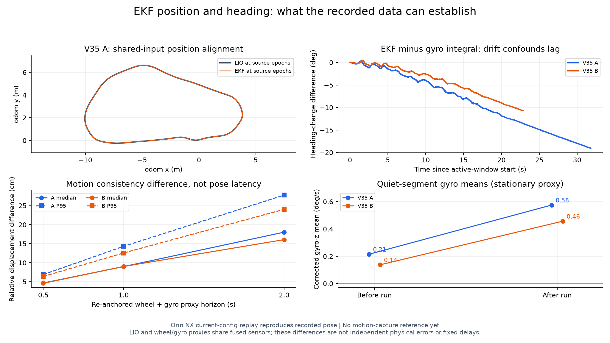
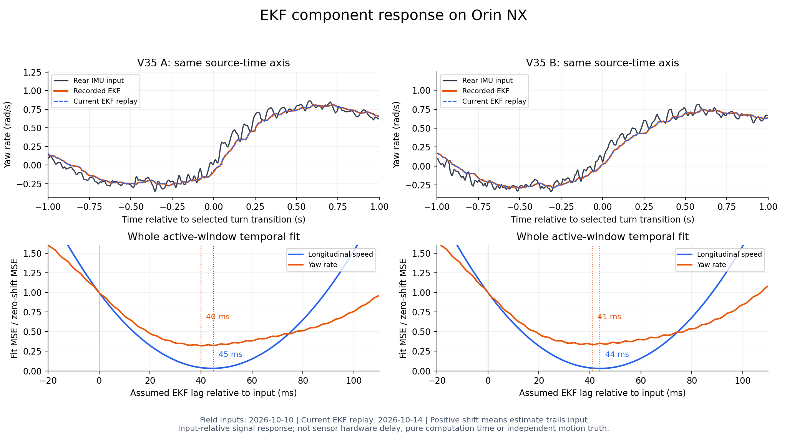

# EKF position and heading timing: NX replay and consistency checks

**English** · [简体中文](2026-10-14-ekf-component-latency.zh-CN.md) · [System latency](../system-latency.md#5-ekf-computation-versus-response-lag)

Measured **2026-10-14**. Reviewed main source `098976b9`; installed `ros-humble-robot-localization	3.5.4-1jammy.20260605.164056`. This work changed no production filter parameters or vehicle commands.

## What was tested

Two completed 2026-10-10 V35 field bags were read and replayed through the real NX `robot_localization/ekf_node` with the current configuration. The original recordings ran FAST-LIO2, EKF, NDT and MPCC together. The new replays ran the EKF with recorded rear-axle inputs in isolated localhost ROS domain **109**, at 1× speed with a 200 Hz simulation clock. FAST-LIO, NDT, adapters and the vehicle driver were not rerun. Recorded `/odometry/filtered` was captured for comparison, not fused; fresh EKF output was remapped to `/ekf_response/deployed`.

The two retained installed-filter replays from the 2026-10-06 investigation were also reanalyzed. They are historical captures, not additional fresh replays. Both use the same deployed EKF YAML hash.

- Configuration SHA-256: `eafdface37e679b94e5e30edf8f17ead001eb2066a008839489247a3b6e821d5`.
- `frequency=200`, `predict_to_current_time=true`, `smooth_lagged_data=true`, `history_length=2`, `Q(vx)=0.4`, `Q(yaw rate)=0.02`.
- Three sampled V35-A rear-IMU messages had gyro-z observation variance **0.01 (rad/s)²**.
- Direct updates: LIO pose and linear velocity, wheel `vx`, IMU yaw rate. IMU orientation and acceleration are not fused.

## Primary conclusion: position and heading

The current EKF replay reproduces the recorded position and heading. Source-time alignment to its LIO input is within a few milliseconds on this fitting grid. **The bags do not independently identify physical `x/y/yaw` latency.** The 40–45 ms velocity/rate signal shifts below must not be assigned to pose.

Additional pose checks ran on the host using the preserved NX arrays. Short-time wheel/gyro motion proxies were constructed without LIO increments, but they share fused sensors and require assumptions. They diagnose consistency, not independent accuracy.

## Position and heading versus shared LIO input

Position and heading were compared with LIO at their source epochs in the same `odom`/rear-axle frames, using fixed gain 1 and offset 0. Unwrapped heading only receives an integer `2π` alignment. This is a shared-input consistency test, not independent motion truth.

| Recorded V35 source-time alignment | A | B |
| --- | ---: | ---: |
| `x` relative to LIO | +1 ms | 0 ms |
| `y` relative to LIO | −2 ms | −2 ms |
| `yaw` relative to LIO | −1 ms | 0 ms |
| Same-epoch 2D position difference P95 | 3.27 cm | 2.88 cm |

The current replays produce the same pose-alignment shifts. At matching source epochs and the eligible moving mask, fresh-replay versus recorded 2D position differences have P95 **1.05 / 1.30 mm** in A/B. This quantifies same-input replay agreement, not physical position accuracy. Near-zero or negative shifts **do not prove zero physical pose delay or prediction before the real event**. The filter predicts current state and corrects historical LIO observations; both curves inherit LIO errors, and 10 Hz LIO interpolation limits temporal interpretation.

## Pose-difference magnitude and motion dependence

These are same-source-epoch differences between EKF and its shared LIO input, not independently measured localization errors. Median/P95/max are over the same eligible moving grid samples as the timing analysis.

| Shared-input pose difference | A | B |
| --- | ---: | ---: |
| Position median | 1.58 cm | 1.44 cm |
| Position P95 | 3.27 cm | 2.88 cm |
| Position maximum | 4.53 cm | 4.04 cm |
| Absolute heading median | 0.27 ° | 0.22 ° |
| Absolute heading P95 | 0.64 ° | 0.58 ° |
| Absolute heading maximum | 0.93 ° | 0.95 ° |

Motion bins use wheel speed and a **centered 105 ms Savitzky–Golay derivative of interpolated wheel speed** (21 samples, degree 3, 5 ms grid) as an acceleration proxy. Accelerating: >0.3 m/s²; braking: <−0.3 m/s²; approximately steady: between these thresholds. This derivative is an offline classification proxy, not physical acceleration truth or a causal-control signal.

| Stage | Position P95 A/B | Heading absolute difference P95 A/B | Grid-equivalent duration A/B |
| --- | ---: | ---: | ---: |
| Accelerating | 2.55 / 2.44 cm | 0.72 / 0.70° | 7.86 / 7.81 s |
| Approximately steady | 3.24 / 2.96 cm | 0.58 / 0.56° | 2.81 / 2.76 s |
| Braking | 3.53 / 3.08 cm | 0.58 / 0.49° | 9.83 / 9.94 s |

Observed speed spans 0.35–2.88 m/s. Across the two runs, position difference versus speed has Spearman rho about +0.05/−0.06; versus absolute acceleration proxy it is about +0.16/+0.15. No monotonic increase with speed is established. Higher-speed straight sections also differ from slower turning sections. The stage results show larger heading differences during acceleration and larger position differences during braking, but speed, turning, input age and interpolation are confounded; two correlated laps do not establish causality or behavior above the observed speed range.

Raw bin counts, quantiles and correlations: `error-by-motion.json`; computation: `error_by_motion.py`. This supplements the consistency evidence without changing production settings.

## Short-time pose checks and reference limitations

For each 0.5/1/2 s window, anchor position and heading to the EKF at its start; integrate corrected gyro-z for heading and wheel speed along that heading for displacement, assuming body `vy=0`. Compare endpoint changes with the EKF. This anchoring removes initial error and can hide constant-speed latency; the result is **not a time-delay estimate**.

| Recorded relative-motion difference, P95 | A | B |
| --- | ---: | ---: |
| 0.5 s relative displacement | 6.89 cm | 6.39 cm |
| 0.5 s heading increment | 0.77° | 0.62° |
| 1 s relative displacement | 14.30 cm | 12.56 cm |
| 1 s heading increment | 1.18° | 0.95° |
| 2 s relative displacement | 27.76 cm | 24.03 cm |
| 2 s heading increment | 1.58° | 1.38° |

Each run contributes 80/39/19 eligible overlapping windows at 0.5/1/2 s; these are not independent trials. Fresh-replay results are similar. The displacement differences grow with the integration horizon, and cannot all be labeled delayed position. Centered LIO pose derivatives indicate a mean body lateral component near **−0.066 m/s**, so the zero-lateral-velocity proxy assumption is imperfect. Derivatives are diagnostic only. Wheel scale/slip, gyro error, frame alignment and true lateral motion also affect the comparison; their contributions are not separated.

### Why gyro integration cannot yet establish heading delay

Fitting heading to the unadjusted gyro integral gives −70/−57 ms in A/B. Allowing an additional linear drift changes both to −6 ms; local 3 s window medians are −1.5/+0.5 ms, with interquartile ranges −23.5…+11.5 and −20.25…+10.25 ms. **These are sensitivity results, not evidence of physical negative latency or a calibrated −6 ms delay.** The fit is materially confounded by drift.

Candidate stationary segments were selected without requiring gyro-z to be zero: wheel speed below 0.02 m/s, LIO linear speed below 0.03 m/s, 1.1 s centered-smoothed LIO yaw derivative below 0.02 rad/s, continuous duration at least 2 s. Corrected gyro-z means were:

| Historical quiet-segment mean | Before run | After run |
| --- | ---: | ---: |
| V35 A | 0.215°/s | 0.575°/s |
| V35 B | 0.137°/s | 0.457°/s |

This reveals reference inconsistency in these historical bags, not a newly measured current-vehicle bias. Candidate stationarity still depends on wheel/LIO, and bias, mounting/planar assumptions and other reference errors have not been isolated. A pooled stationary-mean adjustment changes heading fits again to −21/−34 ms; it is an offline sensitivity check, not a production correction. No compensation was deployed.



Motion capture should provide the independent position/heading reference: calibrate clock mapping and rigid-body extrinsics, preserve capture/source epochs, then compare the time and magnitude of repeated translation/turn transitions. Varied motion is needed to separate delay from spatial/heading offsets; constant-speed straight motion alone is insufficient.

## Auxiliary velocity and angular-rate diagnosis

**Positive shift means the EKF estimate trails its input. These are whole-window fitted signal shifts, not P95 latency or identified pure dead time.**

| Dataset | `vx` relative to wheel speed | Yaw rate relative to rear IMU | Valid 5 ms grid samples |
| --- | ---: | ---: | ---: |
| `recorded-v35-A` | 45 ms | 40 ms | 4098 |
| `replay-v35-A` | 45 ms | 40 ms | 4098 |
| `recorded-v35-B` | 44 ms | 41 ms | 4101 |
| `replay-v35-B` | 45 ms | 41 ms | 4101 |
| `installed-manual` | 39 ms | 41 ms | 9905 |
| `installed-auto` | 40 ms | 50 ms | 1421 |

In the V35 data, recorded and newly replayed velocity/rate fits agree within **1 ms on the search grid**. This establishes reproducibility of these signal fits; it does not establish 1 ms measurement accuracy or a hardware deadline. Removing the LIO-continuity requirement from the velocity fits leaves these results unchanged (`sensitivity.json`).

Yaw-rate local 5 s window shifts have interquartile ranges **30–41.5 ms** in A and **26–38.5 ms** in B. The varying local fits show why one universal fixed delay is inappropriate.

An independent same-level crossing detector gives yaw-rate crossing-shift medians of **58.1 / 63.0 ms** in recorded A/B, across **42 / 49 threshold crossings**. Different thresholds from the same turn are correlated observations. Wheel-speed crossing medians are **43.5 / 44.5 ms**, across 30/34 crossings. These crossing metrics and the whole-curve fits measure different response properties.

Whole-curve 40/41 ms minimizes the full-window squared error of `EKF(t)≈g*IMU(t−Δ)+b`. Crossing 58.1/63.0 ms is the median time difference for reaching the same raw value in the same direction, without gain/bias correction. EKF changes local slopes, peaks and fast fluctuations, so the metrics can differ. Neither independently measures hardware dead time, and their difference does not identify another latency stage.

**Detector implementation limits:** `crosscheck.py` linearly interpolates crossing time and checks the two points 20 ms before/after it, rather than requiring every sample in the interval to persist on its respective side. Matching selects the nearest unused same-direction output crossing within 150 ms; multiple-candidate ambiguity is not rejected. "Unique" only means a matched output is not reused. The 20 ms check is not added to the recorded crossing time, so `40+20≈60 ms` does not explain the metric difference. Repeated crossings and noise can still affect this auxiliary result.

A separate quick comparison of the 2026-10-10 19:04 and 2026-10-13 14:23 records gives 42/30 ms under different records and masks. It is not a matched experiment establishing a roughly 10 ms EKF improvement, and these values do not define universal fixed 50 ms delay. See [record boundaries and the IMU steering candidate](2026-10-14-imu-steering-model.md#ekf-lag-boundary).

The retained manual capture now fits 39 ms, versus the earlier report's 45 ms: this analysis uses a different grid and continuity mask. Keep the earlier result and method with its dated report; this is not evidence of a new configuration change.



The selected plot transition maximizes the IMU yaw-rate slope after 105 ms smoothing **for display selection only**. Plotted input/output samples and fitting data are not smoothed by that selector. Lower panels use recorded-data fitting curves.

The first `vy` fit reached the +250 ms search boundary and was rejected as an identified result. Expanding the search to ±1 s produced **374 / 342 ms** input-relative shifts in recorded A/B, reproduced by the current filter. LIO `vy` standard deviation is only **0.0334 / 0.0311 m/s**. This is an exploratory fit of a small, coupled lateral signal; it is not an independently identified physical lateral-response delay. Retain it as a finding requiring stronger excitation/independent reference, not a compensation constant.

In two-dimensional mode, `z`, roll, pitch and their associated rates are constrained rather than independently measured motion signals. Odometry pose/twist covariances describe uncertainty, not latency; Odometry has no published acceleration field here.

## Message age versus filter response

Within each first-enabled-RUNNING to first-COMPLETE interval, recorded EKF header-to-bag-receipt ages were:

| Recorded output age | A | B |
| --- | ---: | ---: |
| P50 | 0.70 ms | 0.59 ms |
| P95 | 3.44 ms | 2.82 ms |
| Maximum | 19.04 ms | 13.90 ms |

The message can be only a few milliseconds old while its rate/speed signal responds over tens of milliseconds. Receipt ages from the new simulated-clock captures are quantized and are **not an NX realtime delivery benchmark**. Clean EKF callback computation duration remains unmeasured.

Rear-IMU gyro-z and corrected Livox gyro-z agree exactly at corresponding source times in both recorded bags (RMSE 0 in the extracted arrays). The measured yaw-rate shift therefore appears after that adapter input in this comparison. Similar recorded/fresh response is consistent with filtering/model weighting being a major contributor; no single-variable `Q(yaw rate)`/IMU-R experiment was performed, so the causal contribution has not been isolated.

## Method and verification

- Primary V35 window: first enabled `RUNNING` status receipt through first `COMPLETE`; then wheel speed >0.35 m/s and continuity filtering. A/B intervals are 31.80/22.90 s; eligible grid counts are given above.
- Sorted source timestamps, finite values, last duplicate retained; no extrapolation. Maximum interpolated gaps: EKF 50 ms, wheel 80 ms, IMU 35 ms, LIO 250 ms. Candidate shifts must have valid reference coverage. Data-quality counters are in `summary.json`.
- Source-time grid 5 ms, shift search ±250 ms in 1 ms increments. Fit `EKF(t) ≈ gain × input(t−shift) + bias` for velocities. Pose fits hold gain/offset fixed. Five-second local windows step every 2.5 s; their spread is descriptive, not an independent confidence interval.
- Crossing levels: yaw rate ±0.2/0.4/0.6 rad/s; speed 0.5–3.0 m/s in 0.5 increments. Check the two points 20 ms before/after crossing; select the nearest unused same-direction match within 150 ms. This neither requires interval-wide persistence nor rejects multiple-candidate ambiguity.
- Synthetic +40/−40 ms signal shifts verify fit sign and recovery; a 40 ms delayed ramp verifies crossing detection.
- Both fresh players exited 0; A/B yielded 15,239/31,087 fresh EKF messages. Configuration hashes match current source. Comparison with originals is shown above.
- The first B directory replay failed because `metadata.yaml` is missing. The read-only `.db3` reader verified 33 topics; retry used explicit SQLite storage and the database URI. The failure remains preserved in `replay-v35-B/`; the successful run is `replay-v35-B-db3/`. Original bag files were not repaired or rewritten.

## Evidence and reproduction

NX evidence: `/home/aims/aimsracer-data/sessions/2026-10-14/ekf-component-latency/`.

Host copy: `/home/elesheep/aimsracer-data/sessions/2026-10-14/ekf-component-latency/`.

Key files: `summary.json`, `results.csv`, `crosschecks.json`, `extended-vy.json`, `sensitivity.json`, `provenance.json`, `pose-checks.json`, `pose-diagnostics.json`, per-run `streams.npz`/metadata/logs and chart-ready `comparison-*.npz`. Earlier reference arrays are preserved under `previous-ekf-vx-response/`. Original source bags and selected-message hashes are listed in recorded-run metadata.

Recompute the saved comparisons on NX without publishing ROS messages:

```bash
cd /home/aims/aimsracer-data/sessions/2026-10-14/ekf-component-latency
OPENBLAS_NUM_THREADS=1 python3 analyze.py
OPENBLAS_NUM_THREADS=1 python3 crosscheck.py
OPENBLAS_NUM_THREADS=1 python3 extended_vy.py
OPENBLAS_NUM_THREADS=1 python3 sensitivity.py
python3 plot.py
OPENBLAS_NUM_THREADS=1 python3 pose_checks.py
OPENBLAS_NUM_THREADS=1 python3 pose_diagnostics.py
python3 plot_pose.py
```

`replay.py` preserves the fresh replay procedure and selected topics. New replays require new labels; it reads the current production YAML and records its hash, so a later changed configuration is a new experiment. No filter tuning or vehicle-motion acceptance is claimed.
