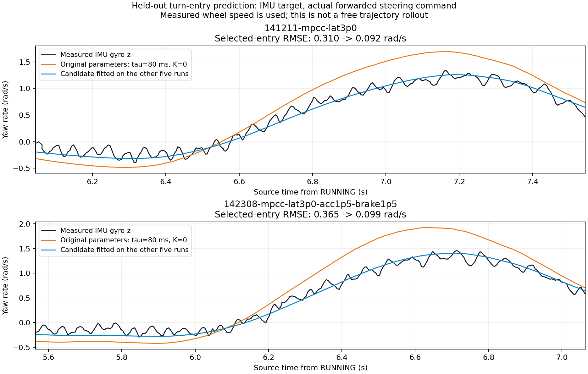
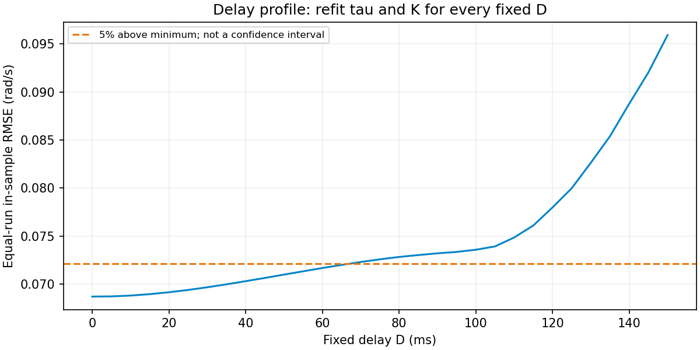

# IMU steering-response identification: six held-out MPCC runs

**English** · [简体中文](2026-10-14-imu-steering-model.zh-CN.md) · [Vehicle response guide](../vehicle-response.md#2026-10-14-imu-steering-candidate)

Analysis date: **2026-10-14**. Primary inputs are six completed MPCC runs from 2026-10-13. Source pointers refer to main `098976b9`. This is offline identification; controller/EKF settings, NX runtime parameters and generated solver bundles were not changed.

## Conclusion and candidate parameters

The existing six-state structure, with equivalent steering response and speed-dependent attenuation, explains much of the forwarded-command-to-rear-IMU yaw response. An equally weighted joint fit of six runs gives:

| Parameter | Original controller configuration | Offline candidate |
| --- | ---: | ---: |
| `steering_tau`, s | 0.08 | **0.1099010670** |
| `understeer_coefficient`, s²/m² | 0 | **0.0416537059** |
| Separate waiting term `D`, s | None | **Not adopted at this stage** |

The candidate model is:

$$
\tau\dot q+q=\delta_{\rm applied},\qquad
\hat r=\frac{v\tan q}{L(1+Kv^2)},\qquad \dot\psi=\hat r,
\quad L=0.36\ {
m m}.
$$

`q` is an equivalent steering state, **not measured front-wheel angle**. `τ` combines observable servo, tyre and body response after command publication; it is not an independently identified servo time constant. `K` is speed-dependent attenuation under the current command scale and sampled conditions, not proof of a particular tyre-slip or understeer mechanism. Command gain and bias are fixed at 1 and 0 to avoid freely fitting them alongside `K`.

Original settings were retained during identification. A new NX bundle was subsequently prepared on the same day at the user's request; see [NX preparation](#nx-field-test-preparation). Exact fit values remain in the [original offline candidate JSON](assets/2026-10-14-imu-steering-model/offline-candidate.json).

## Signals, timing boundary and eligibility

- Input: forwarded `/vesc/command.steering_angle`, rather than the pre-selector `/drive` proposal.
- Target: `/rear_axle/imu.angular_velocity.z`, retaining existing upstream bias/frame correction without additional smoothing.
- Speed: `/rear_axle/wheel_odom.twist.twist.linear.x`, converted from ERPM rather than independent ground-speed truth.
- Time: message header source epochs, subtracting the first enabled `RUNNING` int64 epoch before conversion to relative seconds. IMU is not pre-aligned by correlation.
- Eligibility: enabled `RUNNING`, wheel speed >0.5 m/s and target speed >0.3 m/s; status hold age ≤250 ms, command hold age ≤40 ms, wheel interpolation gap ≤40 ms. Unknown command gaps and the following 3.2 s are excluded. Approximately 3.5 s of native command prehistory initializes `q` by exact piecewise first-order propagation, without using measured output to initialize the state.

Extracted NPZ SHA-256 values match their metadata. Source paths, columns, sample counts, timing gaps and eligible speed quantiles are in [complete results](assets/2026-10-14-imu-steering-model/results.json).

| 2026-10-13 run | Eligible IMU samples | Actual speed P50 / P90, m/s |
| --- | ---: | ---: |
| `134131-mpcc-baseline-lat1p0` | 3953 | 1.628 / 2.465 |
| `135222-mpcc-lat1p5` | 3527 | 1.849 / 2.659 |
| `135509-mpcc-lat2p0` | 3286 | 2.025 / 2.877 |
| `135727-mpcc-lat2p5` | 3144 | 2.189 / 3.064 |
| `141211-mpcc-lat3p0` | 3014 | 2.354 / 3.262 |
| `142308-mpcc-lat3p0-acc1p5-brake1p5` | 2838 | 2.482 / 3.445 |

There are **19,762 native IMU samples**, with eligible peak wheel speed about 3.59 m/s. Samples are temporally correlated; their count is not the number of independent repeated experiments.

## Fitting and validation across runs

Bounded multistart least squares uses `τ∈[0.003,0.35] s`, `K∈[0,0.2] s²/m²`, and additionally `D∈[0,0.2] s` for the delayed model. Each run's residuals are divided by the square root of its sample count, giving equal run weight.

Each fold leaves out **one entire run**, fits only the other five and predicts the held-out IMU yaw rate. Entry windows use previously selected command-growth events, from 0.55 s before to 0.95 s after each center. There are seven windows; the final run has two partly overlapping windows, and overlapping samples count once in its entry mask. These are not independent statistical observations.

$$
{\rm RMSE}_{\rm aggregate}
=\sqrt{\frac{1}{6}\sum_{j=1}^{6}{\rm RMSE}_j^2}.
$$

| Model | Whole-driving held-out RMSE, rad/s | Entry held-out RMSE, rad/s |
| --- | ---: | ---: |
| Original `τ=0.08,K=0` | 0.167182 | 0.253725 |
| Refit `τ,K` | **0.069622** | **0.084972** |
| Refit `D,τ,K` | 0.069662 | 0.085010 |

The two-parameter candidate reduces whole-driving and entry RMSE by about **58.4% / 66.5%**. Across held-out folds, `τ` ranges over **108.1–113.3 ms** and `K` over **0.03919–0.04257 s²/m²**. This is fold-to-fold variation, not a confidence interval.

Black is native IMU, orange is the original model and blue is prediction using a fit from the other five runs. The image shows only the first selected entry in each run; title RMSE values refer to that displayed window. The table aggregates all selected entry windows. [Per-run metrics CSV](assets/2026-10-14-imu-steering-model/held-out-metrics.csv)

**Measured wheel speed is used; this validates yaw response only.** It is not a free trajectory forecast with unknown future speed, nor evidence that closed-loop lateral error or lap time has improved.

## Is a separate D needed?

The all-data three-parameter fit is `τ=108.56 ms,K=0.04174,D=1.29 ms`. Held-out folds fit `D` around **0–4.10 ms**, without better held-out performance.

Fixing `D` and refitting `τ,K` gives **0–65 ms** within +5% of minimum fitting RMSE on a 5 ms search grid. This describes parameter tradeoffs; **it is not a confidence interval or proof of zero physical dead time**. The two-parameter form is therefore retained at this stage.

An earlier fit of one 1.5 s entry window in each 14:12/14:23 run used `atan(L*r_IMU/v)=g*q+b` and gave approximately `D=72/75 ms,τ=34/41 ms`. It also freely fit gain and bias, used a different target/window/model and lost only about 5% fit accuracy with fixed `D=0`. Those historical values cannot be combined with this whole-driving `τ,K` candidate or added as another independent delay.

## EKF lag boundary

An earlier joint exploration of the two HTML records, from **published steering command to EKF yaw rate**, gave approximately **τ=169 ms,K=0.042**. Its input was `/drive`, not the authoritative forwarded command, and its output includes EKF response. **Those values are not vehicle parameters or deployed settings.** This report refits six `/vesc/command → IMU` records; it does not subtract a nominal 40–50 ms from 169 ms.

Best EKF/IMU whole-curve shifts differ by record: 40/41 ms in the 2026-10-10 19:29/19:35 V35 runs, 42 ms in the 19:04 low-speed HTML, and 30 ms in the 2026-10-13 14:23 run. The later quick comparison uses speed >0.5 m/s, ±150 ms search and no LIO-continuity requirement; the original V35 method uses >0.35 m/s, ±250 ms search and additional continuity filtering. Different waveforms and masks do not constitute a matched experiment showing a 10 ms EKF improvement, or establish fixed 50 ms dead time. See the [EKF component report](2026-10-14-ekf-component-latency.md#auxiliary-velocity-and-angular-rate-diagnosis) for whole-curve versus threshold-crossing definitions.

The six-state MPCC initializes from EKF position, yaw and longitudinal speed, estimating steering from actual command history; EKF yaw rate is not a separate prediction state. Source-to-takeover software extrapolation, vehicle response and estimator signal lag have separate boundaries. Near-zero yaw alignment to LIO does not identify zero physical heading latency.

## Relationship to NPU

The inspected NPU snapshot is `npu-ius-lab/Roboracer_China_2026`, `real-car-original`, commit `6c5012b9cd310c8fca5281c408298ffb5d4b3885`. [Its dynamics and observer source](https://github.com/npu-ius-lab/Roboracer_China_2026/blob/6c5012b9cd310c8fca5281c408298ffb5d4b3885/controller/src/f1tenth_dynamic_mpcc/src/core.cpp) separates steering-command state `δc`, estimated front angle `δ`, lateral velocity `vy` and yaw rate `r`, using axle cornering stiffness, mass and yaw inertia for body response.

| Component | Six-state equivalent candidate here | NPU nine-state model |
| --- | --- | --- |
| Steering state | `q` combines actuator and body-following effects | Command `δc` and actuator-model estimate `δ` are separate |
| Yaw response | `r=v*tan(q)/[L*(1+K*v²)]` | Tyre moment gives `dr/dt`, then `dψ/dt=r` |
| Lateral motion | No independent `vy` | Tyre lateral forces give `dvy/dt` |

The approaches are related, but this empirical model is not a formally derived equivalent reduction. NPU nominal tyre forces use `Fy=C*α`, without independent tyre-force relaxation states; wheel-angle estimation still has a no-sensor limitation. Nine describes state dimension, not nine physical degrees of freedom. This controller's internal nine-element array consists of six model states and three previous-input memory values; it is not the same nine-state dynamic model.

## Independent verification, supplemental run and remaining work

Source-extract hashes remain unchanged. All 18 held-out curves were compared with an independent **50 μs uniform-grid command-hold and `scipy.signal.lfilter`** implementation; maximum yaw-rate difference from native-edge exact propagation is **0.0001843 rad/s**. Per-run RMSE, entry masks and equal-weight aggregate arithmetic were independently recomputed. [Verification JSON](assets/2026-10-14-imu-steering-model/validation.json)

The 2026-10-10 19:04 approximately 1.5 m/s run is an unfitted supplementary check: 4907 eligible native IMU samples, original RMSE **0.06232** versus candidate **0.05476 rad/s**. Only `/drive` published commands are available in that HTML for this analysis, rather than authoritative forwarded commands, and the day differs; it is not primary validation evidence.

Before a controller experiment, generated OCP dynamics, native command-history propagation, runtime prediction and validation must remain consistent, and the solver bundle must be regenerated/rebuilt. Editing YAML does not alter a loaded fixed bundle. Free trajectory forecasts, left/right turns, new conditions and closed-loop tracking still need validation. Mechanical angle, tyre effects, sideslip, ERPM/ground-speed error and battery-condition contributions are not separately identified.

## NX field-test preparation (2026-10-14)

The user subsequently authorized writing the candidate to the vehicle. NX source/installed configuration now has exact `τ=0.10990106703655375 s`, `K=0.04165370594684592 s²/m²`, with host source synchronized. New bundle `/home/aims/aimsracer-data/bundles/20261014-field-mpcc-lat3p0-acc1p5-brake1p5-imu-steering` was generated and compiled for aarch64 on NX; fingerprint is `18404714cfd7f03e993dcfaee7a2868c1d16ac30d060033c20fddc1ce4e32558`.

It retains the 14:23 reference and other settings: N15/dt=0.1, cruise/hard speed 3.5/4 m/s, acceleration/braking 1.5 m/s², planning ay=3 and steering rate 2 rad/s. Independent acceleration mode and the disabled combined constraint are unchanged. Old/new `config.json` differ only in `τ,K`; baseline bundle and reference hashes remain unchanged.

`test_bundle`, `test_core`, `test_reference` and current-profile deployment verification pass. The latter also checks generated/native/history propagation agreement, independent bounds, stopping and rejection when the combined constraint is enabled. Two legacy fixed-counterexample tests fail on both original/new ay=3 profiles because their overload/binding cases assume ay=1 or the enabled combined constraint. Logs are retained; runtime logic was not changed to force those fixtures to pass.

NX entrypoint `~/run_mpcc_imu_fit.sh` selects the new bundle; `~/run_mpcc_old_model.sh` selects the original one. Both default to one lap, recording and `auto_start=false`. Installed launch arguments were checked with `--show-args`; the controller was not started and no vehicle commands were sent. Normal localization initialization, manual enabling and vehicle validation remain necessary.

NX evidence is `/home/aims/aimsracer-data/experiments/imu-steering-deploy-20261014/`; host copy is `/home/elesheep/aimsracer-data/sessions/2026-10-14/imu-steering-deployment/nx-evidence/`. `deployment-result.json` and `final-check.json` record backups, ARM build and verification. Preparation does not establish road closed-loop acceptance.

## Subsequent field record on 2026-10-15

The later `022604_194643_race` session ran a subsequent bundle with the same τ/K and completed 15 full laps; see the [multilap report](2026-10-15-mpcc-multilap-review.md) for the actual bundle, online revisions and error definitions. Offline propagation with identical recorded inputs gave yaw-rate RMSE 0.09908 rad/s for the new parameters versus 0.35861 for the old-parameter counterfactual. This checks conditional response prediction, not matched old/new closed-loop operation or a 72.4% tracking improvement. The unstarted status above belongs to the Oct 14 preparation stage, not the subsequent session.

## Evidence and reproduction locations

Full host analysis directory: `/home/elesheep/aimsracer-data/sessions/2026-10-14/imu-steering-model-review/`. It contains `fit_models.py`, `validate.py`, `build_artifacts.py`, held-out prediction arrays, delay profile and the standalone interactive page `imu-steering-review.html`. These scripts read source extracts and write analysis outputs; they do not publish control commands.

Source extracts: `/home/elesheep/aimsracer-data/sessions/2026-10-13/longitudinal-acceleration-review/raw-extracts/`. Original NX bag paths are retained in results JSON. Identification ran on the host; subsequent NX preparation is recorded separately above.

The repository includes static figures, candidate values, per-run metrics, complete results and verification JSON. **Raw arrays, full scripts and the interactive page are not supplied by a fresh checkout.** Asset `artifact-manifest.json` is the source-analysis directory manifest; some entries exist only in the host directory above. Repository asset hashes are listed separately in `assets-sha256.json`.
