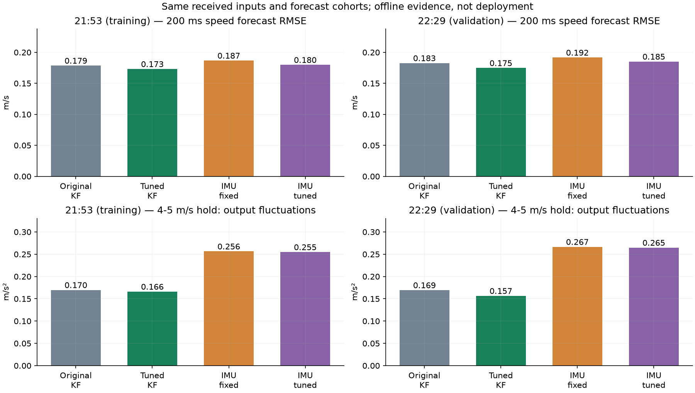
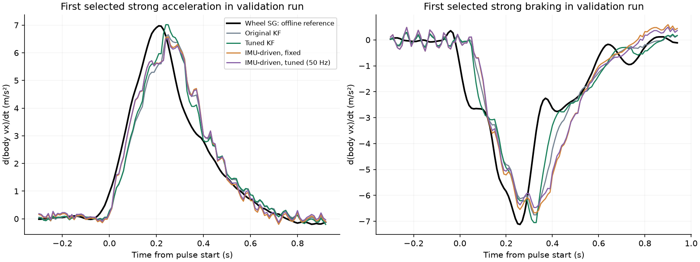

# 2026-10-14 纵向滤波调参与 IMU 驱动预测对照

## 结论

在本次模型、噪声约束和已有录包中，推荐现有线性 KF 的调参候选继续做观测验证。单纯 IMU 驱动预测、放慢轮速校正及其联合调参，没有改善总体表现。它在部分下午直线片段有预测收益，但在两轮恒速扫描中噪声和制动滞后更大，下午转弯预测也更差。此结论限于下面的一维实现，不能否定有独立姿态/重力补偿、更完整车辆模型的所有惯导方案。

仅调参的 KF：jerk PSD 30、扰动 PSD **0.1→0.01**、轮速方差 **0.01→0.0025**、比力方差 16。候选已保存为 longitudinal_acceleration_tuned_20261014.yaml（记录中的工作区路径：`src/aims_racer_system/params/longitudinal_acceleration_tuned_20261014.yaml`）。这些是有效调参值，不是独立测得的物理噪声。默认参数、运行节点和 NX 未修改。

## 同口径结果

预测为已经收到的轮速 `v_now + a_now×0.2`，高速当前轮速至少 3 m/s，当前/未来端点移动且处于直线有效段。两轮高速样本数分别为 4,202、4,195 个，所有方案完全相同。保持波动为目标速度 4/4.5/5 m/s 成功保持段内方差按样本数加权后开平方，并不是独立真值误差。

| 方案 | 21:53 训练：高速预测 RMSE | 22:29 验证：高速预测 RMSE | 22:29 高速保持波动 | 验证强加速/强制动滞后中位数 |
|---|---:|---:|---:|---:|
| 原参数 KF 回放 | 0.178640 m/s | 0.182728 m/s | 0.169468 m/s² | 60/60 ms |
| 只调参数的 KF | 0.173170 m/s | 0.174793 m/s | 0.156627 m/s² | 50/50 ms |
| IMU 驱动预测，20 Hz 轮速校正 | 0.186777 m/s | 0.191655 m/s | 0.266652 m/s² | 50/80 ms |
| IMU 驱动预测＋调参，50 Hz 轮速校正 | 0.179863 m/s | 0.185177 m/s | 0.264786 m/s² | 50/80 ms |
| IMU 驱动预测＋调参，100 Hz 对照 | 0.179801 m/s | 0.185116 m/s | 0.264684 m/s² | 50/80 ms |

仅调参 KF 的高速 200 ms 预测 RMSE，训练降低 3.06%，验证降低 4.34%。训练强加速/制动中位滞后分别 60/70→50/50 ms，验证 60/60→50/50 ms。它属于温和改善，不能宣称消除 50–70 ms 延迟。互相关搜索步长 10 ms，不是命令到物理响应延迟测量。





## 实际尝试的方案

现有 KF 是 [v,a,d]：预测时保持加速度均值不变，轮速观测 v，IMU 比力观测 a+d，源时间历史回放。它已经以约 200 Hz IMU/约 100 Hz 轮速接收更新。本次尝试 30 个主网格、6 个扰动参数追加配置，共 36 个设置。

新方案采用 [v,b] 惯性传播：`dv/dt=f_filtered−b`、`db/dt=随机游走`；IMU 用源时间更新因果一阶低通比力，轮速更新速度与有效偏置，IMU 到达时向接收时刻预测并输出 `f_filtered−b`。b 汇总重力投影、偏置和转弯耦合，不能单独解释为 IMU 零偏。低通时间常数有真实响应代价，不是零延迟去噪。

固定 IMU 方案：低通时间常数 40 ms、轮速 20 Hz、轮速方差 0.01、偏置 PSD 0.1、有效加速度噪声 PSD 0.08。组合搜索 10/20/40/80 ms、20/50/100 Hz、轮速方差 0.0025/0.01、偏置 PSD 0.01/0.1，共 48 个设置，另对两个候选试 0.02/0.32 加速度噪声 PSD，总计 52 个设置。

所有 IMU 方案都未同时满足训练稳态波动和均值约束。最低训练目标的 100 Hz 对照因此是失败约束下的诊断候选，而非推荐；50 Hz 慢轮速候选同样不满足约束。100 Hz 保留全部原始轮速观测，20/50 Hz 按源时间桶接纳首条观测，其余丢弃，不伪造额外延迟。

50 Hz 候选为 `{"tau_s": 0.04, "wheel_hz": 50, "speed_variance": 0.0025, "bias_psd": 0.01, "acceleration_psd": 0.32, "history_ns": 2000000000, "max_history": 4096}`。初始不限速率候选先冻结后验证。50 Hz 表行是已完成不限速率验证后的补充范围限定，只根据训练网格最小目标选出，没有用保留指标搜索；不能把这个补充行描述为完全未见保留结果的试验。

## IMU 噪声与是否值得融合

原始纵向比力在目标速度 4–5 m/s 的成功保持段，段内标准差合并值分别为 **1.177、1.287 m/s²**。这包含振动、俯仰和真实微小运动，不是独立白噪声标定。降低比力方差到 1/4，或增大 jerk PSD，通常使输出更快、更抖；本次训练噪声约束淘汰了这些激进设置。

仅去掉 IMU 观测、保持调参后 KF 的 jerk 和轮速方差，得到未单独优化的轮速消融：训练/验证高速预测 RMSE 为 0.183568/0.183369 m/s，较融合候选的 0.173170/0.174793 m/s 更大；高速保持波动则只有 0.117751/0.107742 m/s²，且强变速滞后中位数均约 50 ms。这说明本次 IMU 的收益主要体现在预测波形/幅值，而非必然提供更多相位提前量；不能声称融合全指标胜过轮速。消融不代表所有纯轮速方案的最优性能。

保持原有线性模型，换成 EKF 会得到相同 F/H 和更新；改善来自模型、参数、信息及时间处理。当前调参不需要 EKF。转弯耦合、姿态重力补偿或滑移模型会改变这个判断。

## 下午 MPCC 与参考差异

六个下午包全部评价。直线移动段 200 ms 预测：调参 KF 在 5/6 包改善，最慢包退化约 0.00053 m/s。转弯口径为当前绝对 yaw rate >0.8 rad/s：在 4/6 包略有改善，另两包退化约 0.00062、0.00360 m/s；最慢包仅 74 个转弯样本，不能宣称全工况改善。IMU 驱动方案在六包转弯预测中均不如原 KF。

调参 KF 的高速加速度与轮速参考 RMSE，在两轮由 0.604/0.583 降至 0.535/0.505 m/s²；与 LIO 0.51 s 平滑微分参考 RMSE 则由 0.381/0.376 增至 0.411/0.392 m/s²。参考之间存在差异，应保留这一退化，不能宣称真实加速度精度全面提升。

## 选择、时间与验证边界

- KF 参数只在 21:53 选取，冻结后用 22:29 与六个下午包验证；IMU 组合主搜索同样只在 21:53 选取。目标与约束见 [PLAN.md](/home/elesheep/aimsracer-data/sessions/2026-10-13/longitudinal-acceleration-review/filter-tuning/PLAN.md)。
- 训练目标：0.5×直线移动 200 ms RMSE²＋0.5×高速直线 200 ms RMSE²＋高速直线 100 ms RMSE²；保持段整体/高速合并标准差不超过旧参数 1.25 倍，最大段内均值绝对值不超过 max(0.1,旧参数最大值+0.025) m/s²。这是比较用工程约束，不是物理验收阈值。
- 按 bag 接收顺序处理输入，源时间更新，晚到输入重放；只在 IMU 到达后发布。全部之前的输入用于初始化，并保留活动结束后 3 s。输入轮速/Iq 不用未来插值；本次未用 Iq。
- 原参数回放与原录制输出并不完全相同：bag 接收顺序/时刻不同于节点回调，活动段加速度差值 RMSE 约 0.027–0.109 m/s²。表中各方法与原参数在同一重建时序比较，不把回放当作原实车输出的逐条复现。
- 轮速参考为居中 0.21 s SG 微分，LIO 参考为 0.51 s 平滑微分，仅用于离线评分。未来数据不进入估计。预测窗口假设当前加速度不变，未使用未来命令。
- 两轮来自同车、同电池、同日重复扫描；时间样本和同一轮次事件相关，不能将数千个网格点视为数千次独立试验。没有独立日期的泛化检验或独立加速度真值，不宣称统计显著改善。
- [validation.json](assets/2026-10-14-longitudinal-filter-tuning/validation.json) 独立核对 40 个跨包方法组合的预测值、样本数、共同口径和输入可用性；全部原提取/派生输入哈希保持一致。38 个强变速事件的所有方法均无 ±200 ms 搜索边界最优值。
- 生产核心已有数值/回放测试 **27 项通过**；新惯性核心通过静止偏置恢复、加速度阶跃、先轮速后 IMU 的启动情况和独立矩阵接收前缀 oracle 核对，oracle 检查 6 个实际快照，另确认晚到输入、历史有界及快照不修改历史。最终核心重新回放 24 个惯性方法/录包组合，全部原生输出与评分归档逐值一致。有限核对不代表全场景证明。
- 本次是本机离线证据；无新 ROS/DDS 回放、NX 部署、独立加速度真值或闭环验收。原导航 EKF、控制链、默认启动配置均未修改。

## 使用候选与复现

在已安装既有观测器的环境中，可由独立 launch 的 `config` 参数选择候选；只运行一个观测器实例。本次没有执行此启动命令：

```bash
ros2 launch aims_racer_system longitudinal_acceleration.launch.py \
  config:=/absolute/path/longitudinal_acceleration_tuned_20261014.yaml
```

候选只需现有节点读取参数文件，无新算法部署。IMU 替代方案目前仅存在离线脚本中。

本机完整目录：[filter-tuning](/home/elesheep/aimsracer-data/sessions/2026-10-13/longitudinal-acceleration-review/filter-tuning/README.md)。用该目录父级 `.venv/bin/python` 依次运行 `tune.py`、`imu_check.py`、`compare_inertial.py`、`slow_only.py`、`verify_inertial.py`、`validate.py`、`build_report.py`。建议新输出目录，保留本次冻结设置与证据。`tune.py`/`compare_inertial.py` 会重新搜索，若需仅复现本次候选，应直接从 JSON 配置调用其 replay 函数。
