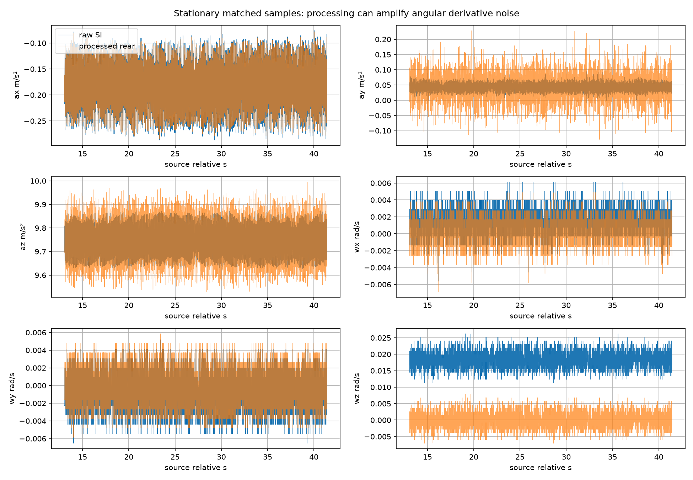
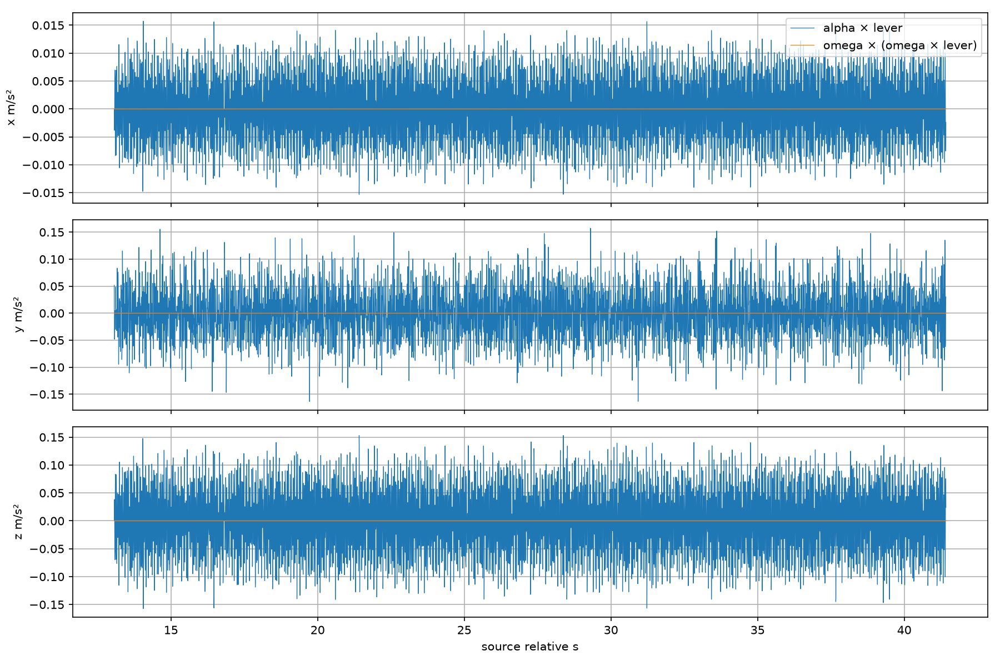
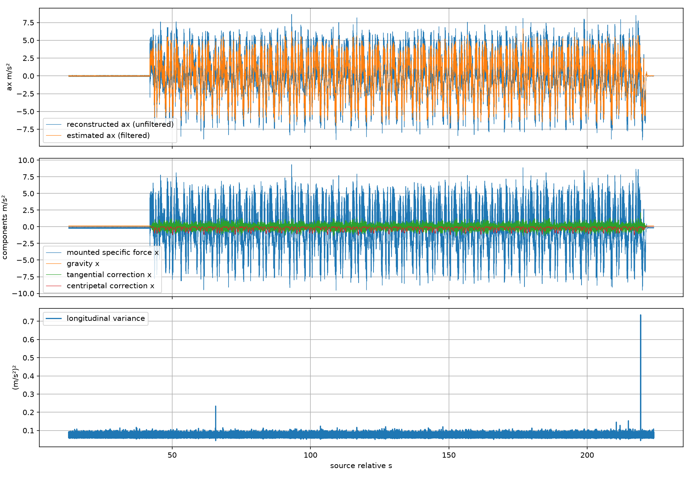
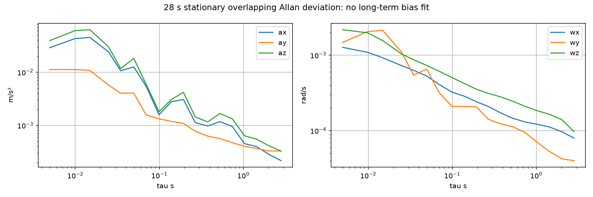
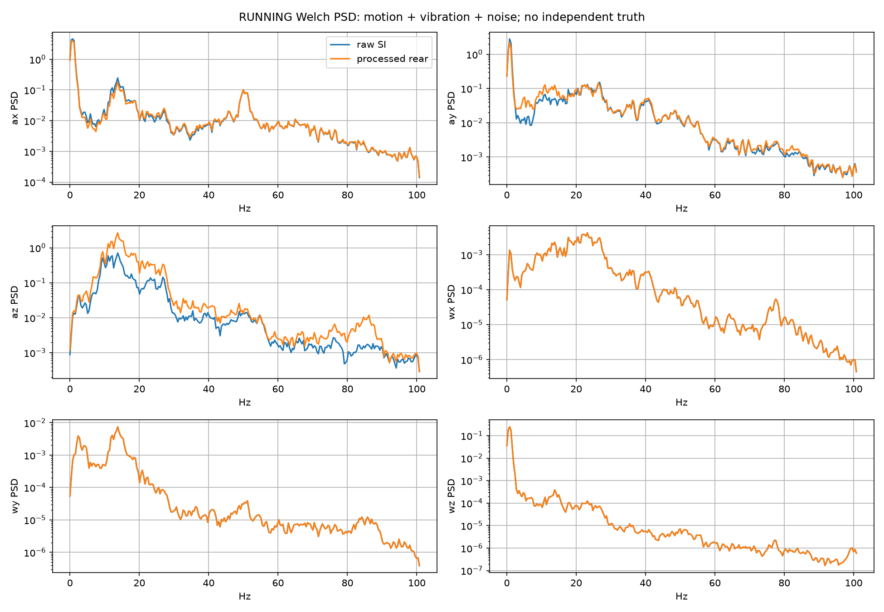

# 后轴车体加速度：数据质量与接收到达因果重放（2026-10-15）

本次完成了可复现的六轴质量审核及原生观察器的真实接收顺序重放。结果支持“坐标、重力恢复、杠杆臂和延迟消息处理具有可审核证据”。**没有独立加速度真值，无法证明实际运动中的加速度精度、bias、动态相位或控制可用性**。LIO 自身使用同一 IMU；原包里的 EKF 不作为输入或参考，轮速也没有作为调参目标。

Exact input: `/home/aims/aimsracer-data/sessions/2026-10-15/022604_194643_race/bag/bag_0.db3`. Original size **1,361,657,856 bytes**, mtime **1792002589590427480 ns**, unchanged before/after read-only selective extraction. Source-relative origin **1792002365474876930 ns**. NPZ SHA256 `e214e8fd8bf8ee782e4d2c30503779dd821ffcc433a26ef9097782b806787e67`; selected CDR SHA256 `226a9a57b3d10fc13cd666a2c50da870475c5f554ef543cbac5e8a5a510a66d6`. Complete provenance, implementation hashes and output hashes are in [quality-summary.json](assets/2026-10-15-body-acceleration/quality-summary.json).

External full evidence: `/home/elesheep/aimsracer-data/sessions/2026-10-15/body-acceleration-observer/quality-20261015-final-q10000-05`. Reproduction commands and data schemas: verification/body_acceleration/README.md（记录中的工作区路径：`verification/body_acceleration/README.md`）.

## 六轴、bias 与 covariance

raw 44,389 点，corrected/rear 各 42,315 点，LIO 2,115 点。rear 的每个源时间都能精确匹配 raw，2,074 个 raw 点无 rear 输出。raw−processed gyro 的常数 bias 为 `[0.001232009827, -0.000665483263, 0.018352380895] rad/s`，全段最大残差 `1.94e-16 rad/s`；bias 来自同源样本差，不是对运动段拟合。

静态窗源相对时间 13.065745826–41.425777542 s，共 5,672 点。raw 加速度先从 g 乘 9.80665 转 SI，gyro 原为 rad/s。raw/corrected 的 accel、gyro covariance 全为零，表示精度未知；rear 有 3 点 accel flag=-1，不能当有效比力。首点 orientation flag=-1，rear IMU 没有姿态。LIO 的非零 covariance 是消息声明，不构成独立测量精度证明。温度、量程饱和标志及完整标定元数据缺失。

|Axis|Raw mean|Raw std|Processed mean|Processed std|
|---|---:|---:|---:|---:|
|ax (m/s²)|-0.182543|0.045446|-0.182542|0.042592|
|ay (m/s²)|0.043288|0.013196|0.043217|0.045927|
|az (m/s²)|9.747207|0.062536|9.747229|0.089428|
|wx (rad/s)|0.001519|0.001437|0.000287|0.001437|
|wy (rad/s)|-0.000770|0.002210|-0.000105|0.002210|
|wz (rad/s)|0.018458|0.002393|0.000106|0.002393|

现有 FASTLIO 源码 lio_node.cpp（记录中的工作区路径：`src/FASTLIO2_ROS2/fastlio2/src/lio_node.cpp`） 的 `imuCB` 把 raw accel 乘 **10.0**；ieskf.cpp（记录中的工作区路径：`src/FASTLIO2_ROS2/fastlio2/src/map_builder/ieskf.cpp`） 使用 `State::gravity=9.81`，初始化没有自动重标 accel。rear 与本观察器使用 **9.80665**。这是当前代码单位/配置差异，需追溯原驱动协议和历史约定；它本身不能证明本次 LIO 姿态的物理误差。本功能未修改导航缩放或重力常数。

静态 raw force 均值 `[-0.18254, 0.04329, 9.74721] m/s²` 可同时包含倾角、bias、scale 等效应，不能直接减成 accel bias。多姿态标定接口要求至少六个已知姿态、各轴足够激励；本次没有进行该标定。

## 杠杆臂与角加速度的代价

后轴到 IMU 安装向量采用现有配置 `l=[0.30,0,0.03] m`；安装旋转为单位阵。恢复车体后轴惯性加速度：

`a_B = R_BI f_I × 9.80665 − b_a − α_B×l − ω_B×(ω_B×l) + R_WBᵀ[0,0,−9.80665]`。

geometry 配置明确说明安装距离近似，并忽略厘米量级 lidar/IMU 相对位移；后轴不是 CG。若真实杠杆误差上界为 δl，则仅平移误差引入的加速度范数界为 `(‖α‖+‖ω‖²)δl`；例如“已知 δl≤1 cm”的条件下才可代入 0.01，本次没有该测量界。安装倾角误差 δθ 的静态水平重力敏感度约为 `9.80665 δθ`，不属于滤波去噪能保证消除的量。

使用尾随 25 ms gyro 最小二乘斜率，输出沿用最新 IMU 源时间；RUNNING 所用样本中心相对最新样本的年龄 P50/P95 为 **11.58/12.28 ms**。这是回归时间支持的描述指标。源采样不规则且频率响应随信号而变，样本中心并非 α 的普遍有效时间，也不是实测通用物理延迟；不能把这条估计链称为零延迟。原生 trace 显式记录 `alpha_window_span_s` 与 `alpha_sample_center_age_s`。静态 `α×l` 的 xyz 标准差 **0.00604/0.04504/0.06043 m/s²**；向心项约 **2.73e−6/9.70e−7/1.10e−6 m/s²**。尤其 `y=0.30 αz−0.03 αx`，解释了 rear ay 标准差从 0.01320 增至 0.04593，az 从 0.06254 增至 0.08943。补偿并不会自动去噪；轴间相关也使 ax 方差不必增加。

历史输出的回算以源时刻 double 精度和尾随回归重建，绝大多数残差很小，完整残差仍含启动/窗口边界异常，因此未声称逐点完全等价。原生 trace 直接输出其实际 α、比力、重力、切向及向心项，供检查。CSV 历史列名 `raw_ax` 是补偿和重力恢复后的未滤波后轴惯性加速度，不是 raw IMU 比力；图例写为 reconstructed ax (unfiltered)，`ax` 写为 estimated ax (filtered)。

## 时间、重力与因果性

原包精确抽取保存了源/接收时间，事件按接收时间排序，源时间保持整数纳秒；共有 **2,115 次跨流源时间倒退**。按源时间全局排序会提前使用未收到的 LIO。当前跨话题接收时间相同的事件为零，导入器若遇到这种 tie 会拒绝重放，避免丢失 sqlite id 顺序。

corrected gyro 最早源时间为 **12.500167845 s**，此前 LIO 保留在事件流中，没有伪造 bias 未就绪的 IMU。corrected 比 rear 接收时间 P50/P95 早 **0.232/1.454 ms**。raw/processed/LIO 的 receipt−source P95 分别 **1.870/6.500/88.490 ms**。raw 最大源间隔 **20.707 ms**；原包没有提供硬件时钟校准与跨机时钟误差证明，这些是包内时间差。

在每个有效 RUNNING IMU 时刻取最新已收到且源时间不晚于 IMU 的可用 anchor，源年龄 P50/P95 **112.06/162.03 ms**。这比“LIO 到达时自身约 60–90 ms”更大，因为还包含两次约 100 ms LIO 更新之间的等待。gyro 传播相对于直接保持旧姿态的水平重力分量差 P50/P95 **0.07278/0.19683 m/s²**。它表示共享 IMU 模型的一致性敏感度，不是真实重力误差。

重放 42,315 个 IMU，**42,293 个 accepted+valid**；无姿态 21 点，gyro warmup 1 点。LIO 到达可以修订内部最新状态，报告只将 accepted+valid IMU 行视为可发布候选，没有把历史修订当作新消息。

## 短静态 Allan 与运行 PSD

透明 NumPy overlapping Allan 使用相邻长度 m 的 cluster 均值差，`σ²(τ)=mean((mean[k+m:k+2m]−mean[k:k+m])²)/2`，每个 τ 列出 cluster_samples 与 pairs，重叠 pair 不是独立自由度。源时间间隔存在抖动，这里 τ 是样本数乘中位周期的名义聚合时间，并未按实际不规则时间加权，因此曲线仅作短时样本波动描述。28.36 s 静态数据只作为短时波动证据，不拟合长期 bias instability。未来长静态 NPZ/CSV 可单独导入。

RUNNING 41.926416916–220.431558514 s 的 Welch 使用 Hann、512 点、50% overlap、constant detrend。源间隔超过中位周期 1.5 倍即分段，短片段剔除，段内局部插值到规则采样；最终支持 **14 段、10,025/35,700 点、20 个 Welch 窗**，仅覆盖约 28.1% 的 RUNNING 点。该保守图只表示这些连续片段，不能代表整段频谱。运行标准差、PSD 同时混有真实车体运动、安装振动、采样问题和传感器误差；没有命名为“传感器噪声”。

## 输出与验收边界

当前默认 optional KF 的静态纵向输出均值 **-0.015655 m/s²**、标准差 **0.025768 m/s²**；同一原生链未滤波 ax 标准差 **0.042774 m/s²**。最终默认 jerk PSD=1e4，仅依据独立合成模型扫频/白噪声测试选定，没有用本包或轮速拟合。与同链未滤波 ax 相比，该静态窗标准差降低约 39.8%；这证明短窗波动收敛，不是精度或消除 bias 的证明。此前 q=1e6 候选标准差 0.045215，反而高于未滤波 0.042774，已保留外部旧候选证据。合成 3 Hz 增益约 1.0436、相位等效延迟 0.8325 ms，不能把该滤波器延迟替代包括 α 窗口、LIO 姿态、传输的完整物理链延迟。RUNNING 标准差 **2.53381 m/s²** 含运动，不是误差。方差为模型假设下的保守 floor，非经独立真值校准的置信区间。

未来动捕导入保留源/接收时间、仿射时钟映射及不确定度、world/marker→body 刚体变换，旋转杠杆臂先于微分处理。居中 Savitzky–Golay 微分窗口和边缘无效掩码显式保存，结果仅作离线参考；本次没有动捕数据。算法契约测试覆盖接收顺序、Allan 支持数、PSD 不跨空隙、标定秩不足拒绝、旋转 marker 杠杆臂、epoch 纳秒精度和参考边缘掩码。

软件构建、原生单测和 NX 资源验收由[validation-summary.json](assets/2026-10-15-body-acceleration/validation-summary.json)记录；不能以这次离线重放替代赛道、硬件或独立精度验收。

## 本机与 NX 软件验证

本机 x86_64 和 NX aarch64 各通过 **22/22 组 CTest**，其中新核心 **13 项**、新 ROS/启动契约 **6 项**；各自 19 个 XML 文件包含 136 个 testcase，均无失败、错误或跳过。分组 CTest 与 XML testcase 不是同一统计层级，不相加。另有 **9 项离线分析测试**通过。实际测试的 127 个源码、配置和验证文件在两端 SHA256 一致；基础 commit 不单独代表这些尚未提交的实现。

完整原生接收顺序重放共 **44,430 个事件**；除测量耗时外，两端离散状态完全一致，纵向估计最大绝对差 **2.22e−15 m/s²**。NX 原生核心的 IMU/LIO 接纳调用 P99 分别为 **1.44/14.60 µs**，这是排除解析、CSV 输出和 DDS 的独立离线边界。

另以 RUNNING 开头 **20 s、1× 实际接收间隔**通过 ROS 发送 **4,000 帧 corrected IMU、199 帧 LIO**，两端均得到 **3,981 帧有效输出**。检查了输出有限性、严格递增且属于实际发送 IMU 的源时间戳，以及没有 wheel/EKF/控制/TF 接口的节点图。NX 状态回调窗口报告的 IMU/LIO P99 最大值分别为 **0.039524/0.049285 ms**；它是最多 512 次回调滚动窗口的 P99 最大值，不是整段 P99。初始化和收尾断流状态单独保留；NX 启动边界有一次 `no_imu`，之后 199 次回放状态有效。

ROS 回放在发布调度端复现记录的接收间隔及名义源年龄；实际调度和 DDS 另有抖动，没有强制复现原包的 DDS 回调顺序。以上采用已经录制的 LIO，**没有同时运行 FAST-LIO/EKF/NDT/MPCC**，也不测传感器硬件延迟或整车严格截止时间。NX 首次整包测试因隔离副本缺少旧 MPCC launch 测试夹具失败；补齐夹具后，单项及最终完整 22 组均通过，原失败日志保留在外部归档。

NX 安装在独立 `/home/aims/aimsracer-body-observer-20261015/install`；主工作区安装未被替换，新车体观测器默认关闭。启动方法见[操作指南](../operations/body-acceleration.zh-CN.md)。证据：[验证摘要及源码哈希](assets/2026-10-15-body-acceleration/validation-summary.json)、[本机完整 CTest](assets/2026-10-15-body-acceleration/desktop-ctest.txt)、[NX 完整 CTest](assets/2026-10-15-body-acceleration/nx-ctest.txt)。完整验证文件在 `/home/elesheep/aimsracer-data/experiments/body-acceleration-20261015/validation/`。

## 方法原始来源

- [NXP AN5087: Allan variance](https://www.nxp.com/docs/en/application-note/AN5087.pdf): cluster-time noise analysis; current evidence supports short-time curves only.
- [NXP AN4399: accelerometer calibration](https://www.nxp.com/docs/en/application-note/AN4399.pdf): calibration requires suitable independent orientations; the implementation here deliberately fits only a diagonal known-pose model.
- [Kalibr IMU noise model](https://github.com/ethz-asl/kalibr/wiki/IMU-Noise-Model): stationary constant-temperature noise models do not capture all dynamic/environmental errors.
- [Analog Devices: vibration rectification](https://www.analog.com/en/resources/technical-articles/vibration-rectification-in-mems-accelerometers.html): vibration can shift DC output; the current data cannot separately identify that effect.
- [SciPy Welch](https://docs.scipy.org/doc/scipy/reference/generated/scipy.signal.welch.html) and [Savitzky–Golay](https://docs.scipy.org/doc/scipy/reference/generated/scipy.signal.savgol_filter.html): explicit PSD and future offline differentiation methods.
