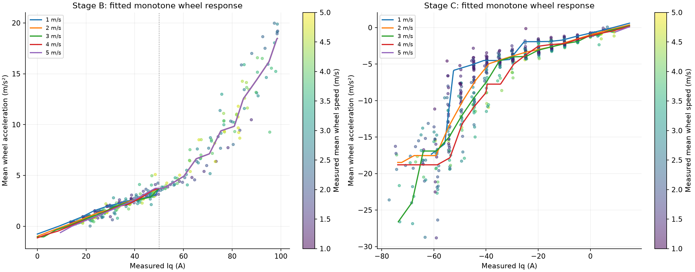
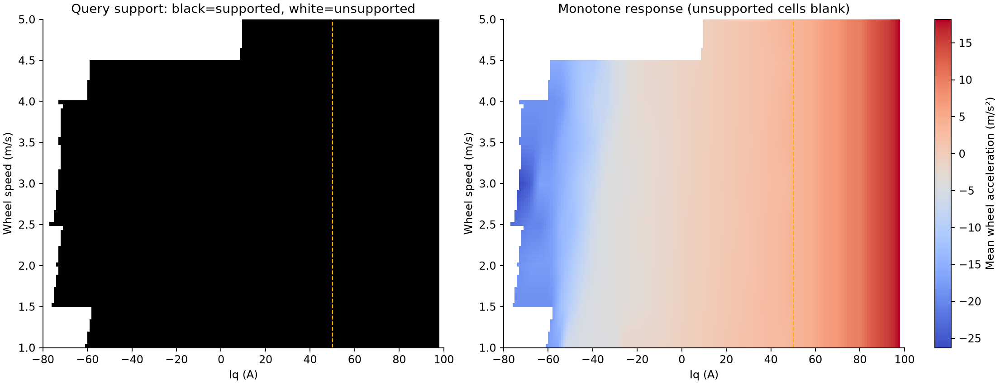

# Measured-current response: collection coverage and an offline wheel model

**Selection update, 2026-10-17:** Later full-step recordings from 2026-10-16 were refitted using body-Vx observations and separation screening. The current descriptive choice is a separate uncompensated affine fit for B/C; see the [selection and literature evidence (Chinese)](2026-10-17-current-affine-selection.zh-CN.md). This report retains historical wheel-only results from a different dataset and does not establish the newer model's physical acceptance.

**English** · [简体中文](2026-10-15-current-response-identification.zh-CN.md)

Evidence reviewed on 2026-10-15. Stage B covered all **146** planned items; Stage C ended with **122 successful, 44 skipped and 17 invalid** items out of 183. Existing recordings yield **333 measured-current candidate windows from 336 formal attempts**. The selected `wheel-only-model-v1` uses 319 trials and 985 overlapping intervals to describe average wheel-speed acceleration. It has forward/inverse query and packaging checks, but has **not been connected to online vehicle control**.

This follows the [Stage A steady-current report](2026-10-13-steady-current-voltage-model.md). Holding-current baselines and response inputs use measured VESC **`avg_iq`**, never `current_motor` or battery-side `current_input`. The frozen Stage A curve remains the zero-acceleration anchor over 1–5 m/s.

## 1. Completed execution does not mean complete measurement coverage

| Stage | Formal attempts | Original successful attempts | Successful unique plan items | Invalid / skipped plan items | Reconstructed current windows |
| --- | ---: | ---: | ---: | ---: | ---: |
| B, acceleration | 186 | 174 | 146 / 146 | 0 / 0 | 185 |
| C, deceleration/coast | 150 | 122 | 122 / 183 | 17 / 44 | 148 |

The six formal B/C run records include retries: B's 174 successful attempts contain 28 repeats of already covered items. C's invalid plan items comprise eight `reverse_motion` and nine `interval_without_positive_duration`; its additional straight-region retries do not create additional plan items. The NX completion notes retrieved during this review agree with the local plan mapping. Success is the original software result, not independent current-tracking or dynamics acceptance. [Collection counters](assets/2026-10-15-current-response/collection-coverage.csv) · [Source hashes](assets/2026-10-15-current-response/source-manifest.json)

Offline reconstruction recovers 37 originally unsuccessful attempts, including all nine originally zero-duration attempts, because native signals permit a slope estimate. Their original failure reasons remain. Three attempts have no sustained current plateau. **333 candidate windows are not 333 stable calibration points**: among windows with at least three samples in each half, only 88/184 B and 64/138 C windows have half-window slopes within 20% of the full-window slope. This is a diagnostic, not an acceptance threshold.

## 2. A requested current is not a measured plateau

Window boundaries use original message-header time and measured Iq establishment/departure, with a sustained two-of-three-sample rule. The plateau tolerance is `max(1 A, 3 × 1.4826 × MAD, 10% × measured current-step amplitude)`. Fit all native wheel samples to `v(t) = b + a(t − t0)`; `a` is interval wheel acceleration. At least three wheel samples are required; no 35 A cutoff or 150 ms minimum is imposed.

Boundary uncertainty is typically about one native feedback period, approximately 10 ms. The exit search is tied to final mode departure and can miss earlier sustained current sag. Current establishment does not establish steady mechanical acceleration; boundary sensitivity and within-window slope changes remain relevant. [Window definitions, diagnostics and examples](assets/2026-10-15-current-response/measured-window-summary.json)

| Existing event | Requested Iq A | Mean measured Iq A | Wheel samples / duration | Actual wheel-speed endpoints m/s | Fitted wheel acceleration m/s² |
| --- | ---: | ---: | ---: | ---: | ---: |
| B `233659`, trial 19 | +98.74 | +97.34 | 16 / 150.4 ms | 1.063 → 3.978 | +19.97 |
| C `015017`, trial 80 | −80.00 | −76.68 | 8 / 70.1 ms | 2.819 → −0.098 | −48.27 |

The B event's old target was 1→1.5 m/s; retaining its overshoot adds real observations over a different speed range. C's first/second-half slopes are −23.61/−44.78 m/s², so a current plateau alone cannot justify a constant-deceleration claim. Negative wheel speed and the original `reverse_motion` label do not independently establish body reversal or a measured slip ratio. These are wheel responses, with rotation, tire contact and observation timing still mixed.

The earlier analysis also exports 1,054 overlapping actual-speed subwindows. These and the final model's 985 selected intervals use different construction rules; neither count denotes independent experiments. Dynamic basic-current correction is paired with acceleration from the same in-domain interval; the Stage A curve is not extrapolated through standstill or reversal.

## 3. High-current acceleration can be pooled as a candidate simplification

For **105 B windows with measured mean Iq ≥50 A**, the observed current range is 50.65–98.69 A across eight nominal starting-speed groups (1–4.5 m/s). All models below use the same windows and leave one complete starting-speed group out. Three originally unsuccessful attempts remain included.

| Candidate | Held-out RMSE m/s² |
| --- | ---: |
| `a = k Iq`, forced through zero | 3.036 |
| `a = k Iq + b` | 1.858 |
| Linear Iq plus actual window-start speed | 1.879 |
| Linear `Iq − Iq0(nominal start speed)` plus intercept | 1.948 |
| Quadratic Iq | 1.807 |
| Linear Iq with speed interaction | 1.773 |

A shared high-current acceleration branch is a useful simplification for this batch. The interaction result leaves possible speed dependence; **50 A is an engineering candidate split, not a demonstrated physical transition**. Omitting an explicit basic-current term is not the same as forcing the curve through zero or proving resistance disappears. [Comparison table](assets/2026-10-15-current-response/high-current-comparison.csv)

Do not transfer this simplification to strong braking: the 37 C windows with measured mean Iq ≤−50 A have starting-speed-held-out RMSE 12.869 m/s² for a common line and 11.020 with a start-speed term. Earlier unrestricted quadratic fits were non-monotonic within observed current ranges for B starting at 1 m/s and C starting at 2–5 m/s. They were not accepted for direct inversion. The final model instead imposes monotonicity; that constraint does not prove the observations themselves are monotonic or physically settled.

## 4. Selected wheel-only model and grouped validation

`wheel-only-model-v1` uses wheel speed, measured `avg_iq` and command signals. Removing IMU, EKF, LIO and observer channels produced exactly identical fitted tables. **319 trials contribute 985 intervals**, with the overlapping intervals from each trial summing to weight one. The low-current acceleration and C branches retain speed dependence; forward acceleration at ≥50 A uses a pooled branch. The low branch uses `u = (Iq − Iq0(v)) / (50 − Iq0(v))`, anchored to zero acceleration at the frozen basic current; both branches meet continuously at 50 A. Weighted isotonic least squares constrains current monotonicity.

Leave out a whole nominal starting-speed group (`start_speed`) or requested-current level (`current_level`; B groups use 5 A increments above the frozen starting baseline), retaining related intervals and repeats in their group. RMSE is trial weighted and computed **only for supported held-out inputs**; coverage is supported trial weight divided by total held-out trial weight. Unsupported inputs are not assigned zero error.

| Group held out | Region | Supported / attempted intervals | RMSE m/s² | Trial-weight coverage |
| --- | --- | ---: | ---: | ---: |
| Starting speed | B low | 208 / 243 | 0.370 | 79.6% |
| Starting speed | B high | 87 / 105 | 1.684 | 82.9% |
| Starting speed | C | 463 / 637 | 2.404 | 76.5% |
| Current level | B low | 243 / 243 | 0.350 | 100.0% |
| Current level | B high | 98 / 105 | 1.833 | 93.3% |
| Current level | C | 603 / 637 | 1.981 | 92.3% |

The 985 input records include intervals unsupported even by the full fitted C surface: 613/637 C records receive training predictions (95.6% trial-weight coverage). Record inclusion, prediction support and accuracy are separate quantities. [Full region metrics](assets/2026-10-15-current-response/grouped-validation.csv) · [Selected model summary and checks](assets/2026-10-15-current-response/wheel-only-summary.json)

The external model offers `predict_acceleration(iq_a, wheel_speed_mps)` and `current_for_acceleration(accel_mps2, wheel_speed_mps)`. At 3 m/s, its examples return 9.7623 m/s² for 80 A and 60.3959 A for +5 m/s². The inverse returns a **target measured plateau current**, not proof of a published or achieved VESC command. Unsupported queries return `valid=false`; there is no extrapolation or silent clipping. Standard-library-only installed-package queries were checked externally; the package/model and loader are not included in this report asset bundle.

The retained verification record covers independent OLS checks of 333 windows (maximum slope discrepancy about 1.03×10⁻¹³ m/s²); all 333 old window boundaries matched. Forward/inverse checks covered 1,760 supported grid queries. These checks verify calculations and interfaces, not vehicle-control suitability. No accuracy acceptance threshold or independent road-condition test was defined. Variable response horizons, same-car/same-batch correlation and wheel-versus-body differences prevent interpreting this as a causal instantaneous dynamics model.

## 5. The proposed longer constant-current experiment remains a separate plan

The acquisition handoff proposes B responses around 1→5 m/s and C around 5→1 m/s, or natural steady state, over a planned ±100 A range in 5 A steps. It recommends removing the fixed **140 ms endpoint-prediction exit** because it can shorten the actual Iq plateau. This is a design proposal, not recorded execution of that new protocol. The old B/C evidence above used smaller target intervals.

The 140 ms budget is not a measured universal VESC delay or a historical upper bound: an old C event takes about 250.4 ms from wheel-target crossing to its defined Iq-unload point. Signal-boundary and unload definitions matter. A revised experiment still needs separate absolute-speed, anti-reversal, region/fault and actual-current-release conditions. Cancelling endpoint prediction alone does not establish safe full-range coverage. This documentation adds no controller or collection configuration changes.

## Evidence available in a clone

The linked CSV/JSON extracts and two plots are the portable evidence for this report; [the manifest](assets/2026-10-15-current-response/source-manifest.json) records source names, SHA256 hashes and extraction rules. Counts, per-trial weights and all six grouped RMSE/coverage rows were checked against existing CSVs. Raw bags were not reprocessed for this documentation review.

**External sources, absent from a fresh clone:** analysis-host root `$AIMSRACER_DATA/sessions/2026-10-15/stage-bc-review`, especially `measured-current-windows/`, its `high-current-pooling/` child, `wheel-only-model-v1/` and `constant-current-acquisition-handoff.zh-CN.md`. The NX `stage-B-summary-20261015.zh-CN.md` and `stage-C-summary-20261015.zh-CN.md` were retrieved live for the completion-count cross-check; their basenames and hashes are in the manifest. Intermediate model folders, raw bags/NPZ, installed wheel and detailed replay history remain external.
