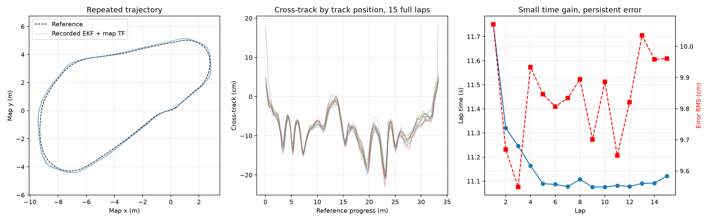

# 2026-10-15 MPCC: repeat laps are consistent, with a persistent outward tracking bias

[中文](2026-10-15-mpcc-multilap-review.zh-CN.md)

The `022604_194643_race` real-car session sustained enabled RUNNING for **178.505 s**, covering **15 complete laps plus an unfinished sixteenth lap**. Native EKF longitudinal speed averaged **3.058 m/s** and peaked at **4.671 m/s**. The 4.5 m/s target segments produced complete laps near **11.09 s**, but lateral-error RMS remained near **9.9 cm** with a repeatable spatial pattern. No solver failures or deadline misses were recorded in 3,564 requests. These observations support the execution and timing claims for this session; they do not establish external tracking accuracy or a controlled old/new controller improvement.

This report covers the latest repeat-lap experiment. The [2026-10-10 field review](2026-10-10-mpcc-field-review.md) retains the earlier single-lap experiments and their distinct measurement definitions.

## Evidence and measurement scope

The source review is `022604-mpcc-review`, for session `022604_194643_race`, dated 2026-10-15 in Asia/Shanghai. Portable evidence is included as [lap rows](assets/2026-10-15-mpcc-multilap/laps.csv), a [curated metric summary](assets/2026-10-15-mpcc-multilap/summary.json), and an [artifact manifest](assets/2026-10-15-mpcc-multilap/artifact-manifest.json). The manifest records source basenames, relative names and SHA-256 hashes; the full bag and raw extracts remain external. Its `selected_cdr_sha256` identifies selected extracted serialized messages, **not** a hash of the whole bag.

Numerical analysis uses each message's header source time, subtracting the bag's initial receipt timestamp in integer nanoseconds before converting to seconds. RUNNING spans bag-relative **41.926417–220.431559 s**. Tracking uses **1,786 enabled RUNNING diagnostic samples** at approximately 10 Hz. Speed uses **35,526 native EKF samples** and **17,850 native wheel samples** within that same window, including startup. The original extraction reported zero selected-topic decode errors and no nonincreasing source timestamps or nonfinite values in the checked core streams. The original `validation.json` records a passed validation; this curation separately recalculated lap groups, raw extracted speed/diagnostic statistics and runtime timings. It did not replay the complete original bag.

Runtime durations use the runtime log's steady clock. The frame viewer instead uses bag receipt time and the latest previously received map→odom transform. Sub-millisecond differences between viewer and source-time event labels are expected; these clocks are not mixed to estimate physical response.

## Configuration and actual speed

The active bundle is `20261015-field-mpcc-imu-steering-live-tuning-v4p5-cap5`: N=15, dt=0.1 s, wheelbase 0.36 m, steering τ=0.109901067 s and understeer coefficient K=0.041653706. Configured acceleration/braking limits were 2.4/4.0 m/s², hard speed cap 5.0 m/s and steering-command rate limit 2.0 rad/s. Curvature speed planning used ay=3.0 m/s². Corridor and combined-acceleration constraints were disabled.

| Online revision | Target speed | Speed weight | Diagnostic samples |
|---|---:|---:|---:|
| 0 | 4.0 m/s | 133.333 | 322 |
| 1 | 4.2 m/s | 133.333 | 98 |
| 2 | 4.5 m/s | 133.333 | 466 |
| 3 | 4.5 m/s | 160 | 900 |

The archived bundle config contains the baseline speed weight; the runtime revisions establish the later change. A configured target is not a measured sustained speed: full-window EKF P95 was **4.494 m/s**, peak **4.671 m/s**; wheel-speed peak was **4.667 m/s**. The configured 5 m/s cap is not evidence that the car reached 5 m/s.

## Complete laps, startup and the final partial lap

Lap boundaries use interpolated diagnostic progress crossings separated by the **33.469732 m** reference length, starting at the enabled position. The initial progress plateau makes the first interpolated boundary **42.026264 s**, about 0.100 s after the first RUNNING sample. Timing remains limited by approximately 10 Hz diagnostics; the displayed decimals do not imply independent millisecond timing accuracy.

The 15th complete lap ended at **209.485247 s**. The following **10.946312 s** up to the last RUNNING sample is an unfinished lap, not a 16th complete lap or a slow parking lap. Total diagnostic progress was 15.992247 reference laps. The operator stop produced STOPPING at **220.531292 s**, then READY at **221.730900 s**; this stop interval is outside complete-lap comparisons.

| Complete laps wholly inside one revision | Target / weight | Number of laps | Mean time | Aggregate lateral RMS |
|---|---|---:|---:|---:|
| 1–2, includes startup | 4.0 / 133.333 | 2 | 11.536 s | 9.872 cm |
| 5–7 | 4.5 / 133.333 | 3 | 11.085 s | 9.829 cm |
| 9–15 | 4.5 / 160 | 7 | 11.088 s | 9.860 cm |

The error column is the square root of the mean squared per-lap RMS values, with equal lap weighting. Individual rows use diagnostic speed and error samples; their speed maxima differ from native-message maxima. Mixed-revision laps 3, 4 and 8 are excluded from these groups. The 4.2 m/s revision contains no complete lap wholly inside it.

Lap 2, excluding startup, took **11.321 s** at the 4.0 target. The stable 4.5 target group took about 11.09 s, an observed improvement of approximately **2.1%** despite a 12.5% target increase. Increasing weight by 20% at the same 4.5 target changed the group mean by about **+0.003 s**. This single sequential tuning session provides no visible lap-time benefit from that weight change; it is not a randomized A/B experiment.

The map trace combines recorded EKF pose with contemporaneous recorded map→odom TF. The middle panel shows the repeated position-dependent tracking pattern. Neither trace is independent position truth; the right panel uses separate axes for seconds and centimeters.

## Tracking geometry and uncertainty

Across all RUNNING diagnostics, signed lateral error had RMS **9.866 cm**, mean **−8.378 cm** and absolute maximum **23.084 cm**. **1,682/1,786 samples (94.18%)** were negative. Among samples with |reference curvature|>0.15 m⁻¹, **962/1,109 (86.74%)** satisfied error×curvature<0, the geometric definition of outward bias used here. This is a repeatable error relative to the frozen reference and estimated localization, not proof of tire understeer or lateral slip.

The configured `rear_offset=0` makes the modeled reference point the base_link/rear-axle origin. Configured vehicle extents were front 0.52 m, rear 0.10 m and half-width 0.16 m; `geometry_verified=true` is an archived configuration flag. The frame audit and topic frame labels do not independently measure the physical origin or body dimensions. Cross-track error describes that modeled point, not body-edge clearance; disabled corridor enforcement and assumed geometry provide no measured track-clearance guarantee.

The largest error occurred at **84.127440 s**, reference progress **22.968 m**, diagnostic speed **2.418 m/s**, approximately 0.2 s after the 4.5 target revision. This event alone cannot attribute the error to the higher target. All **3,570** RUNNING localization-health samples were ready with one epoch. NDT inlier residual P95 **7.792 cm** measures registration residual, not localization position error. The largest map→odom translation-parameter step was **18.040 cm**; applying translation and rotation together at the then-current vehicle pose gave a maximum correction of **5.121 cm**. Those quantities must not be equated. No external position truth excludes a fixed localization/reference bias.

The separate geometric prediction screen reported smaller contour error at future path nodes, but Path headers are publication times, not exact plan-start times, and the car replans continuously. It cannot establish time-aligned future trajectory accuracy or identify the source of this bias.

## Steering response, constraints and execution timing

The offline response comparison propagates τ q̇+q=u at actual `/vesc/command.steering_angle` change times, then predicts yaw rate as v tan(q)/[0.36(1+Kv²)] using measured wheel speed. The comparison target is native `/rear_axle/imu.angular_velocity.z`, not EKF yaw rate. It excludes the first RUNNING second, requires wheel speed>0.5 m/s and commanded speed>0.3 m/s, command age≤40 ms, wheel interpolation gaps≤40 ms and RUNNING diagnostic age≤250 ms. This session used `hipnuc=false`; the comparison is not a HI13 measurement.

Over **35,500** eligible native IMU samples, deployed parameters produced **0.09908 rad/s** yaw-rate RMSE versus **0.35861 rad/s** for an offline τ=0.08 s, K=0 counterfactual using the same recorded inputs, approximately 72.4% lower. This supports the conditional yaw-response prediction on this record. It is not a 72.4% closed-loop tracking improvement or an old/new controller trial. No separate pure delay, fitted gain or offset is included. The viewer's earlier 80 ms shifted steering-to-gyro fit is not an independent physical delay measurement; its description of EKF yaw rate as an independent MPCC prediction state is also inaccurate.

| Runtime metric | Samples | P95 | Maximum |
|---|---:|---:|---:|
| Native solver time | 3,564 requests | 1.371 ms | 5.875 ms |
| Submission→result delivery | 3,564 requests | 2.159 ms | 6.670 ms |
| Submission→successful plan activation | 3,560 activations | 39.374 ms | 44.335 ms |
| Publish interval, emitted speed>0.3 m/s | 8,950 intervals | 20.986 ms | 29.689 ms |

Activation timing includes the configured 20 ms handover and scheduling. These timing boundaries overlap and must not be added. They are not actuator, localization-to-command or full vehicle-response latency.

Of **3,564 requests**, **3,563** were accepted; the last was cancelled as authority/generation changed during stopping. **3,560** activations succeeded and **3** were cancelled by tuning-revision changes. Final `failed=0` and `deadline_misses=0` correspond to observed **0/3,564 (0%)** session counter rates; they are not a future failure-probability bound. `handover_rejected=0` and `log_dropped=0`. The pre-enable FAULT followed a localization epoch change and required explicit re-enable; RUNNING continued until the operator stop.

There were zero steering-rate-limited diagnostic samples. This does not rule out mechanical rate limits because actual steering-angle feedback was unavailable. The wheel-speed×gyro proxy |v r| had P95 **4.336 m/s²**, maximum **6.254 m/s²**, and **23.35%** of the 35,500 eligible samples exceeded 3 m/s². The configured ay=3 controls curvature speed planning here; it is not an active hard lateral-acceleration constraint. IMU ay is specific force, not tire force, and proxy exceedances do not demonstrate violation of an enabled hard constraint.

The next useful comparison holds the 4.5 target and weights fixed and checks estimated state, reference geometry, planned future recovery and subsequent executed motion at the recurring error locations. That comparison needs proper plan-time alignment and localization uncertainty before assigning the error to steering, speed prediction or tire behavior. This documentation curation changes no controller code or operating parameters.
