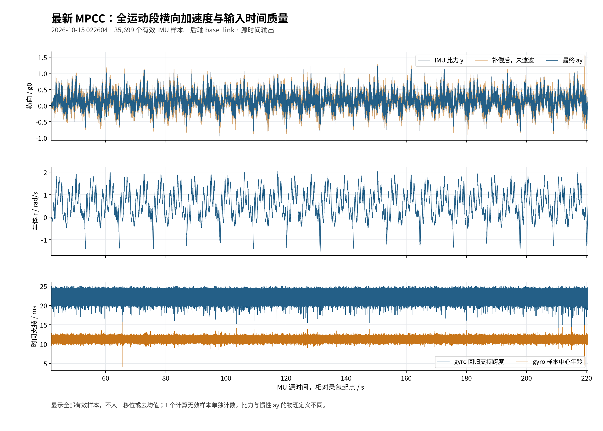
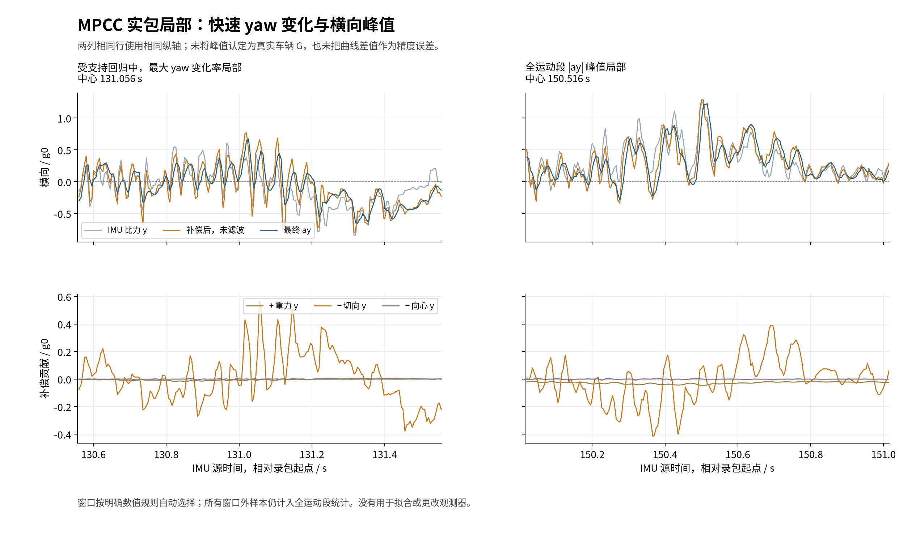
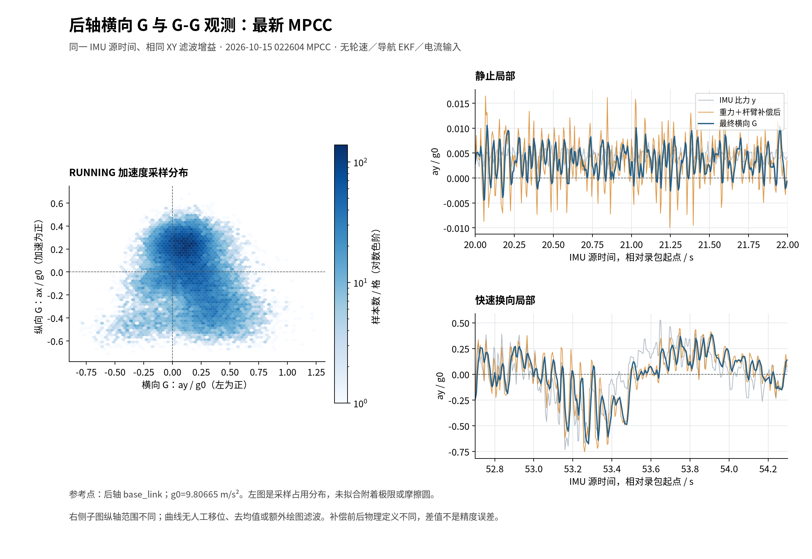
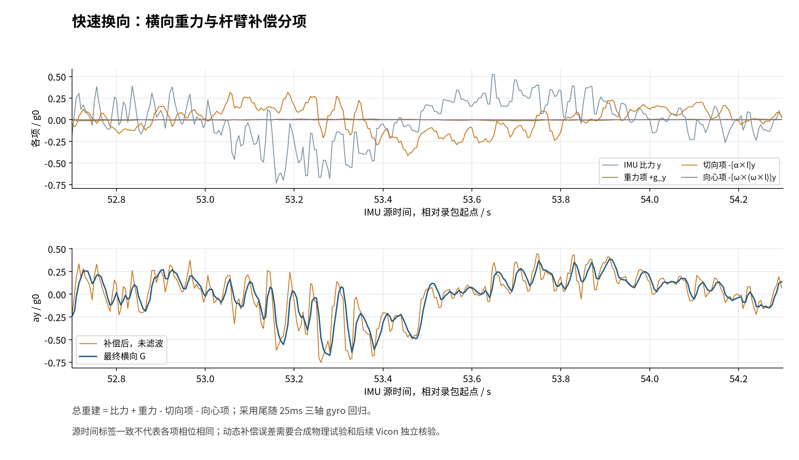
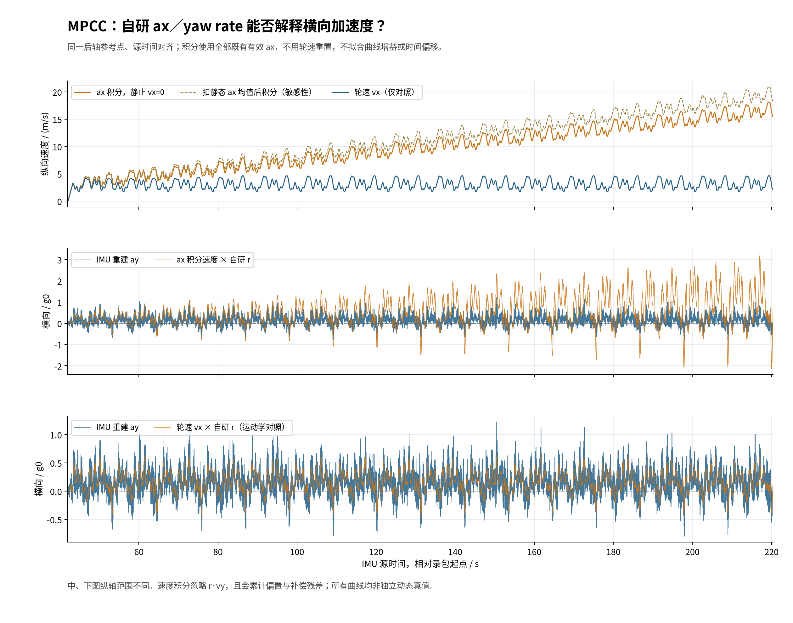

# 2026-10-15 first rear-axle lateral G observation

**English** · [简体中文](2026-10-15-planar-acceleration-quality.zh-CN.md) · [Operations](../operations/planar-acceleration.md) · [Vicon acquisition](../operations/vicon-observer-validation.zh-CN.md)

The optional C++ planar acceleration observer is implemented. **The latest MPCC bag is the primary measured evidence for ay dynamics.** The B/C straight-line calibration bags are auxiliary checks for rest, cross-axis response and timing anomalies, not lateral-performance acceptance. Accepted ax behaviour is preserved. This supports signal inspection and validation recording, **not acceptance of rapid dynamic G, friction limits or control supervision**. Synthetic rotation exposes compensation phase error; auxiliary B data also has extreme timing-related spikes. No independent motion-capture truth is available yet.

## Figures and definitions

The primary recording is `022604_194643_race`, with approximately 178.5 s of motion. Panels show all valid samples: lateral signals, body r and gyro regression time support, without selecting only smooth intervals.

The left window centres on maximum absolute alpha_z among samples with at least 20 ms regression support (131.056 s). The right centres on the full-motion absolute ay maximum (150.516 s). Each spans ±0.5 s, with shared y scales within each row. All samples outside these windows remain in total statistics; selection does not tune the observer or mask anomalies.

The hexbin includes every valid native RUNNING sample, lateral ay/g0 on x (left positive), longitudinal ax/g0 on y (acceleration positive). Both share source time, rear-axle reference and final filter response. Colour represents sample counts, not a friction envelope or independent-sample probability. The stationary/turning panels show IMU specific force, compensated unfiltered inertial ay and filtered ay, with different y scales. No extra plotting filter, manual shift or static-mean subtraction is used.

Mounting rotation, gravity restoration and full rigid-body lever compensation precede the `[ay,jy]` filter. Raw IMU specific force and rear-axle inertial acceleration are different quantities. Differentiation for angular acceleration can increase stationary noise after compensation.

## Latest MPCC recording

Original bag: `sessions/2026-10-15/022604_194643_race/bag/bag_0.db3`. The accepted ax analysis input is reused from `source-quality-20261015-01/imu-quality-input.npz`, SHA256 `e214e8fd8bf8ee782e4d2c30503779dd821ffcc433a26ef9097782b806787e67`. Corrected IMU/LIO are merged by recorded receipt time: 44,430 events. Estimation/publication use source time; origin is `1792002365474876930 ns`.

The stationary window is 13.065745826–41.425777542 s (5,672 valid IMU samples); RUNNING is 41.926416916–220.431558514 s (35,699). Standard deviation uses ddof=0; P95 is the 95th percentile of absolute samples without demeaning. g0=9.80665 m/s².

| Stationary quantity | Mean m/s² | Std m/s² | Absolute P95 m/s² |
| --- | ---: | ---: | ---: |
| IMU force y | 0.043288 | 0.013196 | 0.065333 |
| Reconstructed unfiltered ay | 0.032950 | 0.045989 | 0.106986 |
| Filtered ay | 0.032957 | 0.027596 | 0.077791 |

Filtering reduces reconstructed stationary std by about 40%, but retains about 0.00336g mean offset. Accelerometer bias/mounting errors are not calibrated. The stationary tangential term has std 0.04504 m/s² and dominates added noise. During RUNNING its std is 1.27038 m/s², while gravity-y std is 0.11689 m/s². Moving-window variance includes real motion and is not a sensor-noise estimate.

RUNNING filtered |Gy| P95 is **0.5361g**, absolute maximum **1.2276g**. These are estimated signal statistics, not validated acceleration peaks or tyre capacity. XY share effective q/R and gain; covariance is uncalibrated and XY correlation unidentified.

## MPCC sample groups and timing review

These mutually exclusive groups partition all 35,699 valid RUNNING outputs. Labels use existing gyro-derived r/alpha_z for inspection only, without parameter fitting or sustained-duration requirements. A near-straight gyro sample does not independently establish straight, no-slip motion; low yaw variation does not establish full vehicle steady state.

| Sample group | Rule (r: rad/s, alpha_z: rad/s²) | Samples | Absolute ay P95 / g | Absolute tangent P95 / m/s² |
| --- | --- | ---: | ---: | ---: |
| Near-straight gyro | abs(r) < 0.15, abs(alpha_z) < 2 | 2,131 | 0.2056 | 0.8906 |
| Low-change gyro turn | abs(r) ≥ 0.5, abs(alpha_z) < 2 | 5,850 | 0.5536 | 1.1373 |
| Rapid yaw change | abs(alpha_z) ≥ 8 | 4,558 | 0.6513 | 3.5841 |
| Other | Complement | 23,160 | 0.5055 | 2.0162 |

Rapid yaw change has larger tangential compensation, motivating alpha noise/phase inspection, not measuring compensation error. Near-straight ay is not automatically estimation error: these rules do not constrain lateral-velocity changes, roll dynamics, vibration or sideslip.

The source-time window contains 35,700 accepted IMU samples, including one invalid `gyro_warmup` and 35,699 valid outputs. Adjacent source intervals range from **0.005824 ms** to **20.706684 ms**, with 29 intervals below 1 ms and none above 30 ms. Minimum valid alpha regression support is **5.650427 ms**. MPCC therefore also contains dense source timestamps; absence of B's 41–62 microsecond regression support does not establish fully healthy timing. Adjacent-sample intervals and full regression spans are different metrics.

At 150.516 s filtered ay is 12.03835 m/s² versus contemporaneous unfiltered reconstruction 9.24294 m/s². Filter state includes history, so this single-point difference is not true error or sensor delay. The local signal still fluctuates rapidly; dynamic compensation/filter response needs further validation rather than acceptance based on smoothness. See [MPCC-specific statistics](assets/2026-10-15-planar-acceleration/mpcc-review.json) for exact windows and selected values.

This review also reran all 44,430 receipt-ordered MPCC events through the native binary: all 38 non-timing fields are bitwise identical to the initial trace, and the original input SHA256 was rechecked. See the [replay check](assets/2026-10-15-planar-acceleration/mpcc-native-recheck.json). Only analysis/reporting changed; observer implementation and filter parameters were not altered.

## Our ax integral and yaw rate versus ay

This checks whether `vx*r` exceeds IMU lateral **acceleration ay**, not lateral velocity vy. Longitudinal acceleration ax is integrated under a small-vy approximation before multiplication by our independent yaw observer's r; ax is not directly multiplied by r.

All inputs use the same MPCC bag/rear-axle reference. Our r is exactly matched to integer IMU source stamps. Wheel vx is a separate comparison, source-time linearly interpolated only across gaps at most 30 ms. No gain/phase fit is applied. Of 35,699 valid motion outputs, five lack wheel interpolation support; common statistics use **35,694** samples.

The speed approximation starts at the last valid recorded stationary sample, **41.420061448 s with vx=0**, and trapezoidally integrates existing valid ax at actual source intervals, without later resets or wheel corrections. Maximum valid-ax interval is 20.730813 ms, including an endpoint integral across one omitted `gyro_warmup` sample. Static-mean subtraction is an additional sensitivity case, not an observer change.

| Lateral acceleration signal | Absolute P95 / g | Absolute maximum / g |
| --- | ---: | ---: |
| Reconstructed/filtered IMU ay | 0.5361 | 1.2276 |
| Our integrated ax speed × our r | **1.8425** | **3.2573** |
| Static-mean-corrected integral × our r (sensitivity) | 2.1462 | 3.8129 |
| Wheel vx × our r (kinematic comparison only) | **0.4425** | **0.6281** |

The long-integral product is indeed much larger. However, at **220.429877700 s**, integrated speed has reached **15.6192 m/s**, or **18.4216 m/s** after static-mean subtraction, versus contemporaneous wheel speed **2.1535 m/s**. In the first 10 motion seconds, P95 is IMU ay **0.5746g**, integral product **0.5021g** and wheel product **0.4522g**. There is no consistently large scale factor from the start.

Planar kinematics gives `ax=dot(vx)-r*vy`, hence `dot(vx)=ax+r*vy`. Integrating ax alone neglects r*vy and accumulates bias and attitude/lever-compensation residuals. This approximation is not a verified vx estimate and cannot establish underestimated ay. Subtracting stationary ax mean (approximately −0.01566 m/s²) worsens this long-term speed discrepancy, so a static constant correction does not resolve motion inconsistency. Wheel speed is not ground truth either; these data cannot uniquely attribute all differences to accelerometer bias.

The wheel product correlates with IMU ay at approximately **0.7323**, with difference RMS **1.4859 m/s²**; its absolute value exceeds IMU ay in **44.9%** of common samples. Thus this comparison does not support a generally much larger `vx*r`. It also does not validate ay accuracy: shared IMU errors, filter responses, true dot(vy) and wheel errors remain. Prior acceptance of acceleration waveforms is not acceptance of unconstrained long-term velocity integration.

[Calculation record](assets/2026-10-15-planar-acceleration/kinematic-comparison.json). Aligned arrays, script snapshot and figures remain under external `kinematic-comparison-02/`. No observer or filter parameters changed.

## Two identified ay quality limitations

**Rotation compensation phase.** A 200 Hz synthetic fixed-rear-point test uses `r=sin(2πft) rad/s` and exact rotational IMU force. True rear ay is zero. Each run lasts 10 s, excluding the first 2 s. Retaining the causal 25 ms gyro regression produces:

| Yaw variation Hz | False filtered absolute Gy P95 | ay error RMS m/s² |
| ---: | ---: | ---: |
| 0.5 | 0.003765g | 0.02620 |
| 1 | 0.015114g | 0.10516 |
| 2 | 0.061231g | 0.42610 |
| 3 | **0.140494g** | **0.97780** |

Historical gyro-regression alpha does not have the same response as current specific force. At 3 Hz the final filter slightly amplifies the residual. Matching final XY filters or adding smoothing does not establish alignment of the physical chain. Substituting the independent yaw observer's delayed alpha is not an established solution. A separate pure-translation test at 0.5–3 Hz gives final-filter gain 1.0013–1.0436 and equivalent phase lag 0.024–0.833 ms; **this is only the final filter, not end-to-end response**.

**B burst source timestamps.** Around `1791992756198130078`–`1791992756198151295 ns` in `233659-B-full`, regression support is only approximately 41–62 microseconds, producing extreme alpha_x. Tangential-y absolute maximum is 106.30 m/s² and filtered ay peaks at 92.66 m/s² (9.448g), while computational validity is true. There is no minimum regression-span credibility gate. Original source timing/driver behaviour needs investigation; these are not credible vehicle accelerations. [Neighbouring events](assets/2026-10-15-planar-acceleration/B-extreme-event.json) retain the failure without masking it out of summary statistics.

Auxiliary B/C have 129,880 / 225,598 input events and 121,664 / 214,838 valid IMU outputs. All-valid |Gy| P95 is 0.07155 / 0.16354g, maximum 9.448 / 1.213g. Different manoeuvres, stationary fractions and timing failures preclude using whole-run statistics as lateral dynamic accuracy measures or an ay parameter ranking.

## Software evidence and boundaries

| Check | x86 | NX aarch64 |
| --- | --- | --- |
| Full package CTest | 25/25 pass | 25/25 pass |
| XML test cases | 145, no failures/errors/skips | 145, no failures/errors/skips |
| 20 s 1× corrected IMU / LIO inputs | 4,000 / 199 | 4,000 / 199 |
| Native expected / ROS SI / ROS G outputs | 3,981 / 3,981 / 3,981 | 3,981 / 3,981 / 3,981 |
| Maximum reported IMU window P99 ms | 0.035061 | 0.080647 |
| Maximum reported LIO window P99 ms | 0.030671 | 0.058373 |

New tests cover roll-rest gravity, steady turns, constant-alpha lever cancellation, matched XY response, late-attitude replay, unchanged ax and DDS/G contracts. Latest MPCC ax differs from the accepted native binary by **zero**. Enabling lateral preserves ax/jerk/variance and discrete states identically on MPCC/B/C. Across x86/NX all 44,430 MPCC events have identical discrete states/times/admission, maximum ay difference 2.67e-14 m/s²; execution costs are excluded.

The 1× ROS replay applies one common epoch shift to source/receipt timestamps and follows recorded receipt intervals. It checks complete native-expected publication source sequence, finite values, G conversion and graph independence. It does not establish numerical native/ROS acceleration parity: DDS callback ordering can differ. This 20 s window does not validate every bag's ROS publication. Callback figures are maximum reported rolling P99 over at most 512 callbacks, including numerical publication—not whole-run P99, sensor delay or vehicle closed-loop workload.

The observer defaults off. NX installation is separate at `/home/aims/aimsracer-planar-observer-20261015/install`; the main installation was not replaced and no vehicle was driven. `y_valid` only describes input/numerical admission, and can remain true during both identified quality failures.

## Reproduction and next work

**Subsequent geometry report, without changing historical figures:** the owner supplied wheelbase 0.365 m and IMU-to-CG x=−0.09 m/y=−0.03 m in ROS vehicle axes. The IMU is above the CG, but vertical separation is unknown. See the measurement record（recorded workspace path：`src/aims_racer_system/params/vehicle_geometry_measurements.yaml`） and [transfer conventions](../operations/planar-acceleration.md#reported-centre-of-mass-geometry). Existing metrics remain rear-axle referenced; no CG figure or controller wheelbase switch is claimed.

Scripts（recorded workspace path：`verification/planar_acceleration/README.md`） · [Statistics](assets/2026-10-15-planar-acceleration/summary.json) · [Runtime summary](assets/2026-10-15-planar-acceleration/runtime-summary.json) · [Architecture comparison](assets/2026-10-15-planar-acceleration/native-parity.json). Compact figures/logs are in Git; bags, full traces, DDS output and binaries remain under external `aimsracer-data/experiments/planar-acceleration-20261015/`.

Next priorities are minimum gyro time-support/timing credibility gates, then causal alpha/force alignment or prediction, checked against held-out dynamic data without disturbing accepted ax. Planned Vicon acquisition requires measured marker-to-rear geometry, clock semantics and prediction settings, with stationary/straight/circle/reversal repetitions. No collection date is needed for software preparation. Lateral velocity and validated sideslip supervision are not delivered here.

[Current calibration entry](../operations/calibration.md) · [Lateral-acceleration calibration and validation](../operations/lateral-acceleration-calibration.md). Original dates, measurements and evidence boundaries are retained.
