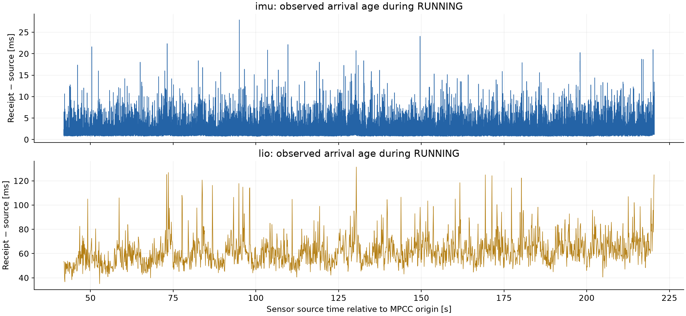
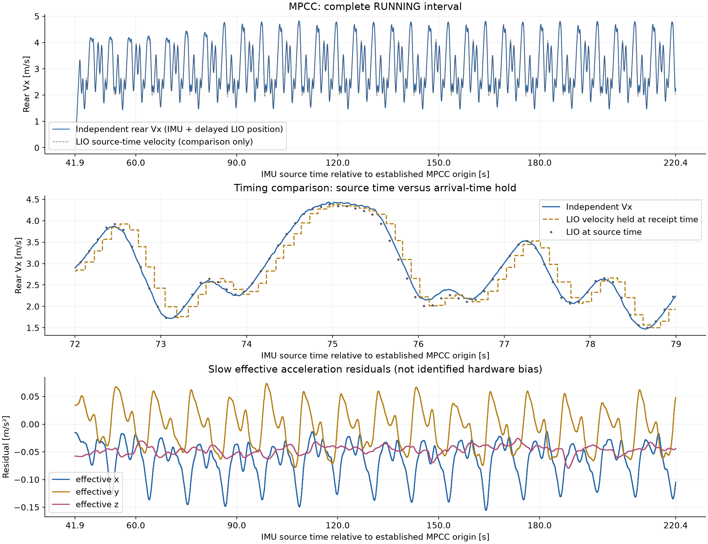
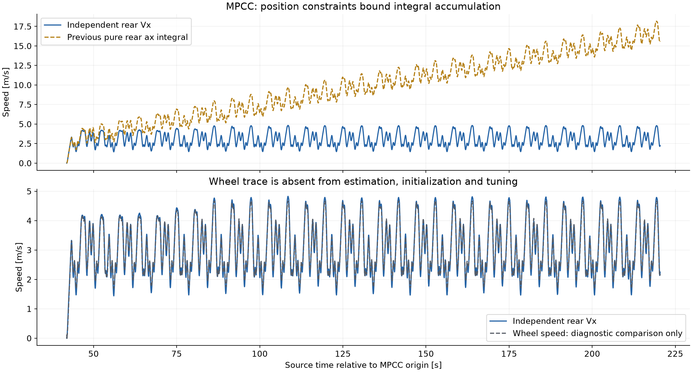

# 2026-10-15 数据：独立后轴 Vx 首版质量复核

实现与验证日期：2026-10-16。 [操作说明](../operations/velocity.zh-CN.md) · 验证工具（记录中的工作区路径：`verification/velocity/README.md`）

首版 C++ 实现已完成本机和 NX 软件验收，两端分别通过完整 MPCC 1× ROS 回放。**B/C/MPCC 双架构全迹线的离散状态与时间完全一致，Vx 最大差约 1.13e−14 m/s；Vicon 独立精度尚未验收。** 当前只作并行观测，ax/ay/yaw rate 和控制接口保留，vehicle/race 默认不开启 Vx。

## 1. 输入契约先于融合

内部状态是物理 IMU 原点的世界系三维位置、速度、IMU 系慢变有效加速度残差，姿态由 corrected gyro 推进和历史 LIO 姿态约束：

\[
\dot p_W=v_W,\quad \dot v_W=R_{WI}(9.80665 f_{I,g}-b_{\mathrm{eff},I})+[0,0,-9.80665]^T.
\]

最终转换到后轴：\(v^B_{rear}=R_{BI}R_{WI}^{T}v_W-(R_{BI}\omega_I)\times\ell_{rear\to I}\)。不需要角加速度，也没有把最终滤波 ax 再积分或强制 vy=0。

- 当前 `FASTLIO2_ROS2/fastlio2/src/lio_node.cpp::publishOdometry` 发布 `t_wi/r_wi`，因此 raw LIO 的 pose 是 **物理 IMU 原点**。其 linear twist 是 `r_wiᵀ v_W`，angular twist 全零；本节点不读取 twist。`livox_frame` 是当前统一名称，不能仅凭名称当作点云光学原点。
- FAST-LIO 内部 `t_il=[-0.011,-0.02329,0.04412] m` 将 lidar 点转到 IMU。该内部转换不能在本节点重复应用。共享后轴→IMU 杆臂仍沿用近似 `[0.30,0,0.03] m`，安装旋转为单位阵。它未完成新的精密实测；0.03 m 是既有后轴参考高度假设，**不是未知的 IMU→质心 z**。
- [Livox 官方通信协议](https://github.com/Livox-SDK/livox_wiki_en/blob/master/source/tutorials/new_product/mid360/livox_eth_protocol_mid360.md) 给出比力单位 g、gyro rad/s。当前 corrected 话题只修正 gyro，仍保留 g 数值。本节点显式乘 9.80665；不能按通常 ROS SI 约定直接再输入 m/s²。
- 当前 FAST-LIO `imuCB` 的加速度乘 10.0，与观测器相差约 1.97%；其重力常量为 9.81。此差异已明确记录，**没有顺带修改导航缩放**。LIO 位姿仍可能含相关误差，不能把这套融合称为独立惯导真值。
- 用户测得轴距 0.365 m、IMU→质心 x=−0.09 m、y=−0.03 m；z 只知为负。首版后轴速度不使用轴距或质心高度，不改现有控制参数，不生成质心输出。

原始 SQLite 仅只读抽取，保留完整三轴比力/gyro、三维位姿/twist、27/72 项协方差、源/接收时间、SQLite 行号及接收顺序。零协方差解释为未知，raw LIO 的 pose/twist 协方差在这些包中均为零。

| 包 | raw IMU | corrected IMU | raw LIO |
|---|---:|---:|---:|
| B | 131112 | 123527 | 6528 |
| C | 214866 | 214855 | 10743 |
| mpcc | 44389 | 42315 | 2229 |

完整 raw LIO 含启动阶段，MPCC 为 2229 条；既往裁取的 rear LIO 数组只有 2115 条，不能混用样本数。当前数据没有通过改时间戳或删除拒绝样本来制造连续性。

## 2. 源传感器质量与时间

MPCC 的既定源时间原点为 `1792002365474876930 ns`。静止段 `[13.065745826,41.425777542] s`，RUNNING 为 `[41.926416916,220.431558514] s`，运动段长 178.505 s。

| RUNNING 输入 | 源间隔 P50 | 接收−源时间 P50 / P95 / 最大值 |
|---|---:|---:|
| raw IMU | 4.962 ms | 0.243 / 1.922 / 16.043 ms |
| corrected IMU | 4.963 ms | 1.565 / 5.972 / 27.881 ms |
| raw LIO | 99.992 ms | 59.943 / 83.893 / 131.365 ms |

上述年龄按原始 bag 接收时间计算，是 **到达年龄，不是独立测得的物理响应延迟**。LIO 位置、姿态、速度共用一条 10 Hz 消息和源时间，其 header 年龄相同，不代表三者真实响应相同。实包无独立三维运动真值，无法分别证明每个分量的真实延迟；速度源时间曲线和按接收时间保持的曲线必须分开看。

全包含启动异常：raw LIO 最大源间断 1.401 s、最大到达年龄 2.683 s；不能以运动段 P95 覆盖启动长尾。B 包 corrected IMU 有 39 次 >30 ms 间断，最大 45.747 ms；C/MPCC 最大分别 19.301/20.707 ms。按原始数据保留并触发规则。

静止段比力均值为 `[-0.18254,0.04329,9.74721] m/s²`，三轴标准差 `[0.04545,0.01320,0.06254] m/s²`；corrected gyro 标准差 `[0.001437,0.002210,0.002393] rad/s`。LIO roll/pitch/yaw 静止标准差约 `[0.0140,0.0148,0.0144]°`。这些均值包括重力投影、安装角、姿态误差及传感器残差，不能直接叫硬件零偏。

按源时间重采样 200 Hz、Welch 1024 点 Hann 窗/50% 重叠，20–80 Hz 比力 RMS：静止三轴 `[0.0391,0.0116,0.0567] m/s²`，运动段 `[0.8726,1.2871,1.0739] m/s²`。运动高频能量包含振动和真实运动，不能全当白噪声；频谱只是离线质量检查，不是节点额外滤波。约 28 s 静止数据不足以识别长期 Allan 零偏稳定性或温漂。

## 3. 融合、初始化和冻结

`velocity.cpp` 与 Python 参考保留同样的输入接收顺序；只在内部历史区间按源时刻插入 LIO。每个 IMU 间隔按 LIO 源时刻切分，用端点插值的比力和 gyro 作中点推进。位置更新采用九维协方差和 Joseph 形式，然后完整重放 p/v/b、姿态与协方差。

初始化使用 ≥3 点、跨度 ≥0.2 s；先扣除 IMU 预积分位移，再回归未知初始速度。可行驶中启动，不利用轮速或静止判断。初始化记录同时有 64 点上限并保留时间跨度，50 Hz LIO 也能初始化。

预先规定的九组候选均按同一固定种子、解析三维真值测试，包含 0.5/1/2/3 Hz 速度、非零 vy 转弯、roll/pitch、静止、三轴残差注入以及 40/90/150 ms LIO 到达延迟。只在满足增益 ±10%、绝对相位延迟 ≤15 ms、RMSE ≤0.1 m/s 后按平均合成 RMSE 排序。

冻结：位置标准差 **0.03 m**，有效残差随机游走 PSD **1e−4 m²/s⁵**；其余参数见 `velocity.yaml`。B 用于运行/故障诊断；C 与 MPCC 在冻结后复核，未按轮速误差挑选参数。MPCC 已被多次查看，不称盲测。

| 合成速度频率 | 增益 | 等效延迟 ms | Vx RMSE m/s |
|---|---:|---:|---:|
| 0.5 Hz | 1.003230 | −0.386 | 0.006441 |
| 1 Hz | 1.000652 | −0.105 | 0.006445 |
| 2 Hz | 0.999326 | −0.017 | 0.006463 |
| 3 Hz | 0.998781 | −0.009 | 0.006501 |

三维转弯、静止、残差注入 RMSE 分别 0.005283、0.006450、0.017840 m/s；七场景平均 0.007918 m/s。增益/相位按正弦余弦回归，RMSE 对未移位真值，舍弃启动前 3 s。微小负相位是该合成实验的拟合结果，不证明实车“负延迟”。这些值只适用于所述解析运动与噪声，不外推为 MID-360 实车精度。

## 4. 实包观察与失效

MPCC 静止 Vx 均值 −0.000357 m/s、标准差 **0.001330 m/s**、绝对值 P95 0.002130 m/s。RUNNING 有 35700 个有效 IMU 输出，均值 3.0540 m/s、最大 4.8272 m/s。接受的历史位置更新创新范数中位数 0.0371 m、P95 0.0801 m、最大 0.1007 m；这是使用同源 LIO 的预测区间一致性，不是独立位置/速度精度。

有效残差曲线仍有随圈内运动变化的周期项，可能吸收姿态、时间对齐或LIO模型误差，不能解释为已分离的硬件零偏。

旧的纯 ax 积分在接近运动末尾达到约 15.62 m/s；其初值取运动前静止为零，此后没有长期纠偏。它还忽略车体系速度导数中的旋转耦合项。新估计器在世界三维推进后转换到后轴，位置约束限制累计误差。下图的轮速仅为冻结后的独立对照，不进入初始化、纠偏、静止判定或选参；与它接近不等于真实速度精度已证明。

核心的“有效”还需通过节点的接收时钟年龄检查。源时间离线状态统计如下；保留 B 包的断流、初始化、降级和停发，不能把有效部分剪出后称为全段连续：

| 包 | 有效 IMU 输出（含降级） | initializing | imu_gap | degraded | lio_stale | 最大历史事件数 |
|---|---:|---:|---:|---:|---:|---:|
| B | 120715 | 2715 | 39 | 3559 | 58 | 440 |
| C | 214801 | 54 | 0 | 36 | 0 | 423 |
| MPCC | 42255 | 60 | 0 | 0 | 0 | 440 |

失效规则：IMU 间隔 >30 ms 重置初始化；IMU 年龄 >50 ms/未来数据拒绝；接受的 LIO 锚点年龄 >0.3 s 降级、>0.5 s 停发。历史 2 s 且最多 4096 事件。重复、过旧、非法 frame、无效四元数、非有限或投影溢出均拒绝；时钟回退清空 epoch。同一 epoch 的源时间严格递增，历史纠偏不重发旧值。

发现并修复了长期创新拒绝后的恢复问题：锚点已过期时，新 LIO 只启动重新初始化，需新的三点与 0.2 s 支持后才恢复；计数 `lio_reinitializations` 明确保留。不是把一个跳变位置直接包装成可用速度。

固定参数敏感性（都是相对名义结果的差，**不是与真值的误差**）：

| 扰动 | 有效覆盖（名义35700点） | 有效部分 Vx 差 RMS / 绝对P95 | 恢复次数 |
|---|---:|---:|---:|
| LIO 源时间提前20 ms | 34744 / 35700 = 97.32% | 0.0486 / 0.0833 m/s | 13 |
| LIO 源时间延后20 ms | 100% | 0.0405 / 0.0713 m/s | 0 |
| 杆臂 y ±2 cm | 100% | 0.0170 / 0.0320 m/s | 0 |
| 杆臂 z ±2 cm | 100% | 0.00379 / 0.00755 m/s | 0 |

提前20 ms 的最大有效差达到 0.2728 m/s，并有 956 点停发/初始化，不能只展示其有效曲线。恢复流程解决持续拒绝后的锁住现象，**没有解决错误时间戳本身**；LIO 姿态/位置的时间一致性仍是重点。没有按此扰动结果重新调参。

## 5. 软件与运行证据

- Python 参考 **13 项**；C++ 核心 **11 项**，覆盖非零 vy、运动中初始化、高频 LIO、40–150 ms 延迟、缺帧/跳变、密集时间戳、30 ms 边界、两秒/数量上限、极大有限值及失锚重初始化。
- 本机和 NX 的整个 `aims_racer_system` 均 **27/27 CTest** 通过，包含全部 25 项既有套件和新 core/runtime 两项。NX 本轮耗时 90.36 s。实际 DDS 用例覆盖 frame、future/stale、非有限、重复、停发、epoch、源时间、协方差及默认关闭/录制契约。
- 七类合成场景和 B/C/MPCC 的 Python/C++ 全事件离散状态、接受/拒绝和时间一致；浮点差低于 1e−8 m/s 门槛。具体最大值见外部 parity JSON。NX 也补跑同七类合成场景的 C++/Python 参考一致性，最大 Vx 差 2.13e−14 m/s，结果见 `accepted/nx/synthetic-native`。
- 最终版本在本机和 NX 分别完成 MPCC 录制窗口 **221.930 s、1×** 回放，涵盖整个 178.505 s 运动段。各自仅发布两个原始观测话题，共 44544 事件；完整预期发布序列均为 **42255/42255**，无缺失/额外/重发。NX ROS 输出相对 x86 原生基线的最大 Vx 差为 4.88e−15 m/s。回放结束额外等待 2 s，末条诊断过期属于刻意断流检查，不是运动段合格证据。
- 回调仅记录最近512次耗时。该 x86 容器回放中 RSS 从 23624 KiB 到 24400 KiB，最大 24400 KiB；5 s 后采样范围 760 KiB。所有诊断窗口 P99 的最大值 0.0569 ms，所有窗口最大耗时的最大值 0.1046 ms，诊断采样最大历史 427 事件（离线全事件峰值440）。它们是该工作负载的有界缓存/耗时证据，不是全运行全局P99，也不是NX实时性能。
- **NX 已于 2026-10-16 补验收**：首次构建曾因网络失联中断；本轮通过 `resume_nx.sh` 完成最终版本的 aarch64 构建、独立安装、全部测试、三份实包全事件对比和完整 ROS 回放。测试版本的 124 个源码/配置/说明文件哈希与本机已验快照一致，ARM 二进制及测试 XML 已归档。安装目录为 `/home/aims/aimsracer-vx-observer-20261015/install-final`，没有覆盖现有车辆 install。

双架构全事件对比（不仅比较有效输出；接受/拒绝、状态、时间、历史数量及重初始化计数均精确一致）：

| 包 | 对比事件数 | Vx 最大绝对差 m/s |
|---|---:|---:|
| B | 130055 | 1.11e−14 |
| C | 225598 | 1.13e−14 |
| MPCC | 44544 | 4.88e−15 |

NX 为 16 GB aarch64 Jetson，采样电源模式 `MAXN_SUPER`。隔离回放的 RSS 从 21792 KiB 到 22812 KiB，最大 22812 KiB；全部诊断窗口 P99 的最大值 0.0818 ms，窗口最大耗时的最大值 0.2725 ms，诊断采样最大历史 426 事件。回放器最大调度迟到 13.327 ms，未造成预期输出丢失。这些是该隔离工作负载的证据，不代表车辆主图负载下的实时保证，也不是传感器或物理动态延迟。

## 6. 可复核产物与下一道门槛

Git 只保留源码、配置、文档和三张图。外部根目录为 `aimsracer-data/experiments/vx-observer-20261015/`；`accepted/` 指向本报告最终运行，`manifest.json` 保存源码/配置、输入、输出、二进制与日志的哈希。此前试验目录保留，不能混用初版恢复逻辑的结果。

NPZ 文件 SHA256：

- B: `6be452ef5870bef42af3319474c18f0070f80bc4d46f51dcb09f731916fbbcff`
- C: `11ea6c7d0e2729001e7edc1629257590fec537bef76c907d40c5daf91f418c5a`
- mpcc: `f59f29a411f85509031a9917a747c700147cd98affc8d038e045aabe8a499173`

每份 `inputs/*/metadata.json` 还保留源db3路径/大小/mtime、抽取器哈希和选定CDR序列哈希。2026-10-16 已核对原文件大小/mtime 与抽取时一致，并补算整份原始 db3 的 SHA256（与上面的 NPZ、selected-CDR 哈希分别保存）：

- B: `6d87d1e9ab640b36ccd7b68fcbb07bd26b5da6d06c1386b0a9f4c83dc3b8b00e`
- C: `9ab9196593ea51d454537d4ba7cc520a05a249e3420f5dc8bfe8b965ccc97787`
- MPCC: `14d3b82f1635c791cc74c583e80a0b84443322039b5644086fa4e3b896cc127f`

NX 完整证据位于 `accepted/nx`，实际运行目录为 `nx-final-20261016-01/runs/20261015T173836`（目录时间为 UTC）。包括源文件与二进制哈希、三包 parity JSON、测试 XML、1× 全输出序列、RSS/耗时和原 bag 文件哈希。

需要时用已完成时钟、外参和参考点标定的 Vicon 验证：Vx RMSE ≤0.15 m/s、绝对误差P95 ≤0.30 m/s；同时报告时钟与位置求导的不确定度。现在没有这份独立真值，也没有已验证的 vy/侧滑结论。达不到目标继续迭代，不接控制或侧滑监督。
