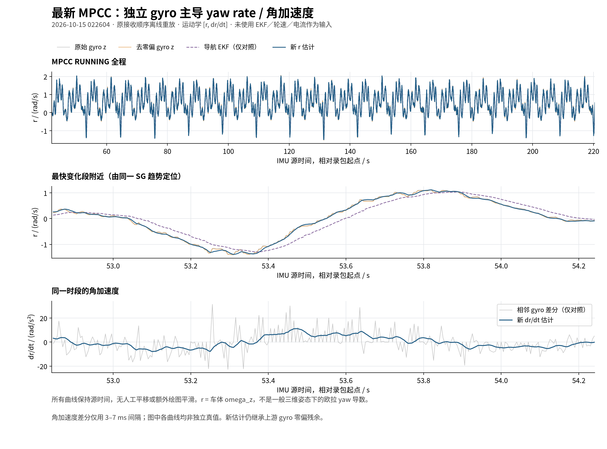

# 独立 yaw rate / 角加速度首版验证（2026-10-15）

[English](2026-10-15-yaw-rate-quality.md) · [操作说明](../operations/yaw-rate.zh-CN.md) · 实现计划（记录中的工作区路径：`docs/plans/2026-10-15-yaw-rate.md`）

在已接受的车体 ax 基线之后，新增独立 C++ `[r, dr/dt]` 运动学观测器。仅输入安装旋转后的、已扣启动零偏的 gyro，不使用导航 EKF、轮速、LIO、电流或转向指令。输出为车体 `omega_z`，不是一般 roll/pitch 下的欧拉 yaw 导数。当前只用于并行观测与录包，vehicle/race 默认关闭。既有 ax 物理计算与滤波保持原样。

## 源数据和实际改进

最新 MPCC 原包为 `2026-10-15/022604_194643_race/bag/bag_0.db3`，沿用此前只读精确抽取。corrected IMU 共 42,315 帧，首两帧为初始化，42,313 帧可作为数值输出候选。14 号晚标定延续至凌晨，另重放 `2026-10-14/233659-B-full` 与 `2026-10-15/015017-C-resume-minus60A-odom30cm`。用户确认采集后安装、减振、轮胎及载荷未变。源文件路径、抽取哈希、窗口和完整结果见 [quality-summary.json](assets/2026-10-15-yaw-rate/quality-summary.json)。

| 包与窗口 | 处理后 gyro 高频残差 std | 新 rate 高频残差 std | 最佳源时间波形对齐偏移 |
| --- | ---: | ---: | ---: |
| MPCC RUNNING | 0.046920 rad/s | 0.028362 rad/s | 4 ms |
| B-full（除首尾各 1 s） | 0.006392 rad/s | 0.004124 rad/s | 7 ms |
| C-resume（除首尾各 1 s） | 0.021035 rad/s | 0.011845 rad/s | 7 ms |

MPCC 静止窗为源相对时间 13.065745826–41.425777542 s，共 5,672 点；处理后 gyro / 新 rate 的标准差为 **0.00239284 / 0.00117481 rad/s**，均值为 **0.000105527 / 0.000105679 rad/s**。滤波降低波动，几乎保留原残余均值；这不是在线辨识 bias 的证据。既有 B/C 审核发现部分静止窗有更明显零偏残余，本版没有消除该问题。

高频残差定义：200 Hz 网格、最大 25 ms 间隔内局部插值，按连续有效段减去 21 点／名义 105 ms、三阶 SG 趋势，每段去掉首尾各 10 点；对输入与输出共同有效样本统计。该量包含真实车体快速运动与振动，不是纯传感器噪声。本次 MPCC 用完整 RUNNING 窗口，未再要求轮速 >0.5 m/s，且有显式边缘剔除，因此不能把这里的 0.046920 与先前审核的 0.04794 当成传感器噪声改善。

对齐扫描比较 `new(t)` 与 `corrected_gyro(t-lag)`，-50…50 ms、1 ms 步长，在所有 shift 共有样本上最小化 RMSE，不拟合增益或偏置，不平移展示曲线。它是波形对齐结果，不是计算、通信或物理延迟。原导航 EKF 只作图形对照，未进入观测器或参数选择。MPCC 的整体 rate 本来含真实转弯，不能用整段标准差声称降噪。

## 参数选择与各分量响应

独立合成扫频固定 R=1e-4，对 q=0.01、0.1、1、2、3、4、6、10、100、1000、10000 比较。每段 12 s、200 Hz，去掉前 3 s，以正弦／余弦最小二乘拟合幅相。选择满足 0.5/1/2/3 Hz rate 幅值误差 ≤10%、相位等效延迟绝对值 ≤15 ms 的最小候选 **q=4**。没有用轮速、Iq 模型或本包动态真值拟合 q。

| 频率 | rate 增益 | rate 等效滤波延迟 | alpha 增益 | alpha 等效滤波延迟 |
| --- | ---: | ---: | ---: | ---: |
| 1 Hz | 1.0114 | 0.306 ms | 0.99994 | 24.371 ms |
| 3 Hz | 1.0907 | 2.512 ms | 0.99257 | 25.271 ms |
| 5 Hz | 1.1866 | 5.831 ms | 0.94514 | 26.584 ms |
| 14 Hz | 0.8130 | 9.828 ms | 0.34610 | 22.772 ms |
| 23 Hz | 0.4983 | 6.621 ms | 0.13717 | 15.648 ms |

**两个输出虽然源时间相同，响应并不相同。** alpha 的平滑伴随约 25 ms 的低频等效滤波延迟；不能把 rate 的 2.5 ms 用到 alpha，也不能马上用它替换 ax 内部的三轴角加速度。5–10 Hz 附近存在增益抬升，不是全频衰减低通。0.03 rad/s 标准差的种子固定白噪声试验，输入／输出 std 为 0.030345／0.014919 rad/s；这只是已知合成噪声下的结果。

模型协方差未独立标定，也不包含对残余 bias 的精度保证。没有独立角速度／角加速度真值，当前仅支持软件行为、平滑效果和相对响应的结论。

## 本机与 NX 验证

本机 x86_64 与 NX aarch64 均通过 **24/24 组 CTest**。新核心包括恒定值、变采样 ramp、安装旋转、重复／倒序／非有限数值、gap 重置和协方差恢复检查；新增 3 项真实 ROS／启动录制契约测试，另有 3 项离线分析测试。完整回归分别见[本机日志](assets/2026-10-15-yaw-rate/desktop-ctest.txt)与[NX 日志](assets/2026-10-15-yaw-rate/nx-ctest.txt)。

42,315 帧相同 gyro 输入的跨架构原生重放，离散状态完全一致，rate 最大差 **4.44e-16 rad/s**，alpha 最大差 **2.04e-14 rad/s²**，见[数值对照](assets/2026-10-15-yaw-rate/native-parity.json)。这不是跨传感器精度对照。

两端均运行独立节点的 **20 s、1× 原接收间隔** ROS 回放：各发 4,000 帧，得到三样本初始化后预期的 3,998 帧 rate 和 3,998 帧 alpha。输出源时间逐条符合预期序列、两话题源时间相同、数值有限、图中无轮速/EKF/LIO/控制接口。源时间 NPZ 单独保存为 int64。

回放期间状态报告的“最多 512 次回调窗口 P99”的最大值，本机 **0.061719 ms**、NX **0.096901 ms**；包含数值发布，但不是全程 P99、硬件延迟或整车联合负载结果。发送调度偏差 P99 为 0.184／0.510 ms，未据此证明严格实时上界。没有并行运行 FAST-LIO/EKF/NDT/MPCC。

首次本机全套测试因未 source 新安装而找不到原有 rear-axle 程序，补齐独立安装环境后全套通过。首次 1× 工具逐帧解压 NPZ 导致发送变慢，被源年龄门限拒绝；改为计时前预加载并收紧为完整预期源序列检查后，两端最终通过。失败与最终日志保留在外部归档，未通过放宽节点源年龄或 gap 门限掩盖问题。

NX 新安装为 `/home/aims/aimsracer-yaw-observer-20261015/install`，主工作区安装未替换。操作入口见[指南](../operations/yaw-rate.zh-CN.md)，完整数据与日志在 `/home/elesheep/aimsracer-data/experiments/yaw-rate-20261015/`。源码、运行哈希及验证摘要见 [validation-summary.json](assets/2026-10-15-yaw-rate/validation-summary.json)。下一步为现场并行录制及独立参考核验，当前未接入控制或替换加速度内部输入。
