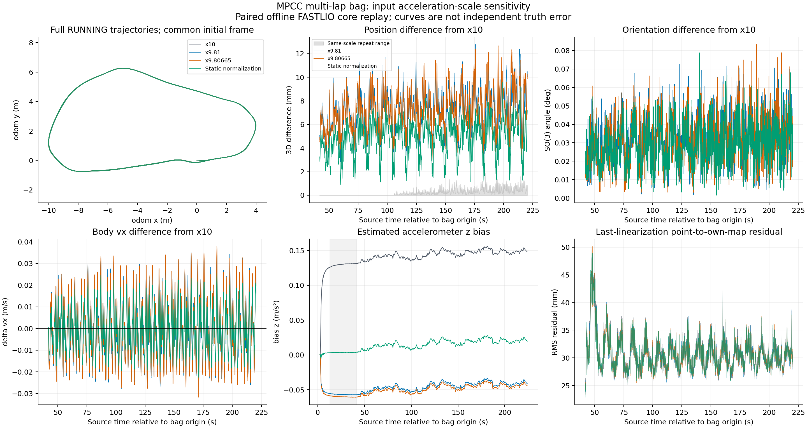
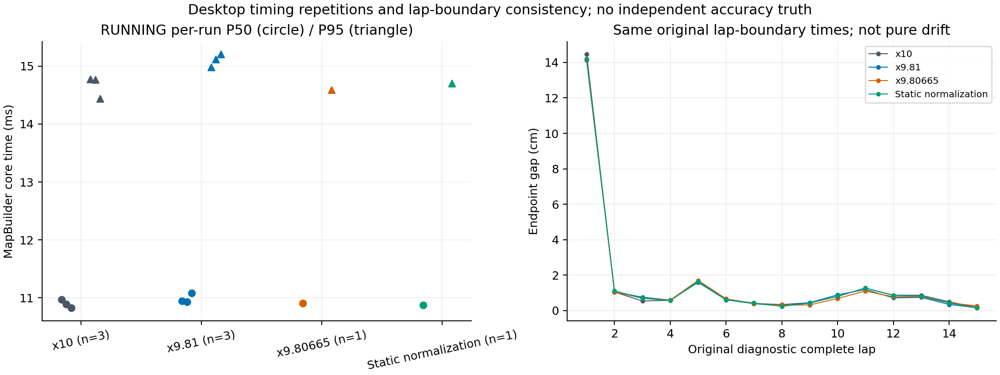

# FastLIO 加速度比例：完整多圈包离线对照

2026-10-17 实验，2026-10-18 将结果从实验目录整理入库。**固定比例差异可以测到，但这个包中的整体轨迹差异较小；没有独立真值，不能判断真实精度改善，也没有测到提速收益。** 这里没有开展新实验或更改 NX 配置。

## 输入、处理与对照

输入是 2026-10-15 `022604_194643_race/bag/bag_0.db3`，SHA256 为 `14d3b82f1635c791cc74c583e80a0b84443322039b5644086fa4e3b896cc127f`。采用归档 `fastlio_rear.yaml` 与算法源码 `afe5f4c5761d0fdf536e535df2a32017c50962a5`，同一二进制、同一输入划分，完整执行 MapBuilder 的 IMU 传播、去畸变、建图和 LiDAR 更新。

固定重力 9.81，其他模型、噪声、外参、滤波及有效迭代上限 10 不变，只改变输入加速度比例。A=x10（三次），B=x9.81（三次），C=x9.80665（一次），D=初始化 raw IMU 均值模长归一化（一次）。D 只使用这次可用的 26 个初始化样本，得到 9.871419825812481；不是完整多姿态标定，也不是把此前 28 秒静态窗用于初始化。

输入 raw IMU 44389 条、LiDAR 2234 条，处理 2220 扫描、进入 MAPPING 后输出 2218 条；所有组输入点数、扫描时刻与 IMU 分组相同。前 14 帧尚无包内 IMU，不能复现实车最初初始化。RUNNING 窗口为相对原 bag 源时间原点的 41.926416916–220.431558514 s，共 1785 个精确对齐输出。沿用原 MPCC 的 15 圈时间边界。

## 状态差异，不是真实误差

共同初始化坐标系直接比较，不拟合轨迹、不平移曲线。首轮相对 A 的 RUNNING 差异 P95：

| 方案 | 三维位置差 | 姿态差 | 纵向速度绝对差 |
|---|---:|---:|---:|
| B，x9.81 | 9.976 mm | 0.05260° | 0.02551 m/s |
| C，x9.80665 | 10.201 mm | 0.05206° | 0.02575 m/s |
| D，初始化归一化 | 6.994 mm | 0.04881° | 0.01794 m/s |

静态 `ba_z` 均值 A=+0.12977、B=−0.05684、C=−0.06013、D=+0.00351 m/s²。约 0.187 m/s² 的 A/B bias 差支持“滤波器吸收大部分静态尺度不一致”的解释；bias 更小不证明真实精度更高，动态比例误差也不等同于固定 bias。

A 的重复运行位置差 P95 最大约 0.874 mm，最大约 1.850 mm；B 三次状态相同。重复性变化与比例效应分开保留。点面对各自地图的残差是内部一致性，不能视为独立测量精度。圈边界起终点间距含真实轨迹和相位差，不是纯里程计漂移。

## 计算时间与来源范围

桌面 Ryzen 9 5900X、Docker 限额 4 CPU、OpenMP 2 线程。RUNNING core P50：A 三次为 10.969/10.895/10.825 ms，B 为 10.945/10.934/11.080 ms；P95：A 为 14.777/14.768/14.438 ms，B 为 14.983/15.116/15.206 ms。B 没有提速，尾部略高；包含匹配迭代和运行波动，不能归因于乘法常数的成本。

core 时间不含 CDR 解码、输入比例换算、ROS 调度、发布或控制器，不代表 NX 耗时。本实验没有闭环 MPCC 或独立实车真值验收。

## 可复核证据

- [全部定义、指标、重复性和限制](assets/2026-10-17-fastlio-accel-scale/metrics.json)。
- [原始中文结论](assets/2026-10-17-fastlio-accel-scale/original-readout.zh-CN.txt)、[固定圈边界明细](assets/2026-10-17-fastlio-accel-scale/lap-boundary-gaps.csv)。
- [其他实现的固定提交与源码行记录](assets/2026-10-17-fastlio-accel-scale/other-implementations.json)：这是另一个源码策略比较，不是本次完整 A/B 的性能结论，也不是多种完整算法的公平对比。
- 完整来源、诊断补丁、8 次输出、配置和 `reproduce.sh` 留在外部 `aimsracer-data/experiments/fastlio-accel-scale-20261017/mpcc-replay/`。可在固定镜像中重建；不会启动硬件节点。

相关背景：[五量质量历史快照](2026-10-17-state-output-quality.zh-CN.md) · [当前独立估计器计算链](2026-10-17-state-observer-latency-policy.zh-CN.md)。
