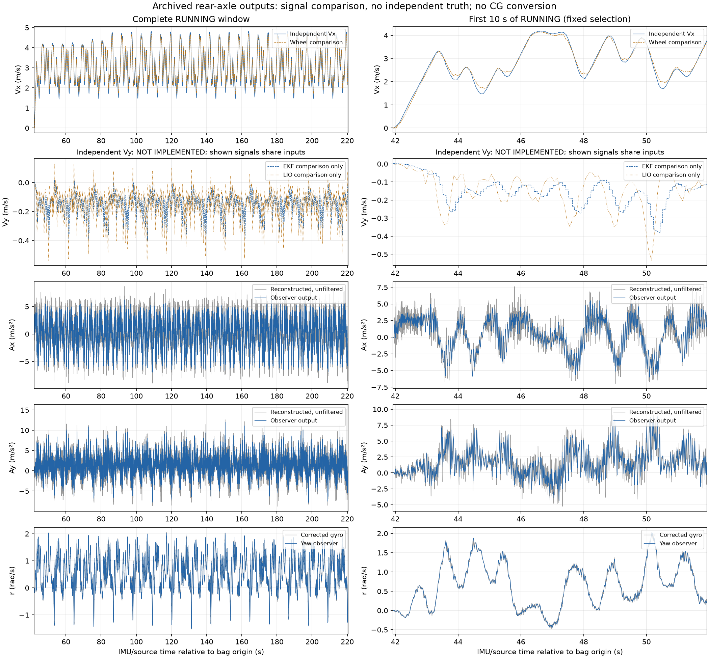
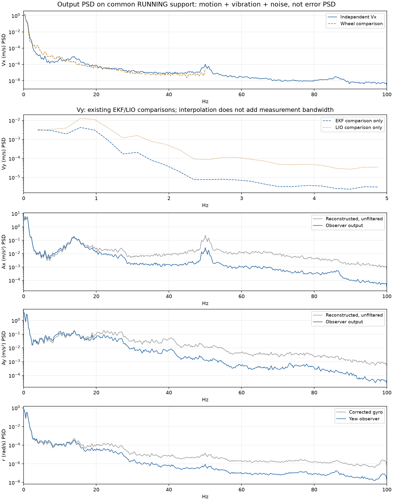

# VX、VY、AX、AY、yaw rate：输出质量校对与质心转换边界

> 后续实现说明（2026-10-17）：本页是新增发布前的质量审查快照。独立 VY 与后轴/质心两套输出现由新的 [state_observer](../operations/state-observer.zh-CN.md) 提供；本页历史表格/数值保持原口径。新增软件验证见[双参考点验证报告](2026-10-17-dual-reference-state-validation.zh-CN.md)，独立动态精度仍待验证。

校对日期：2026-10-17。主要运动数据采集于 2026-10-15，既有双架构软件验证完成于 2026-10-15～16。本报告重新读取归档 trace、只读抽取数组和验证清单，计算输出统计、公式一致性、相对响应及输出 PSD；没有修改滤波器、车辆配置或 NX 安装，没有重新开展实车实验。

## 1. 先看结论

**当前已经具备四个独立观测输出的计算与软件验证证据：VX、AX、AY、yaw rate。独立 VY 尚未发布；质心五量输出尚未实现，不能把现有后轴结果改名当作质心结果。** “独立观测器”表示它不使用导航 EKF/轮速等输入，不表示它拥有独立传感器真值：LIO 与这些观测器共享 IMU。

| 量 | 当前实际输出和参考点 | 已能支持的判断 | 尚不能支持的判断 |
| --- | --- | --- | --- |
| VX | `/state_estimation/vx` 的 linear.x；后轴、车体 x 方向 | 静止波动小；有三维合成真值、历史纠偏和完整 ROS 回放证据 | 实车绝对地速精度已达标；质心 VX 已验收 |
| VY | 新独立节点无有效输出；现有 LIO/EKF VY 只作对照 | 可检查现有 VY 的幅值和相对跟随 | 可信的质心 VY、侧滑角或瞬时侧滑状态 |
| AX | `/state_estimation/body_acceleration` 或 planar 的 x；后轴惯性加速度 | 单位、重力恢复、杆臂及滤波可复核；静止 std 0.02577 m/s² | 动态绝对精度、无漂移长期积分速度 |
| AY | `/state_estimation/planar_acceleration` 的 y；后轴惯性加速度 | 有输出、有分解、有可复现的软件验证 | 快速转动精度、实车峰值 G、摩擦边界；已发现补偿相位与异常时间问题 |
| yaw rate | `/state_estimation/yaw_rate` 的 angular_velocity.z；车体 z 轴角速度 | 可降低短时波动；本次矩阵复算与归档输出一致 | 残余 bias 已消除、全频无失真、角加速度与 rate 同响应 |

五量均缺独立 Vicon 动态精度证据。当前源码的 vehicle/race 中四个新观测器开关仍默认 false。本次没有查询实时 NX 进程；历史隔离安装/回放不证明它们正在实车主图中运行。

## 2. 本次到底校对了什么

### 2.1 数据、窗口与分母

主要包为 `sessions/2026-10-15/022604_194643_race/bag/bag_0.db3`。采用既有源时间原点 **1792002365474876930 ns**：

- 静止窗口：**13.065745826～41.425777542 s**，约 28.36 s。
- RUNNING 窗口：**41.926416916～220.431558514 s**，约 178.505 s，含起步。
- 图中局部窗口固定为 RUNNING 最初 10 s，没有按“看起来平滑”选段。

trace 包括 IMU 输入及 LIO 到达引起的内部修订。本报告只把“IMU 事件、接纳成功、估计有效”的行作为数值输出候选；**LIO 到达后同一源时刻的内部修订不算新增发布**。这是离线核心输出口径，ROS 节点还需检查接收时钟下的源年龄、frame、协方差可用标记等条件。

| 分支 | 全事件数 | corrected IMU 输入数 | 全包有效 IMU 输出候选 | RUNNING 有效候选 |
| --- | ---: | ---: | ---: | ---: |
| VX | 44,544 | 42,315 | 42,255 | 35,700 |
| AX/AY | 44,430 | 42,315 | 42,293 | 35,699 |
| yaw rate | 42,315 | 42,315 | 42,313 | 35,700 |

VX 使用完整 raw LIO **2,229** 条，AX/AY 使用既有后轴 LIO 裁取 **2,115** 条，所以事件数不同。VX 保留 60 个 initializing；加速度保留 21 个 no_orientation、1 个 gyro_warmup；yaw rate 前两帧为初始化。四个已实现量在 RUNNING 有 **35,699 个精确相同的 int64 IMU 源时间**，全包共同有效源时间为 42,254 个。不能把初始化/停发删掉后称全段连续有效。

### 2.2 本次新算与既有验证分开

本次实际执行的检查如下，数值和输入 SHA256 保存在[新校对 JSON](assets/2026-10-17-state-output-quality/summary.json)：

| 本次检查 | 结果 | 说明 |
| --- | --- | --- |
| VX、planar、yaw 三份 trace 与各自归档哈希 | 三份一致 | 没有混用初版 trace；VX 为已验 Python 参考 trace，原生一致性另有历史证据 |
| EKF/LIO/轮速对照 NPZ 与原抽取清单 | 一致 | 对照 NPZ SHA256 为 `86d66fd62c685ddbd677f2a50babf7316bd8504b585300fe6fe6dd25e212e7d0` |
| 三个分支当前 core/header/node/参数与各自验证快照 | **12/12 文件一致** | 只覆盖这 12 个文件；不是整个工作区、构建链或在线安装版本一致性证明 |
| 用 trace 的 force/gravity/omega/alpha 重算三维未滤波加速度 | x/y/z 最大差均为 **0** | 验证分解项与代数关系；这些分项不是独立物理参考 |
| 用矩阵形式重新计算 42,315 帧 yaw KF | rate 最大差 **4.44e−16 rad/s**；alpha **2.95e−14 rad/s²** | 与 C++ 标量递推采用同模型、同输入；验证计算，不验证实车物理精度 |
| 重新计算 EKF VX/轮速、EKF VY/LIO 相对波形指标 | 与既有指标差为 **0** | 重新从抽取数组计算，没有只转抄历史报告 |
| 静止/运动输出统计和两张新图 | 已生成 | 统计不扣均值、不手动移位、不按结果选参 |

本次未重新解码原始 db3、未重新运行 x86/NX 全套 CTest 或 DDS 回放，也没有新采集 Vicon。第 8 节中的软件运行数字明确属于历史验证。

## 3. 五量的计算过程

统一车体轴为 x 前、y 左、z 上。当前 `base_link` 原点位于后轴。VX/VY 是**指定参考点的车体系速度分量**；AX/AY 是同一点的**惯性加速度在车体系中的投影**。

### 3.1 VX：世界系积分，LIO 历史位置纠偏，再转换到后轴

输入只有 `/livox/imu_bias_corrected` 和 raw `/fastlio2/lio_odom`。不读取轮速、导航 EKF、LIO twist、电流或控制指令。corrected IMU 的加速度仍为 g，必须乘 **9.80665**，gyro 单位为 rad/s。

内部状态为：

\[
x=[p_W^{3D},v_W^{3D},b_{\mathrm{eff},I}^{3D}]^T,
\quad \dot p_W=v_W,
\quad \dot v_W=R_{WI}(9.80665 f_{I,g}-b_{\mathrm{eff},I})+g_W.
\]

这里的慢变有效残差可能吸收姿态、时间和 LIO 模型误差，不能叫已分离的硬件零偏。姿态由 gyro 推进和历史 LIO 姿态约束，不在九维协方差状态内。

LIO 到来时，在它的**历史源时刻**计算位置创新 `p_LIO−p_predict`，用 9×9 协方差中的位置—速度—残差关联同时修正三组状态，并重放至最新 IMU。位置观测矩阵为 `H=[I₃,0,0]`；协方差采用 Joseph 更新：

\[
P^+=(I-KH)P^-(I-KH)^T+KRK^T.
\]

Joseph 形式提高数值稳健性，不解决共享 IMU 的相关误差，也不构成精度证明。冻结位置标准差为 0.03 m、有效残差 PSD 为 1e−4 m²/s⁵。初始化需要至少三个 LIO 位置、跨度至少 0.2 s，回归未知初始速度，支持行驶中启动。

后轴速度由刚体速度关系得到：

\[
v_{rear}^B=R_{BI}R_{WI}^Tv_W-\omega_B\times\ell_{rear\to IMU}^B.
\]

最后只发布 x。其余分量的零值是占位，协方差对角为 1e6；**linear.y=0 不是测得 VY=0**。源码：velocity.cpp（记录中的工作区路径：`src/aims_racer_system/src/velocity.cpp`）、velocity_node.cpp（记录中的工作区路径：`src/aims_racer_system/src/velocity_node.cpp`）。

### 3.2 VY：从 FAST-LIO 速度状态到后轴，再到导航 EKF

**当前图表中的 LIO VY，是 FAST-LIO 的三维速度估计经过车体坐标转换和后轴杆臂补偿后的 y 分量；EKF VY 则是导航 EKF 融合该观测后的 y 速度状态。** 两者都有具体计算链。“独立 VY 尚未发布”仅指新观测分支没有有效 VY 输出，不是说现有系统没有计算 VY。

#### 3.2.1 FAST-LIO 内部先估计世界系三维速度

FAST-LIO 的 IESKF 状态包含世界系速度 `v`、姿态 `r_wi`、加速度偏置 `ba`、gyro 偏置 `bg` 等。每个 IMU 预测步执行：

\[
\hat v_{W,k+1}^{-}=\hat v_{W,k}^{+}
+\left[R_{WI,k}(f_{I,k}-\hat b_{a,I,k})+g_W\right]\Delta t.
\]

其中 `f_I` 是进入 FAST-LIO 后的加速度输入，按比力使用。**当前 `lio_node.cpp` 对 raw `/livox/imu` 的加速度乘 10.0，IESKF 的重力模长为 9.81；这与第 3.1 节新 VX 分支乘 9.80665 的实现不同。** 本报告没有修改该比例。

LiDAR 扫描到来后，点到地图平面的残差进入迭代误差状态更新，通过状态协方差的关联修正速度等状态；`State::operator+=` 明确包含 `v += delta.segment<3>(12)`。因此这里的 VY 来源是 **IMU 传播 + LiDAR 约束的速度状态**，不是简单对相邻发布位置做差，也不是只对横向加速度自由积分。

源码：IESKF 预测与更新（记录中的工作区路径：`src/FASTLIO2_ROS2/fastlio2/src/map_builder/ieskf.cpp`）、LiDAR 更新（记录中的工作区路径：`src/FASTLIO2_ROS2/fastlio2/src/map_builder/lidar_processor.cpp`）。

#### 3.2.2 发布 raw LIO 时，世界速度先转到 Livox 坐标系

`publishOdometry()` 实际执行 `vel = r_wi.transpose() * v`，所以 `/fastlio2/lio_odom.twist.twist.linear` **已经是 Livox 坐标系分量**，不是世界系分量：

\[
\hat v_I=R_{WI}^{T}\hat v_W.
\]

源码：lio_node.cpp（记录中的工作区路径：`src/FASTLIO2_ROS2/fastlio2/src/lio_node.cpp`）。不能在读取 raw LIO twist 后再重复施加一次世界→Livox 旋转。

#### 3.2.3 从 Livox 参考点转换到后轴，取 y 分量

令 `I` 为当前统一 Livox 参考点/坐标系，`B` 为后轴 `base_link`，`R_BI` 把 Livox 向量转到车体系，`ell` 为后轴→Livox 的车体系杆臂。代码执行：

\[
\hat v_{rear}^{B}=R_{BI}\hat v_I-\omega_B\times\ell
=R_{BI}R_{WI}^{T}\hat v_W-\omega_B\times\ell,
\qquad \omega_B=R_{BI}\omega_I.
\]

因此完整的后轴横向速度为：

\[
\boxed{\hat v_{y,rear}^{B}
=\left[R_{BI}R_{WI}^{T}\hat v_W\right]_y
-\omega_{B,z}\ell_x+\omega_{B,x}\ell_z.}
\]

当前几何配置为 `R_BI=I`、`ell=[0.30,0,0.03] m`，代入得：

\[
\boxed{\hat v_{y,rear}=\hat v_{I,y}-0.30\,r+0.03\,\omega_{B,x}.}
\]

平面运动忽略 roll rate 时，进一步成为 `vy_rear ≈ vy_Livox − 0.30*r`；若同时以 yaw `psi` 表示平面姿态，则等价于：

\[
\hat v_{y,rear}\approx
-\sin\psi\,\hat v_{W,x}+\cos\psi\,\hat v_{W,y}-0.30\,r.
\]

这也说明 **世界系 `v_W_y` 不能直接当作车体系 VY**。减去 `0.30*r` 是去除前置传感器随车转动产生的横向速度：例如后轴只有前向速度、`r=1 rad/s`，前方 0.30 m 的 Livox 会有约 `+0.30 m/s` 横向速度，补偿后后轴 VY 仍可为零。这个例子只是刚体几何说明，不是实测结果。

角速度取 **LIO 源时间**对应的 IMU 实测值；无同刻值时使用两侧样本线性插值，默认要求两侧间隔不超过 30 ms，缺少支持时等待或丢弃该条 LIO。当前 `rear_axle_frames.launch.py` 把节点的 `/livox/imu` 输入重映射到 `/livox/imu_bias_corrected`，不是使用新 yaw-rate KF 的输出。转换保留 LIO 时间戳，输出 `/rear_axle/lio_odom.twist.twist.linear.y`。

源码：后轴转换公式（记录中的工作区路径：`src/aims_racer_system/src/rear_axle_odometry.cpp`）、源时间匹配及发布（记录中的工作区路径：`src/aims_racer_system/src/lio_to_rear_axle.cpp`）、[输入重映射](../../src/aims_racer_system/launch/rear_axle_frames.launch.py)、[几何参数](../../src/aims_racer_system/params/rear_axle_geometry.yaml)。这里沿用统一 Livox 原点，忽略内部厘米级 LiDAR/IMU 间距，不能重复套用 FAST-LIO 内部外参。旧 Python 转换实现采用相同公式。

#### 3.2.4 导航 EKF 怎样得到另一路 VY

导航 EKF 输出 `/odometry/filtered.twist.twist.linear.y`，对应滤波状态中的 `vy`，不是直接透传上一步结果。当前 [ekf_rear.yaml](../../src/aims_racer_system/params/ekf_rear.yaml) 的输入选择为：

| 输入 | 实际参与融合的量 | 与 VY 的关系 |
| --- | --- | --- |
| `/rear_axle/lio_odom` | 平面下的位置、yaw、VX、VY；其余三维量由 `two_d_mode` 约束 | 提供直接的 VY 速度观测，也通过位置/姿态状态关联影响估计 |
| `/rear_axle/wheel_odom` | 仅 VX | 不把轮速消息中假设的 VY=0 当作观测 |
| `/rear_axle/imu` | 仅 yaw rate | 不融合 IMU AX/AY，不在导航 EKF 中用 AY 积分生成 VY |

滤波先按运动模型预测状态，再进行矩阵观测更新。以通用 EKF 记号表示，VY 是更新结果的对应分量：

\[
\hat x^+=\hat x^-+K\left[z-h(\hat x^-)\right],
\qquad \hat v_y^+=\left[\hat x^+\right]_{v_y}.
\]

`K` 由当时的状态与观测协方差决定，不是固定权重或简单平均；同次位置、姿态等创新也可能通过协方差关联影响 VY。输出频率为 200 Hz，晚到 LIO 按历史源时刻回退并重放（`smooth_lagged_data=true`、历史 2 s），随后预测到当前输出时刻。**200 Hz 发布不代表每帧都有新 LIO VY 观测，也不保证 VY 的动态响应为 5 ms。**

两路 VY 共享 LIO/IMU 数据，不是两套独立测速仪。第 5.2 节的波形比较评价这两路输出的相对响应，不是独立真值误差。

#### 3.2.5 新 VX 分支为什么仍不能算已交付 VY

第 3.1 节的新 VX 观测器内部也维护世界三维速度。从刚体关系看，取 `R_BI*R_WI^T*v_W − omega_B×ell` 的 y 分量可构造 VY 候选；但当前节点只发布有效 x，y 为零占位、方差为 1e6，没有发布并验证这个候选。因此不能把其调试 `v_W_y` 或消息中的 `linear.y=0` 当作新 VY 观测。

另外，不能使用 `VY=AY/r`。平面关系是：

\[
a_x=\dot v_x-rv_y,\qquad a_y=\dot v_y+rv_x.
\]

如果以后采用积分形式，需要联合推进 `dot(vx)=ax+r*vy`、`dot(vy)=ay−r*vx` 并有长期观测约束；不能只把 `ay−r*vx` 长期自由积分后宣称 VY 已可信。

### 3.3 AX/AY：从比力恢复惯性加速度，补偿到后轴，再滤波

输入只有 corrected IMU 三轴比力/gyro，以及 `/rear_axle/lio_odom` 姿态。首先完成 g→SI 和安装旋转；再计算：

\[
\boxed{a_{rear}^B=f_{IMU}^B-b_a^B+g^B
-\alpha_B\times\ell-\omega_B\times(\omega_B\times\ell)}.
\]

各项含义为：

| 项 | 来源与含义 |
| --- | --- |
| `f_IMU` | 安装旋转后的 IMU 比力，m/s² |
| `b_a` | 配置中的固定加速度偏置，当前为零；没有在线辨识其真实值 |
| `g_body` | LIO 历史姿态锚定、gyro 推进后的重力向量；符号定义满足静止时 `f+g≈0` |
| `alpha×lever` | IMU 与后轴之间的切向加速度差 |
| `omega×(omega×lever)` | IMU 与后轴之间的向心加速度差 |

当前杆臂约为后轴→IMU `[0.30,0,0.03] m`，安装旋转为单位阵，仍是近似几何。角加速度使用尾随 **25 ms 三轴 gyro 线性回归**；晚到 LIO 在历史时刻约束姿态并重放后续计算，而不是把收到的旧姿态直接覆盖当前姿态。

得到未滤波的后轴惯性 ax/ay 后，分别进入 `[ax,jx]` 和 `[ay,jy]` 状态滤波；两轴共享模型参数和增益，默认 jerk PSD=1e4。**没有减掉整车转弯加速度 `vx*r`，也没有用它生成 AY。** 源码：body_acceleration.cpp（记录中的工作区路径：`src/aims_racer_system/src/body_acceleration.cpp`）。

需要区分三个层级：

1. 原始 IMU 比力。
2. 旧 `/rear_axle/imu` 的后轴比力：做了杆臂补偿，尚未恢复重力。旧六轴 PSD 图中的 `processed rear` 属于这一层。
3. 新观测器恢复重力、补偿并滤波后的后轴 AX/AY。本报告的新 PSD 展示这一层，并与同链未滤波惯性加速度比较。

### 3.4 yaw rate：安装旋转后的 corrected gyro，再做运动学 KF

`r=omega_body.z`，不是一般 roll/pitch 下的欧拉 yaw 导数。仅输入 corrected gyro；启动零偏在上游扣除一次，本节点不估计在线残余零偏。

\[
x_r=[r,\alpha_z]^T,\quad
F=\begin{bmatrix}1&dt\\0&1\end{bmatrix},\quad H=[1,0],\quad
Q=4\begin{bmatrix}dt^3/3&dt^2/2\\dt^2/2&dt\end{bmatrix},\quad R=10^{-4}.
\]

状态在 IMU 源时刻推进，不等待 LIO，也不预测到接收时刻。超过 30 ms 的源间隔会重置，连续三帧后恢复有效。rate 和 alpha 虽然源时间相同，滤波响应却不同。源码：yaw_rate.cpp（记录中的工作区路径：`src/aims_racer_system/src/yaw_rate.cpp`）。

## 4. 直接看输出质量：静止、运动和频谱

### 4.1 静止：偏离零多少、波动多少

以下由当前归档输出重新计算，每个已实现量均为 **5,672** 点；std 使用 ddof=0，绝对值 P95 定义为 `percentile(abs(x),95)`，没有扣均值。

| 输出 | 单位 | 均值 | 标准差 | 绝对值 P95 | 绝对峰值 |
| --- | --- | ---: | ---: | ---: | ---: |
| VX | m/s | −0.000357 | 0.001330 | 0.002130 | 0.008548 |
| AX | m/s² | −0.015655 | 0.025768 | 0.058052 | 0.078356 |
| AY | m/s² | 0.032957 | 0.027596 | 0.077791 | 0.128932 |
| yaw rate | rad/s | 0.000105679 | 0.001174812 | 0.002290573 | 0.004131894 |
| 独立 VY | m/s | 未发布 | 未发布 | 未发布 | 未发布 |

AX 未滤波 std 为 0.042774，最终为 0.025768 m/s²；AY 为 0.045989→0.027596 m/s²；corrected gyro z 为 0.002393→rate 0.001175 rad/s。滤波确实降低短窗波动，但保留了静态均值。静态近零不代表动态跟随正确，约 28 s 数据也不足以证明长期温漂和零偏稳定性。

**统计口径校正：** 旧 body quality JSON 的 `p95`/`max` 是带符号统计，本表明确采用绝对值。例如最终 AX 的绝对值 P95 是 0.058052，而不是旧字段中的带符号 P95 0.028788。两者数学定义不同，不能互换。

现有 VY 对照另列，不能补填为独立 VY 的精度：EKF 静止 5,657 点，均值 0.000430、std 0.001218 m/s；LIO 静止 283 点，均值 0.000484、std 0.002068 m/s。采样数、带宽和输入相关性均不同。

### 4.2 运动：这里的幅值不是误差

| 输出 | RUNNING 样本数 | 均值 | 标准差 | 绝对值 P95 | 绝对峰值 |
| --- | ---: | ---: | ---: | ---: | ---: |
| VX，m/s | 35,700 | 3.05404 | 0.88846 | 4.61833 | 4.82723 |
| AX，m/s² | 35,699 | 0.08751 | 2.53381 | 4.59802 | 6.97860 |
| AY，m/s² | 35,699 | 1.47936 | 2.16820 | 5.25697 | 12.03835 |
| yaw rate，rad/s | 35,700 | 0.57121 | 0.63071 | 1.60370 | 2.03302 |
| VY EKF，仅对照，m/s | 35,526 | −0.14974 | 0.06782 | 0.28955 | 0.40257 |
| VY LIO，仅对照，m/s | 1,785 | −0.14956 | 0.10107 | 0.35749 | 0.53758 |

AY 的绝对值 P95/峰值对应 **0.5361g / 1.2276g**。这些是估计信号的分布，不是已确认的实际轮胎能力；两路 VY 均值接近 −0.15 m/s，也不能据此确认真实侧滑。

图中没有额外平滑或时间平移，已知无效区间及超过门限的间隔断线。VY 一行明确展示的是 EKF/LIO 对照，新独立 VY 缺失。VX 的“Independent”指独立观测分支，不是独立真值。图右各行纵轴按该局部信号自适应，比较不同窗口幅值时应看刻度。

### 4.3 新输出 PSD：检查滤波到底改变了哪些频率

这张图专门补充用户关心的**输出质量**：AX/AY 比较未滤波惯性加速度与最终输出，yaw 比较 corrected gyro 与最终 rate；不再把旧 `/rear_axle/imu` 比力 PSD 当成最终输出 PSD。

本次频谱方法为：RUNNING 固定窗口内按源时间线性插值到 200 Hz；每一行两个信号使用共同支持，超过 30 ms 的间隔断开，VY 的 LIO 支持上限为 250 ms；已知无效输出两端的插值区间也断开。Welch 使用 1,024 点 Hann 窗、50% 重叠、每窗去常量趋势，跨连续段按 Welch 窗数加权。图省略 DC 点。PSD 单位为速度 `(m/s)²/Hz`、加速度 `(m/s²)²/Hz`、角速度 `(rad/s)²/Hz`。

| 图行 | 共同支持网格点 | 可用连续段 | Welch 窗数 |
| --- | ---: | ---: | ---: |
| VX / wheel | 35,694 | 2 | 67 |
| VY EKF / LIO | 35,701 | 1 | 68 |
| AX 未滤波 / 最终 | 35,697 | 2 | 67 |
| AY 未滤波 / 最终 | 35,697 | 2 | 67 |
| gyro / yaw rate | 35,701 | 1 | 68 |

网格点数不同于真实输出数；插值不是新测量，也不是连续有效率。轮速约 100 Hz，所以其显示止于 50 Hz；LIO 约 10 Hz，VY 显示止于 5 Hz，仍不能据此声称 5 Hz 带宽已经验证。完整频谱数组见 [output-psd.json](assets/2026-10-17-state-output-quality/output-psd.json)。

图中 AX/AY 和 yaw rate 的较高频能量受到抑制，但低频与部分中频仍有真实运动、振动和误差混合。VX 约 50 Hz 附近的窄带结构也值得留意，当前没有独立参考把它归因为车体运动或传感器振动。**这张图是输出 PSD，不是误差 PSD；能量较小不能直接解释为更准确。**

旧六轴 PSD 仅保留约 28.1% 运动样本，因为采用了“源间隔 >1.5 倍中位周期即分段”的更严格规则；本图采用显式 30 ms 支持条件和不同 Welch 窗长。两图支持范围及对象均不同，不能把频谱差异全部归因于滤波改进。

## 5. 动态跟随：哪些有证据，哪些仍有问题

### 5.1 VX：合成模型合格，实车绝对精度仍未测

历史冻结配置在解析真值下覆盖 0.5/1/2/3 Hz 速度、三维转弯、静止、残差注入和 40/90/150 ms LIO 到达延迟。正弦 Vx RMSE 为 **0.00644～0.00650 m/s**；七场景平均 **0.007918 m/s**，增益约 0.9988～1.0032。

这些是已知运动/噪声模型下的历史结果。本次只读取已冻结结果和核验源文件；没有重跑该合成套件。它们不等于 MID-360 实车速度误差，也不能把微小负等效相位拟合值解释为物理“负延迟”。

旧无约束 ax 积分在运动末尾达到约 15.62 m/s，同刻轮速约 2.15 m/s，说明“AX 波形可用”不意味着“长期只积分 AX 可得可信 VX”。旋转耦合、姿态、偏置和补偿残差均会影响积分。

### 5.2 VY：相对滞后明显，不能直接用于快速动态状态

本次从对照 NPZ 重新计算 **44≤t<219 s**、200 Hz 的 35,000 个共同网格点，比较 `EKF(t)` 与 `reference(t−lag)`；扫描 −800～800 ms，步长 5 ms，不拟合增益或偏置，所有候选偏移使用同一有效样本集合。

| 比较 | 零移位差值 RMSE | 最佳波形偏移 | 偏移后差值 RMSE | 5 s 分窗最佳偏移范围 |
| --- | ---: | ---: | ---: | ---: |
| EKF VX / wheel VX | 0.07067 m/s | 30 ms | 0.01136 m/s | 30～35 ms |
| EKF VY / LIO VY | 0.09930 m/s | **265 ms** | 0.04677 m/s | **230～290 ms** |

第一行是原导航 EKF VX，不是新独立 VX 观测器的延迟。第二行说明当前 VY 对照存在明显响应差异，但 LIO 参与 EKF 融合，且只有约 10 Hz，因此这些差值都不等于真实误差，扫描步长也不等于独立时间精度。不能部署固定 265 ms 补偿来宣称已解决。

### 5.3 AX：末级滤波跟随较快，完整物理链仍待验

历史合成纯平移 3 Hz 时，末级滤波增益约 **1.0436**、等效相位延迟约 **0.833 ms**。但角加速度回归、姿态锚点、传输和几何误差位于它之前，不能把 0.833 ms 当成完整 AX 链延迟。

RUNNING 的角加速度回归样本中心年龄中位数约 **11.58 ms**、P95 **12.28 ms**；它是时间支持描述，不是所有信号通用的物理延迟。AX 动态精度尚未独立测量，尤其转弯时 `ax=d(vx)/dt−r*vy`，不能用轮速差分直接给它判定真值误差。

### 5.4 AY：两个可复现问题仍存在

**问题一：转动补偿与当前比力响应不一致。** 历史合成试验固定后轴，令 `r=sin(2πft) rad/s`，IMU 比力由精确刚体运动生成，真实后轴 AY 为零。保留当前因果角加速度回归后得到：

| yaw 变化频率 | 虚假最终 AY 的绝对值 P95 | AY 误差 RMS |
| --- | ---: | ---: |
| 0.5 Hz | 0.003765g | 0.02620 m/s² |
| 1 Hz | 0.015114g | 0.10516 m/s² |
| 2 Hz | 0.061231g | 0.42610 m/s² |
| 3 Hz | **0.140494g** | **0.97780 m/s²** |

这直接说明，匹配 XY 末级滤波并没有消除前级角加速度补偿的时间响应问题。不能仅增加平滑，或直接换入另一节点的滞后 alpha，就宣称修复。

**问题二：异常密集源时间导致回归失去可信支持。** 辅助 `233659-B-full` 包中，gyro 回归跨度只有约 **41～62 μs**，切向 y 补偿达到 106.30 m/s²，最终 AY 峰值 **92.66 m/s²（9.448g）**，当时仍标记 valid。当前代码只有样本数和数值分母检查，没有物理上合理的最小回归时间支持门控；本次源码哈希确认这仍是既有实现。

主 MPCC 也不是完全规则采样：有效 AY 的回归支持最小 **5.650427 ms**。不能只因没有 B 包那种极端尖峰，就认定全部动态 AY 可靠。B/C 为直线标定数据，只辅助检查时间异常/串扰，不能代替弯道 AY 精度验收。[完整 AY 原报告](2026-10-15-planar-acceleration-quality.zh-CN.md)

### 5.5 yaw rate：降低波动，但保留 bias，并有频率增益抬升

历史 MPCC RUNNING 的高频残差 std 从 corrected gyro **0.046920** 降到 rate **0.028362 rad/s**；该残差含快速真实运动/振动，不是纯传感器噪声。相对 corrected gyro 最佳波形偏移为 4 ms，不是物理传感器延迟。

| 历史合成频率 | rate 增益 | rate 等效延迟 | alpha 增益 | alpha 等效延迟 |
| --- | ---: | ---: | ---: | ---: |
| 1 Hz | 1.0114 | 0.306 ms | 0.99994 | 24.371 ms |
| 3 Hz | 1.0907 | 2.512 ms | 0.99257 | 25.271 ms |
| 5 Hz | **1.1866** | 5.831 ms | 0.94514 | 26.584 ms |

它不是所有频率都衰减的普通低通。rate、alpha 共用时间戳不等于同响应；静止均值基本保留，不能称残余 gyro bias 已估计或消除。

## 6. 时间、失效和不确定度要怎样读

消息源年龄、回调耗时、滤波相位、物理响应分别回答不同问题，不能相加或互相替代。

| 项 | 已知行为与限制 |
| --- | --- |
| 原包 corrected IMU 到达年龄 | MPCC RUNNING P50/P95 约 1.565/5.972 ms；不是独立物理响应延迟 |
| raw LIO 到达年龄 | 同窗 P50/P95 约 59.943/83.893 ms；10 Hz 更新之间仍有等待 |
| AX/AY 实际使用的姿态锚点年龄 | 历史报告 P50/P95 112.06/162.03 ms；其后有 gyro 推进，不等于直接持有旧姿态 |
| IMU 间隔 >30 ms | 各分支重置或重新准备相应状态；不能跨断流当连续有效 |
| 数值发布 | ROS 节点还检查 IMU 源年龄 50 ms 等门控；离线核心候选不自动等于现场实际发布 |
| VX 锚点 | 0.3 s 后降级，0.5 s 后停发；失锚恢复需重新取得三点、0.2 s 位置支持 |
| 时钟回退 | 清空历史/开启新 epoch；同一 epoch 内源时间递增 |
| 协方差 | 条件模型不确定度；共享 LIO/IMU 相关性、外参和真实 bias 误差未独立标定 |

特别是 `valid=true` 表示计算和输入门控通过，不是动态精度已达标。AY 的已知尖峰可以在 valid 时存在，模型协方差也不能自动覆盖所有未建模误差。

## 7. 质心五量：已知几何、转换公式与敏感性

### 7.1 本次会话更新的测量语义

用户先前给出 **IMU→质心**、用车体轴表达的 x=−0.09 m、y=−0.03 m；本次补充“高度估计 3 cm，具体不清楚”。因此可用于后续估计方案的名义向量为：

\[
d_{IMU\to CG}^B\approx[-0.09,-0.03,-0.03]^T\ \mathrm m.
\]

**z 为用户估计，不是已标定值，也没有误差上界。** 原测量 YAML（记录中的工作区路径：`src/aims_racer_system/params/vehicle_geometry_measurements.yaml`）仍记录此前 z 未知；本次只在报告及新 JSON 中保存补充语义，没有追改历史配置/图，也没有让新坐标进入运行时。

轴距 0.365 m 是另一项测量，不进入这里的刚体参考点转换。现有后轴→IMU 0.30 m 近似也不能当作独立精测的后轴→质心位置。优先直接使用 IMU→质心关系，减少串接近似参考点。

### 7.2 完整三维转换

先取得 IMU 点的车体系速度与已恢复重力的惯性加速度，再计算：

\[
v_{CG}^B=v_{IMU}^B+\omega_B\times d,
\qquad
a_{CG}^B=a_{IMU}^B+\alpha_B\times d+\omega_B\times(\omega_B\times d).
\]

yaw rate 的车体分量不随参考点平移而改变。仅作平面 yaw 运动时，已知水平偏移对应：

\[
\begin{aligned}
v_{x,CG}&=v_{x,IMU}+0.03r,&
v_{y,CG}&=v_{y,IMU}-0.09r,\\
a_{x,CG}&=a_{x,IMU}+0.03\alpha_z+0.09r^2,&
a_{y,CG}&=a_{y,IMU}-0.09\alpha_z+0.03r^2.
\end{aligned}
\]

这些公式说明参考点改变会同时改变速度和加速度。它们从 **IMU 点**出发，不能直接套到已经补偿到后轴的输出上。实际 roll/pitch 运动存在时，需要完整三维 d；也要在参考点转换后检查滤波响应，不能把不同响应的最终信号直接相加当成已验证输出。

### 7.3 高度差“差 1 cm”会带来多少变化

本次用主 MPCC 中已有三轴 omega/alpha，计算假设 `Δd=[0,0,+0.01] m` 的转换敏感性：

\[
\Delta v=\omega\times\Delta d,
\quad \Delta a=\alpha\times\Delta d+\omega\times(\omega\times\Delta d).
\]

| +1 cm 高度扰动带来的分量变化 | 绝对值 P95 | 绝对峰值 |
| --- | ---: | ---: |
| ΔVX | 0.003776 m/s | 0.007473 m/s |
| ΔVY | 0.005130 m/s | 0.011607 m/s |
| ΔAX，滤波前转换 | 0.249545 m/s² | 0.711377 m/s² |
| ΔAY，滤波前转换 | **0.454429 m/s²** | **1.171505 m/s²** |

这些是 **35,699 个共同加速度有效运动样本**上的假设场景变化；−1 cm 的符号相反、绝对统计相同。它不是已测得的几何误差、置信区间或真实运动误差；角加速度本身含噪声/相位误差，所以它显示的是当前补偿算法对高度的敏感性。它也说明，直接把未知高度设为零可能明显影响动态加速度。

本报告没有生成新的质心 AX/AY/VX/VY 时间序列，也没有用上述敏感性替代质心输出验收。要完成质心交付，仍需明确参考 frame、扩展并验证 VY、修复时间支持门控并评估转动补偿响应。

## 8. 已有软件验证，分别证明了什么

下表为既有归档结果，本次没有重跑；各套件对应不同阶段快照，**22/24/25/27 不能相加，也不是同一次五量联合验收**。

| 分支 | 历史 x86/NX 软件检查 | ROS 回放证据 | 证据边界 |
| --- | --- | --- | --- |
| AX 首版 | 各 22/22 组 CTest；各 136 XML testcase，无失败/错误/跳过 | 20 s、1×；4,000 IMU＋199 LIO→3,981 有效输出 | 不是原车动态真值或整车联合负载 |
| yaw rate | 各 24/24 组 CTest；42,315 帧原生跨架构 rate 最大差 4.44e−16 rad/s | 20 s、1×；4,000 IMU→3,998 rate 和 alpha | 不含在线 residual bias 验收 |
| AX/AY planar | 各 25/25 组 CTest；各 145 XML testcase，无失败/错误/跳过 | 20 s、1×；SI/G 均 3,981 帧，源时间/单位/图检查 | 数值 valid 不消除已知 AY 物理响应问题 |
| VX | 各 27/27 组 CTest；B/C/MPCC 全事件原生离散状态一致 | **221.930 s 全录制窗口、1×**；NX **42,255/42,255**，运动段 178.505 s 全覆盖 | 未同时运行整车 FAST-LIO/EKF/NDT/MPCC 负载；无独立地速真值 |
| VY / 质心五量 | 尚无对应新增输出的软件/物理验收 | 尚无 | 现有内部三维状态及旧 VY 对照不能补齐这行 |

历史包的回调 P99 多为最多 512 次回调滚动窗口所报值，不是全程全局 P99；本报告不把它用于证明传感器延迟或整车严格实时保证。此前独立 NX 安装未覆盖主车辆 install，本次也未重新核查在线 source/ELF/进程链。

## 9. 下一步怎样把五量质量真正闭环

1. **先明确交付定义。** 质心处、车体轴、同一源时刻的 VX/VY/AX/AY/r；每个量有独立有效性，未知分量不能填零当测量。高度 3 cm 保留估计标签和可更新参数。
2. **处理已证实的计算可信度缺口。** gyro 回归需有合理的最小时间支持/异常时间诊断；评估比力、角加速度和姿态的因果响应对齐，不能只通过平滑减少峰值。
3. **在质心参考点做合成真值和原包检查。** 包含非零 VY、三维 roll/pitch/yaw、静止、横移、加速/制动、快速换向、时钟与断流。分别报告幅值、相位、RMSE、拒绝/停发及恢复，不只给一条平滑曲线。
4. **用独立 Vicon 验证动态质量。** 测刚体到 IMU/质心的外参、记录采样/接收时钟与同步不确定度，先转换位姿参考点再离线求导。保留参考求导窗口/有效带宽、遮挡和边界无效段；留出未调参重复动作。已有[采集接口与说明](../operations/vicon-observer-validation.zh-CN.md)。

既有 VX 文档提出的独立目标为 RMSE ≤0.15 m/s、绝对误差 P95 ≤0.30 m/s，但目前无这份独立真值结果；不自动把目标外推成质心 VY 或 AX/AY/r 的验收标准。其余量应根据实际控制/分析带宽确定要求，再用留出数据判断是否达标。

## 10. 复现与证据入口

- 本次复算脚本（记录中的工作区路径：`verification/state_quality/audit_outputs.py`）及说明（记录中的工作区路径：`verification/state_quality/README.md`）。仅需要 NumPy/SciPy/Matplotlib，运行不启动 ROS、传感器或车辆。
- 本次[完整指标与哈希](assets/2026-10-17-state-output-quality/summary.json)、[精简 CSV](assets/2026-10-17-state-output-quality/metrics.csv)、[输出 PSD 数组](assets/2026-10-17-state-output-quality/output-psd.json)。
- 本次外部运行产物：`aimsracer-data/experiments/state-quality-20261017/review-04/`。此前草稿保留；图/JSON 以本页链接的最终版本为准。
- 本次[交付检查记录](assets/2026-10-17-state-output-quality/verification.json)：独立标准库重算统计、附件哈希、链接及图面检查；不是新增车辆测试。
- 既有 [VX 报告](2026-10-15-vx-quality.zh-CN.md)、[AX 报告](2026-10-15-body-acceleration-quality.zh-CN.md)、[AX/AY 报告](2026-10-15-planar-acceleration-quality.zh-CN.md)、[yaw rate 报告](2026-10-15-yaw-rate-quality.zh-CN.md)。

本页将“已读取的历史运行记录”“本次新复算”“尚未做的独立验收”分开保存。原 bag、完整 trace 和二进制仍在外部数据目录；从仅含 Git 源码的全新 checkout 可以阅读附件，但重跑需要相应外部证据。
