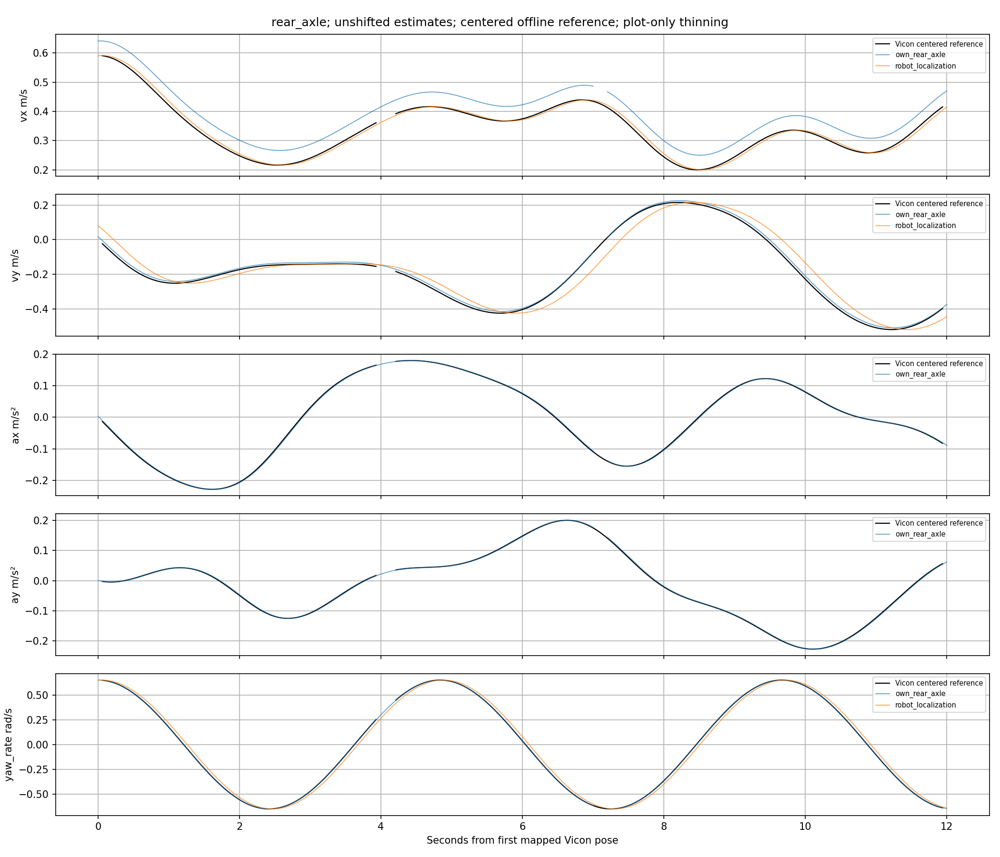

# Vicon 五量对比程序准备与软件验证

日期：2026-10-17。为用户计划的 **2026-10-19** 测试准备；Vicon 接入尚未确定，按用户回复做成可配置。现场操作与配置（记录中的工作区路径：`verification/vicon_state/README.zh-CN.md`）。

## 已完成

- 核对当前 VX/VY、AX/AY、yaw rate 的在线核心与 ROS 发布均为 C++；双参考点入口 `state_observer` 也是 C++。Python 用于 launch、测试和离线分析。
- MPCC 继续目前的 Robot Localization VX 输入；在线估计器、MPCC 和导航配置本轮均未改动。
- `verification/vicon_state/run.py` 提供 inspect、record、extract、analyze、demo。话题／标准位姿类型、单位、两个参考点、安装旋转、时钟、动作窗口可配置；未知的真实参数在模板中保持 null。
- 后轴／质心参考由 Vicon 原始位姿独立构造，先换点再求导；包含三维旋转及 SO(3) omega_z。主要误差不平移／去偏，原发布时刻与相同参考网格的基线对照分别输出。
- 误差、连续性、源时间年龄、三个求导窗口、弱激励／周期多解、固定偏置引起的偏移歧义均在程序中显式处理。图不跨缺口连线，原始 bag／CSV／实际源时间与来源哈希保留。

## 软件验证结果

隔离 ROS Humble 容器中 **19 项 pytest 全部通过，零失败／错误／跳过**。验证覆盖：

1. 解析三维平移／转动、非零 marker→body 旋转、后轴／质心杆臂、四元数符号切换、整数 epoch 精度、明确 mm→m 换算。
2. 跟踪无效／坏四元数／缺口分段、中心窗口边缘、未知时钟与外参、错误 frame、输出缺失和覆盖率、提取文件被改动。
3. 已知正向波形滞后、弱激励不可辨识、固定偏置与原始 RMSE 偏移混淆；三个窗口误差共用支持，基线共用参考网格。
4. TransformStamped、PoseStamped、PoseWithCovarianceStamped、Odometry 四种真实 ROS CDR 消息，多 sqlite3 分片只读提取。
5. CLI 从真实序列化 bag 生成后轴／质心完整五量报告；真正 ROS DDS 发布→inspect→原生 ros2 bag record→定时正常停止→SQLite→提取。最后一次录制每个合成话题记录 **134 条**，九个话题合计 1,206 条；测试使用独立 localhost domain 209，不接触车辆。

合成示例独立注入 VX 30 ms、VY 20 ms、yaw rate 5 ms，程序找回对应波形偏移；VX 保留注入的约 0.05 m/s 固定偏置。该例按原始 RMSE 搜索会得到 VX 约 170 ms，说明需要把形状响应与偏置误差分开，而不是移动曲线使主要误差变小。AX/AY 激励不足时不强行报告可辨识偏移。

现场未配置的模板运行 inspect 会列出接入／时钟／外参缺项并返回 2；不会默认为已同步或零杆臂。几何／时钟尚未完成不会阻止保存原始录制，但准确对照必须补齐这些信息。

## 证据与使用边界

测试日志、源码哈希和合成指标：[验证清单](assets/2026-10-17-vicon-comparison-preparation/validation-summary.json)、[pytest](assets/2026-10-17-vicon-comparison-preparation/pytest.txt)、[合成指标](assets/2026-10-17-vicon-comparison-preparation/demo-metrics.json)。示例图为程序验证数据：

完整自检数据、报告、真实 ROS 录包自检及配置信息保存在 `aimsracer-data/experiments/vicon-state-preparation-20261017/`；主入口 `demo/report/report.zh-CN.md`。也可在无 ROS 的 NumPy/SciPy/Matplotlib 环境运行 `run.py demo --output 新目录` 重建。

**这里尚无实车 Vicon 数据。** 19 项通过证明对比程序及采集链的软件行为，不能证明估计器已经稳定／精确、满足低延迟指标或已经部署到 NX。当前估计器原有的加速度回归相位、名义几何及共享 IMU/LIO 不确定度边界保留。真实采集后按静止、直线、稳定圆弧、换向及保留验证组分别评估，再决定估计器调参及后续 MPCC 接线。

[返回电流标定入口](../operations/calibration.zh-CN.md) · [横向加速度标定与校对](../operations/lateral-acceleration-calibration.zh-CN.md)。本报告的日期、数值与证据边界保持原口径。
