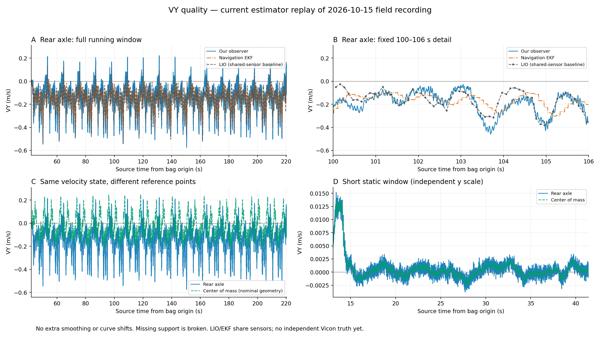
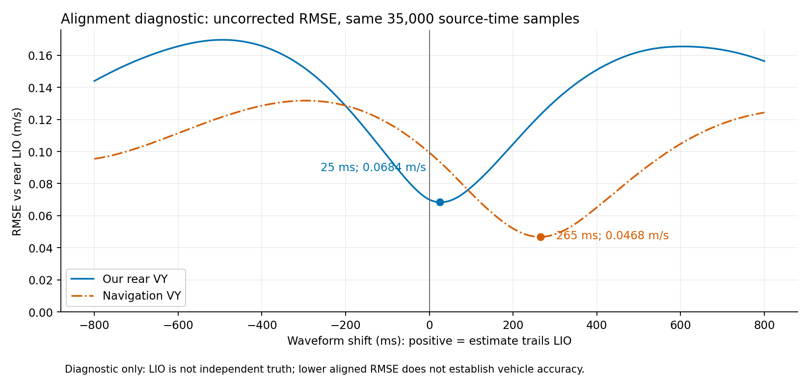

# 独立 VY 当前质量与实包图表

整理日期：2026-10-18。对象为当前双参考点 C++ 状态估计器的独立 VY：IMU 传播加 LIO 位姿约束，不读取 Robot Localization 的速度。以下是当前实现对 **2026-10-15 实车录包的 1× 回放**，不是新的实车测试，也不是 Vicon 真值测试。

**判断：短静态表现较好；相对 LIO，波形比导航 EKF 更及时；动态波动仍偏大，动态绝对精度和控制适用性尚待 Vicon 验证。**

## 1. 直接看输出



- **A：后轴全运行段。** 蓝色是我们的独立 VY；灰色是录包中的后轴 LIO VY；橙色是录包中的导航 EKF VY。我们的输出包含更大的快速波动和峰值。
- **B：固定 100–106 s 局部窗口。** 导航 EKF 更平滑，部分变化相对较晚。我们的输出跟随较快，也出现相对 LIO 更大的偏离。现阶段不能把这些变化全部解释为真实运动，或全部解释为噪声。
- **C：后轴与质心。** 两条曲线来自同一速度状态，经过参考点转换。质心 VY 更接近零，主要受几何转换影响，不能据此判定更准确或没有侧滑。
- **D：短静态。** 纵轴单独缩放。窗口开头约 13–14 s 有一段约 0.015 m/s 的暂态，随后接近零；统计保留了这段暂态，没有人工剔除。

主图不额外平滑、不平移曲线，横轴使用原始源时间。超过支持间隔的缺口断线展示；LIO 局部图上的圆点是原始采样点。图中未使用合成 Vicon 示例数据。

## 2. 短静态能说明什么

窗口为相对 bag 起点的 13.065745826–41.425777542 s。单位均为 m/s；标准差是总体标准差，P95 为绝对值的第 95 百分位。

| 输出 | 样本数 | 均值 | 标准差 | 绝对值 P95 | 最大绝对值 |
|---|---:|---:|---:|---:|---:|
| 我们的后轴 VY | 5,672 | 0.000650 | 0.002490 | 0.003362 | 0.015189 |
| 我们的质心 VY | 5,672 | 0.000672 | 0.002392 | 0.002986 | 0.014154 |
| 录制的后轴 LIO VY | 283 | 0.000484 | 0.002068 | 0.004038 | 0.005125 |
| 录制的导航 EKF VY | 5,657 | 0.000430 | 0.001218 | 0.002333 | 0.004040 |

后轴静态均值约 0.65 mm/s，标准差约 2.49 mm/s，说明这段短静态下接近零。导航 EKF 的静态波动更小。这些结果不能代替长时间漂移测试，也不是动态精度合格判据。

## 3. 动态一致性与响应

下表比较后轴 VY 与录制的后轴 LIO VY。共同时间网格为 44 ≤ t < 219 s、200 Hz，共 35,000 点；所有候选平移和两种输出使用同一有效样本集合。插值跨越间隔上限：我们的输出 30 ms、导航 EKF 40 ms、LIO 250 ms。

| 与后轴 LIO 的比较 | 不平移 RMSE（m/s） | 最佳波形平移 | 平移后 RMSE（m/s） |
|---|---:|---:|---:|
| 我们的后轴 VY | 0.07001 | 25 ms | 0.06839 |
| 导航 EKF VY | 0.09930 | 265 ms | 0.04677 |



计算为比较 `estimate(t)` 与 `LIO(t − lag)`，扫描 −800 至 800 ms，步长 5 ms，以原始 RMSE 最小为准，不拟合增益、不减去均值或偏置。正平移表示估计波形相对 LIO 较晚。这与 Vicon 工具的去均值相关性诊断不是同一指标。

我们的零平移一致性更好，最佳波形偏移更小；导航 EKF 平移后的 RMSE 更低，因此不能笼统说我们在所有方面都更好。**25 ms 和 265 ms 是相对 LIO 的波形诊断，不是测得的端到端物理延迟。** LIO 和导航 EKF 都共享上游传感器，表内 RMSE 是信号差异，不是独立真值误差。

完整运行窗口为 41.926416916–220.431558514 s：

| 输出 | 运行标准差（m/s） | 运行最大绝对值（m/s） |
|---|---:|---:|
| 我们的后轴 VY | 0.11717 | 0.57527 |
| 我们的质心 VY | 0.09620 | 0.24917 |
| 录制的后轴 LIO VY | 0.10107 | 0.53758 |
| 录制的导航 EKF VY | 0.06782 | 0.40257 |

运行标准差包含真实运动，不能称为噪声标准差。我们的后轴峰值比导航 EKF 大，需要通过 Vicon 判断是更及时捕捉运动，还是噪声、模型或姿态误差造成的过冲。

## 4. 为什么质心 VY 不同

两参考点使用相同的车体轴方向。名义后轴→质心偏移为 `[0.21, −0.03, 0] m`，刚体速度转换为：

\[
\mathbf v_{CG}^{B}=\mathbf v_{rear}^{B}
+\boldsymbol\omega^{B}\times\mathbf r_{rear\to CG}^{B},
\qquad v_{y,CG}=v_{y,rear}+0.21\,\omega_z.
\]

因此转弯时，后轴与质心 VY 存在合理差异。这里的角速度取估计器实际使用的车体角速度；几何参数来自当前名义配置，其中 IMU 比质心高约 3 cm 是用户估计值。质心速度不是另一份独立测量。

## 5. 证据与复现

- 原始实车录包标识：`/home/aims/aimsracer-data/sessions/2026-10-15/022604_194643_race/bag/bag_0.db3`。
- 回放证据目录：`/home/elesheep/aimsracer-data/experiments/dual-reference-state-20261017/warning-policy/`。
- 图表及原始计算结果目录：`/home/elesheep/aimsracer-data/experiments/dual-reference-state-20261017/vy-quality-20261017-final/`。
- 实际回放 ELF SHA256：`9d1aa3b796b385bcc3d7a5a45558eef1dea8612dd642cfb5ccf0ffd5fea86c1c`。
- 源时间原点：`1792002365474876930 ns`；先以整数相减，再转成秒，避免大时间戳精度损失。
- [全部统计、输入和图片 SHA256](assets/2026-10-18-vy-quality/metrics.json)、[可缩放主图](assets/2026-10-18-vy-quality/vy-comparison.svg)、绘图程序（记录中的工作区路径：`verification/dual_reference/plot_vy.py`）。

在已有回放容器中复现（输出必须是新目录）：

```bash
docker exec aims-dual-state-20261017 python3 /work/verification/dual_reference/plot_vy.py \
  --input /out/warning-policy \
  --output /out/vy-quality-reproduced
```

程序校验输入数据哈希，重新计算全部统计和 321 个候选平移，并断言零平移 RMSE 和最佳平移与已有回放记录一致。本次已执行并目视检查两张图。独立动态误差、急转弯峰值可靠性、物理延迟仍需在 Vicon 时间与参考点标定后实测。本次仅新增分析图表，不改在线估计器和 MPCC。
