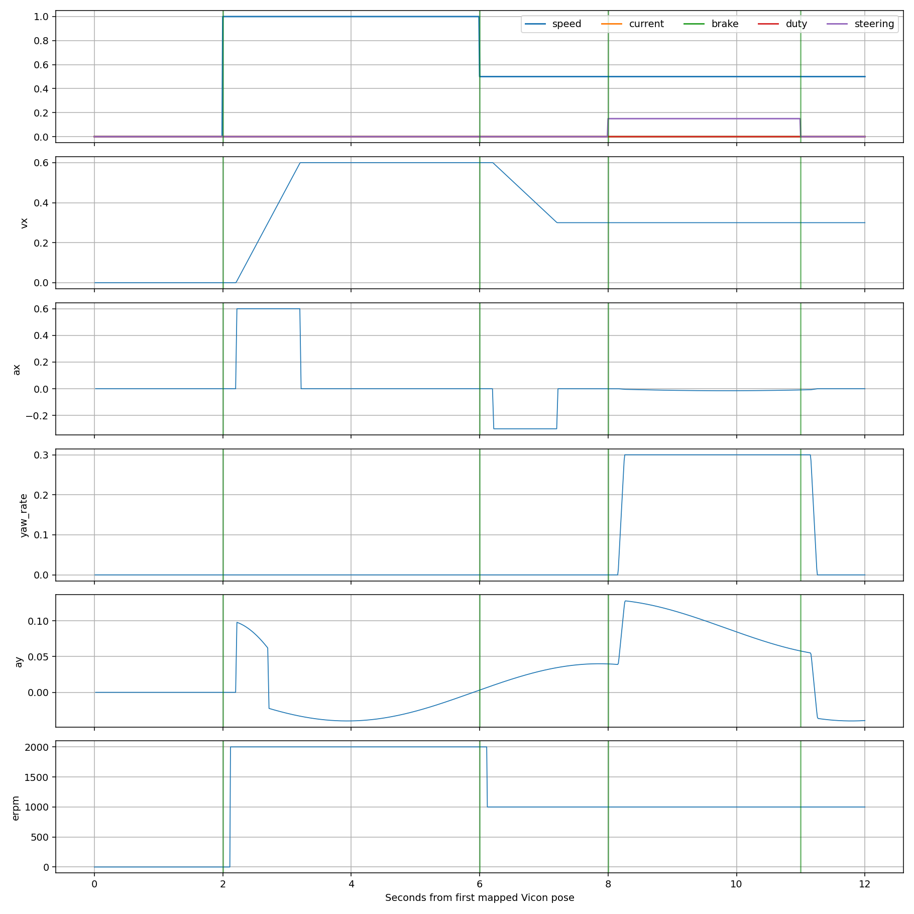

# 执行器整车响应区间

使用命令源时间和 ERPM 源时间；Vicon 按显式时钟映射。位置直接做后向有限差分，不使用中心平滑，不使用未来样本提前响应。
先将标记点转到实测后轴，再对世界速度求导并旋转到车体系，避免把车体系速度导数误作惯性加速度。
阈值为基线中位数附近 max(响应下限, 4×MAD 标准差估计)，实际噪声倍数见配置；持续样本数和持续时间须同时满足。
区间下端至上端覆盖响应值所依赖的原始观测；确认时刻单列，时钟扩展区间和 0.5／1／2 倍阈值敏感性见 JSON。
没有实际舵角反馈，因此这些量包含命令传输、执行器和车体动力学，只能解释为整车响应，不能分离纯舵机机械延迟。
参考资格：`{"qualified": false, "warnings": ["synthetic_data"], "clock_uncertainty_ns": 500000.0}`

| 事件／通道 | 有效 | 量 | 响应区间 ms | 确认 ms | 原因 |
| --- | --- | --- | --- | --- | --- |
| 0/speed | True | vx | [280.0, 290.0] | 310.0 |  |
| 0/speed | True | ax | [200.0, 220.0] | 240.0 |  |
| 0/speed | True | yaw_rate | 未检出 | — | insufficient_response_excitation |
| 0/speed | True | ay | 未检出 | — | insufficient_response_excitation |
| 0/speed | True | erpm | [110.0, 120.0] | 140.0 |  |
| 1/speed | True | vx | [370.0, 380.0] | 400.0 |  |
| 1/speed | True | ax | [430.0, 450.0] | 470.0 |  |
| 1/speed | True | yaw_rate | 未检出 | — | insufficient_response_excitation |
| 1/speed | True | ay | 未检出 | — | insufficient_response_excitation |
| 1/speed | True | erpm | [110.0, 120.0] | 140.0 |  |
| 2/steering | True | vx | 未检出 | — | insufficient_response_excitation |
| 2/steering | True | ax | 未检出 | — | insufficient_response_excitation |
| 2/steering | True | yaw_rate | [170.0, 180.0] | 200.0 |  |
| 2/steering | True | ay | 未检出 | — | insufficient_response_excitation |
| 2/steering | True | erpm | 未检出 | — | insufficient_response_excitation |
| 3/steering | True | vx | 未检出 | — | insufficient_response_excitation |
| 3/steering | True | ax | 未检出 | — | insufficient_response_excitation |
| 3/steering | True | yaw_rate | [170.0, 180.0] | 200.0 |  |
| 3/steering | True | ay | 未检出 | — | insufficient_response_excitation |
| 3/steering | True | erpm | 未检出 | — | insufficient_response_excitation |

无效事件仍保留诊断值，不能据此作延迟归因；未检出仅说明本阈值／观测支持下激励不足。
输入、配置和程序哈希见 [metrics.json](metrics.json)，各求导支持见 [response_signals.csv](response_signals.csv)。本报告不自动判定实车验收通过。

