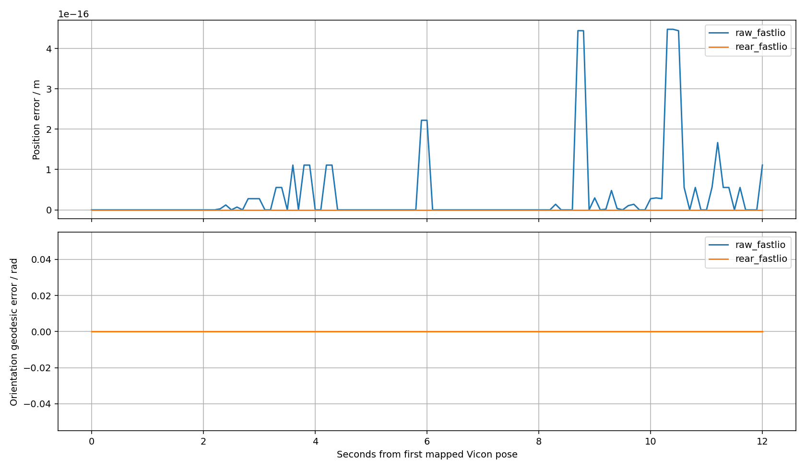

# FastLIO 动捕对照

按源时间匹配后轴位姿，主要误差不做曲线平移；仅使用显式固定外参或指定静止窗口。没有全轨迹配准。
原始 IMU 位姿先应用安装旋转，再扣除后轴至 IMU 杆臂；原始速度必须有同步的修正陀螺仪以扣除角速度叉乘杆臂。缺失时不假设为零。
速度参考为离线中心窗口求导；波形偏移只作诊断，不等于物理延迟。
标定／时间资格：`{"qualified": false, "warnings": ["synthetic_data"], "clock_uncertainty_ns": 500000.0}`

| 流 | 匹配数 | 位置 RMSE m | 姿态 RMSE rad | vx RMSE | vy RMSE |
| --- | ---: | ---: | ---: | ---: | ---: |
| raw_fastlio | 121 | 1.00675e-16 | 0 | 0.000432801 | 5.87322e-05 |
| rear_fastlio | 121 | 0 | 0 | 0.000432801 | 5.87322e-05 |

漂移增长、缺测、波形偏移和输入／配置／程序哈希详见 [metrics.json](metrics.json)。本报告不自动判定实车验收通过。

