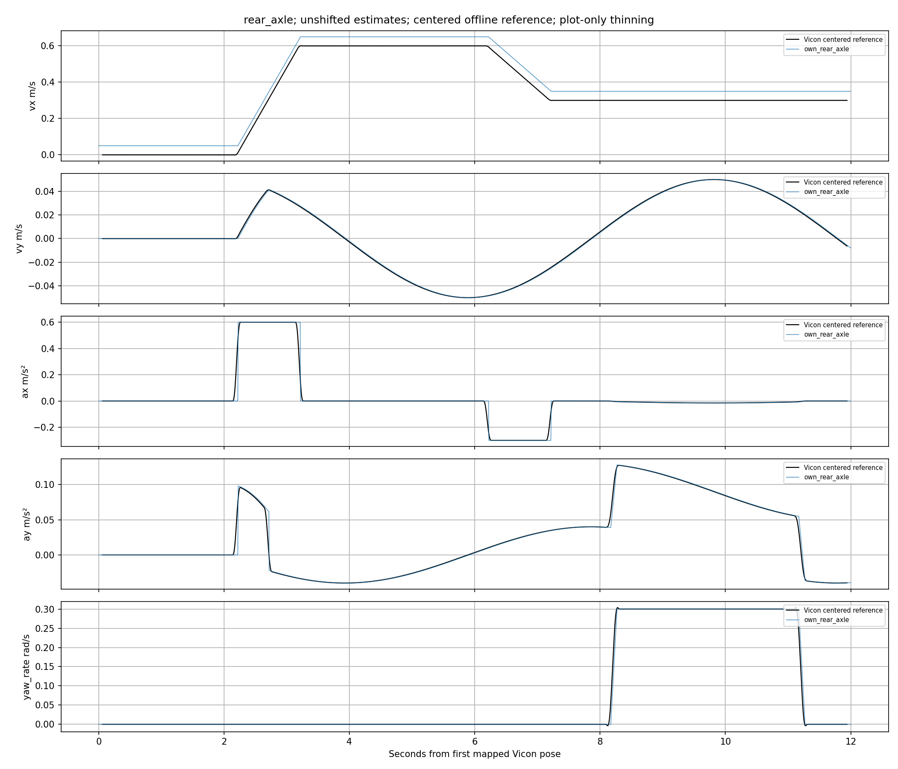
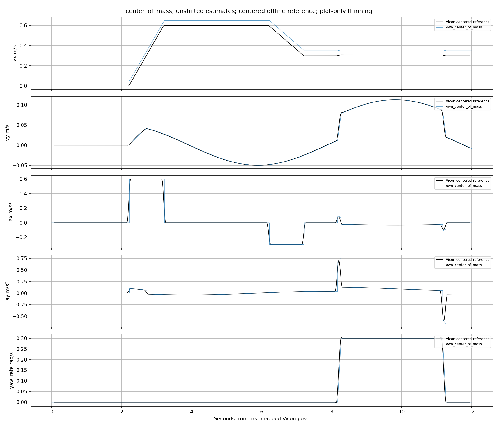

# Vicon 五量对照报告

主要误差按原源时间计算，未平移估计曲线。参考使用中心窗口及未来动捕样本，不进入在线估计器。
完整后轴／质心五量支持：True；合成数据：True。本报告不自动判定实车验收通过。

参考标定／同步状态：`{"rear_axle": {"qualified": false, "warnings": ["synthetic_data"], "clock_uncertainty_ns": 500000}, "center_of_mass": {"qualified": false, "warnings": ["synthetic_data"], "clock_uncertainty_ns": 500000}}`

| 窗口／流／参考点／量 | n | bias | RMSE | MAE | P95绝对误差 | 参考覆盖率 | 最佳波形偏移ms |
| --- | ---: | ---: | ---: | ---: | ---: | ---: | ---: |
| whole/own_rear_axle/rear_axle/vx | 2365 | 0.049493 | 0.049642 | 0.049493 | 0.056 | 100.0% | 20.0 |
| regime_static/own_rear_axle/rear_axle/vx | 419 | 0.050008 | 0.050008 | 0.050008 | 0.05 | 100.0% | 不可辨识 |
| regime_straight/own_rear_axle/rear_axle/vx | 1262 | 0.049654 | 0.049865 | 0.049654 | 0.056 | 100.0% | 不可辨识 |
| regime_turn/own_rear_axle/rear_axle/vx | 605 | 0.05 | 0.05 | 0.05 | 0.05 | 100.0% | 不可辨识 |
| regime_s_turn/own_rear_axle/rear_axle/vx | 0 | — | — | — | — | 0 | 无共同支持 |
| whole/own_rear_axle/rear_axle/vy | 2365 | 8.2388e-06 | 0.00061973 | 0.00048664 | 0.00079994 | 100.0% | 20.0 |
| regime_static/own_rear_axle/rear_axle/vy | 419 | 1.3635e-06 | 1.1099e-05 | 1.3635e-06 | 0 | 100.0% | 不可辨识 |
| regime_straight/own_rear_axle/rear_axle/vy | 1262 | 0.00013676 | 0.00066383 | 0.00060828 | 0.00079985 | 100.0% | 不可辨识 |
| regime_turn/own_rear_axle/rear_axle/vy | 605 | -6.2761e-05 | 0.00048439 | 0.00042906 | 0.00073765 | 100.0% | 不可辨识 |
| regime_s_turn/own_rear_axle/rear_axle/vy | 0 | — | — | — | — | 0 | 无共同支持 |
| whole/own_rear_axle/rear_axle/ax | 2365 | -0.00012749 | 0.030073 | 0.0039978 | 0.0010327 | 100.0% | 不可辨识 |
| regime_static/own_rear_axle/rear_axle/ax | 419 | -0.0010093 | 0.0096113 | 0.0010093 | 0 | 100.0% | 不可辨识 |
| regime_straight/own_rear_axle/rear_axle/ax | 1262 | 0.0019018 | 0.030642 | 0.0048032 | 0.0032967 | 100.0% | 不可辨识 |
| regime_turn/own_rear_axle/rear_axle/ax | 605 | -6.1995e-07 | 0.00031573 | 0.00017949 | 0.0004909 | 100.0% | 不可辨识 |
| regime_s_turn/own_rear_axle/rear_axle/ax | 0 | — | — | — | — | 0 | 无共同支持 |
| whole/own_rear_axle/rear_axle/ay | 2365 | 2.9522e-05 | 0.0047209 | 0.0010675 | 0.0018442 | 100.0% | 不可辨识 |
| regime_static/own_rear_axle/rear_axle/ay | 419 | -0.00016465 | 0.0015675 | 0.00016465 | 0 | 100.0% | 不可辨识 |
| regime_straight/own_rear_axle/rear_axle/ay | 1262 | 8.5919e-05 | 0.0036404 | 0.00077886 | 0.00063997 | 100.0% | 不可辨识 |
| regime_turn/own_rear_axle/rear_axle/ay | 605 | 0.0005558 | 0.0035271 | 0.0012505 | 0.0034432 | 100.0% | 不可辨识 |
| regime_s_turn/own_rear_axle/rear_axle/ay | 0 | — | — | — | — | 0 | 无共同支持 |
| whole/own_rear_axle/rear_axle/yaw_rate | 2365 | -2.3555e-15 | 0.0073959 | 0.0010445 | 1.4511e-14 | 100.0% | 20.0 |
| regime_static/own_rear_axle/rear_axle/yaw_rate | 419 | 0 | 0 | 0 | 0 | 100.0% | 不可辨识 |
| regime_straight/own_rear_axle/rear_axle/yaw_rate | 1262 | 0.00014308 | 0.0031057 | 0.0002774 | 0 | 100.0% | 不可辨识 |
| regime_turn/own_rear_axle/rear_axle/yaw_rate | 605 | -0.0003635 | 0.011691 | 0.0025373 | 0.0037331 | 100.0% | 不可辨识 |
| regime_s_turn/own_rear_axle/rear_axle/yaw_rate | 0 | — | — | — | — | 0 | 无共同支持 |
| whole/own_center_of_mass/center_of_mass/vx | 2365 | 0.049493 | 0.049643 | 0.049493 | 0.056 | 100.0% | 20.0 |
| regime_static/own_center_of_mass/center_of_mass/vx | 419 | 0.050008 | 0.050008 | 0.050008 | 0.05 | 100.0% | 不可辨识 |
| regime_straight/own_center_of_mass/center_of_mass/vx | 1262 | 0.049658 | 0.049869 | 0.049658 | 0.056 | 100.0% | 不可辨识 |
| regime_turn/own_center_of_mass/center_of_mass/vx | 605 | 0.049989 | 0.04999 | 0.049989 | 0.05 | 100.0% | 不可辨识 |
| regime_s_turn/own_center_of_mass/center_of_mass/vx | 0 | — | — | — | — | 0 | 无共同支持 |
| whole/own_center_of_mass/center_of_mass/vy | 2365 | 8.2394e-06 | 0.0017659 | 0.00069986 | 0.0015289 | 100.0% | 20.0 |
| regime_static/own_center_of_mass/center_of_mass/vy | 419 | 1.3635e-06 | 1.1099e-05 | 1.3635e-06 | 2.7756e-16 | 100.0% | 不可辨识 |
| regime_straight/own_center_of_mass/center_of_mass/vy | 1262 | 0.00016681 | 0.00097154 | 0.00066071 | 0.00079998 | 100.0% | 不可辨识 |
| regime_turn/own_center_of_mass/center_of_mass/vy | 605 | -0.00013909 | 0.0026549 | 0.00095012 | 0.001497 | 100.0% | 不可辨识 |
| regime_s_turn/own_center_of_mass/center_of_mass/vy | 0 | — | — | — | — | 0 | 无共同支持 |
| whole/own_center_of_mass/center_of_mass/ax | 2365 | -0.00013605 | 0.030593 | 0.0047927 | 0.014149 | 100.0% | 20.0 |
| regime_static/own_center_of_mass/center_of_mass/ax | 419 | -0.0010093 | 0.0096113 | 0.0010093 | 1.3181e-12 | 100.0% | 不可辨识 |
| regime_straight/own_center_of_mass/center_of_mass/ax | 1262 | 0.0014786 | 0.03099 | 0.0053232 | 0.015899 | 100.0% | 不可辨识 |
| regime_turn/own_center_of_mass/center_of_mass/ax | 605 | 0.0011311 | 0.0078098 | 0.0017797 | 0.0093337 | 100.0% | 不可辨识 |
| regime_s_turn/own_center_of_mass/center_of_mass/ax | 0 | — | — | — | — | 0 | 无共同支持 |
| whole/own_center_of_mass/center_of_mass/ay | 2365 | 3.0745e-05 | 0.040373 | 0.0061243 | 0.003619 | 100.0% | 不可辨识 |
| regime_static/own_center_of_mass/center_of_mass/ay | 419 | -0.00016465 | 0.0015675 | 0.00016465 | 1.8963e-13 | 100.0% | 不可辨识 |
| regime_straight/own_center_of_mass/center_of_mass/ay | 1262 | -0.00291 | 0.033006 | 0.0043987 | 0.001926 | 100.0% | 不可辨识 |
| regime_turn/own_center_of_mass/center_of_mass/ay | 605 | 0.0088947 | 0.056198 | 0.011049 | 0.031584 | 100.0% | 不可辨识 |
| regime_s_turn/own_center_of_mass/center_of_mass/ay | 0 | — | — | — | — | 0 | 无共同支持 |
| whole/own_center_of_mass/center_of_mass/yaw_rate | 2365 | -2.3555e-15 | 0.0073959 | 0.0010445 | 1.4511e-14 | 100.0% | 20.0 |
| regime_static/own_center_of_mass/center_of_mass/yaw_rate | 419 | 0 | 0 | 0 | 0 | 100.0% | 不可辨识 |
| regime_straight/own_center_of_mass/center_of_mass/yaw_rate | 1262 | 0.00014308 | 0.0031057 | 0.0002774 | 0 | 100.0% | 不可辨识 |
| regime_turn/own_center_of_mass/center_of_mass/yaw_rate | 605 | -0.0003635 | 0.011691 | 0.0025373 | 0.0037331 | 100.0% | 不可辨识 |
| regime_s_turn/own_center_of_mass/center_of_mass/yaw_rate | 0 | — | — | — | — | 0 | 无共同支持 |

## Vicon 参考工况分层

标签仅由主窗口的后轴 Vicon 速度、惯性加速度和横摆角速度生成，所有估计器及质心共用相同时间标签；阈值是可配置的描述规则，不是验收限值。
静止同时满足低平面速度、低横摆角速度和低平面加速度；直行需达到移动速度且横摆率低；转弯需达到移动速度且横摆率高。中间范围保留为未分类。
S 弯需在连续有效且持续移动的参考内出现两个持续足够长、符号相反的横摆率波瓣，过渡时间和整对波瓣跨度均受限；中间过渡纳入该 S 弯。缺测或遮挡会切断候选，不跨缺口拼接。
分类只在同标签连续参考段首末网格时刻之间有效，边界不外推。各工况的支持不足／缺失显式列出，仍保留可用样本的描述统计。源断流只统计同一工况连续段内相邻原发布样本。工况分层不计算波形偏移，避免跨不连续工况拟合时移；整段和手动窗口保留原偏移诊断。
实际分类配置：`{"static_speed_max_mps": 0.05, "static_yaw_rate_max_rad_s": 0.03, "static_acceleration_max_mps2": 0.2, "moving_speed_min_mps": 0.2, "straight_yaw_rate_max_rad_s": 0.05, "turn_yaw_rate_min_rad_s": 0.1, "s_turn_min_lobe_s": 0.2, "s_turn_max_transition_s": 0.5, "s_turn_max_pair_span_s": 4.0, "min_samples": 20, "min_supported_span_s": 0.2, "max_gap_s": 0.04}`

| 工况 | 支持状态 | 主参考样本 | 连续段数 | 段内跨度合计 s |
| --- | --- | ---: | ---: | ---: |
| static | available | 213 | 1 | 2.12 |
| straight | available | 635 | 2 | 6.33 |
| turn | available | 303 | 1 | 3.02 |
| s_turn | missing | 0 | 0 | 0 |

未分类有效参考样本：38；主参考无效网格样本：12。标签段见 [regime_labels.csv](regime_labels.csv)。

## 相同参考网格的基线比较

各量所有可用估计器共用相同参考时刻及缺口支持；插值不增加 LIO 等低频观测的独立带宽。上表保留各流原发布时刻评分。

| 窗口／参考点／量 | 共同 n | 各流 RMSE |
| --- | ---: | --- |
| whole/rear_axle/vx | 1183 | own_rear_axle: 0.049642 |
| regime_static/rear_axle/vx | 210 | own_rear_axle: 0.050009 |
| regime_straight/rear_axle/vx | 632 | own_rear_axle: 0.049861 |
| regime_turn/rear_axle/vx | 303 | own_rear_axle: 0.05 |
| regime_s_turn/rear_axle/vx | 0 | 无共同支持 |
| whole/rear_axle/vy | 1183 | own_rear_axle: 0.00061993 |
| regime_static/rear_axle/vy | 210 | own_rear_axle: 1.1626e-05 |
| regime_straight/rear_axle/vy | 632 | own_rear_axle: 0.00066476 |
| regime_turn/rear_axle/vy | 303 | own_rear_axle: 0.00048497 |
| regime_s_turn/rear_axle/vy | 0 | 无共同支持 |
| whole/rear_axle/ax | 1183 | own_rear_axle: 0.030241 |
| regime_static/rear_axle/ax | 210 | own_rear_axle: 0.010864 |
| regime_straight/rear_axle/ax | 632 | own_rear_axle: 0.02952 |
| regime_turn/rear_axle/ax | 303 | own_rear_axle: 0.00032016 |
| regime_s_turn/rear_axle/ax | 0 | 无共同支持 |
| whole/rear_axle/ay | 1183 | own_rear_axle: 0.0047727 |
| regime_static/rear_axle/ay | 210 | own_rear_axle: 0.0017715 |
| regime_straight/rear_axle/ay | 632 | own_rear_axle: 0.0034693 |
| regime_turn/rear_axle/ay | 303 | own_rear_axle: 0.0036106 |
| regime_s_turn/rear_axle/ay | 0 | 无共同支持 |
| whole/rear_axle/yaw_rate | 1183 | own_rear_axle: 0.007426 |
| regime_static/rear_axle/yaw_rate | 210 | own_rear_axle: 0 |
| regime_straight/rear_axle/yaw_rate | 632 | own_rear_axle: 0.0034139 |
| regime_turn/rear_axle/yaw_rate | 303 | own_rear_axle: 0.011972 |
| regime_s_turn/rear_axle/yaw_rate | 0 | 无共同支持 |
| whole/center_of_mass/vx | 1183 | own_center_of_mass: 0.049643 |
| regime_static/center_of_mass/vx | 210 | own_center_of_mass: 0.050009 |
| regime_straight/center_of_mass/vx | 632 | own_center_of_mass: 0.049865 |
| regime_turn/center_of_mass/vx | 303 | own_center_of_mass: 0.049991 |
| regime_s_turn/center_of_mass/vx | 0 | 无共同支持 |
| whole/center_of_mass/vy | 1183 | own_center_of_mass: 0.0017716 |
| regime_static/center_of_mass/vy | 210 | own_center_of_mass: 1.1626e-05 |
| regime_straight/center_of_mass/vy | 632 | own_center_of_mass: 0.0010224 |
| regime_turn/center_of_mass/vy | 303 | own_center_of_mass: 0.0027152 |
| regime_s_turn/center_of_mass/vy | 0 | 无共同支持 |
| whole/center_of_mass/ax | 1183 | own_center_of_mass: 0.030757 |
| regime_static/center_of_mass/ax | 210 | own_center_of_mass: 0.010864 |
| regime_straight/center_of_mass/ax | 632 | own_center_of_mass: 0.029884 |
| regime_turn/center_of_mass/ax | 303 | own_center_of_mass: 0.0077793 |
| regime_s_turn/center_of_mass/ax | 0 | 无共同支持 |
| whole/center_of_mass/ay | 1183 | own_center_of_mass: 0.040736 |
| regime_static/center_of_mass/ay | 210 | own_center_of_mass: 0.0017715 |
| regime_straight/center_of_mass/ay | 632 | own_center_of_mass: 0.03316 |
| regime_turn/center_of_mass/ay | 303 | own_center_of_mass: 0.056672 |
| regime_s_turn/center_of_mass/ay | 0 | 无共同支持 |
| whole/center_of_mass/yaw_rate | 1183 | own_center_of_mass: 0.007426 |
| regime_static/center_of_mass/yaw_rate | 210 | own_center_of_mass: 0 |
| regime_straight/center_of_mass/yaw_rate | 632 | own_center_of_mass: 0.0034139 |
| regime_turn/center_of_mass/yaw_rate | 303 | own_center_of_mass: 0.011972 |
| regime_s_turn/center_of_mass/yaw_rate | 0 | 无共同支持 |

## 求导窗口敏感性

| 流／量 | 各窗口 RMSE（相同样本支持） |
| --- | --- |
| whole/own_rear_axle/rear_axle/vx | 0.08s: 0.049642；0.12s: 0.049642；0.18s: 0.049642 |
| regime_static/own_rear_axle/rear_axle/vx | 0.08s: 0.050003；0.12s: 0.050008；0.18s: 0.050019 |
| regime_straight/own_rear_axle/rear_axle/vx | 0.08s: 0.049865；0.12s: 0.049865；0.18s: 0.049864 |
| regime_turn/own_rear_axle/rear_axle/vx | 0.08s: 0.05；0.12s: 0.05；0.18s: 0.05 |
| regime_s_turn/own_rear_axle/rear_axle/vx | 无共同支持 |
| whole/own_rear_axle/rear_axle/vy | 0.08s: 0.00062009；0.12s: 0.00061973；0.18s: 0.00061947 |
| regime_static/own_rear_axle/rear_axle/vy | 0.08s: 5.3593e-06；0.12s: 1.1099e-05；0.18s: 2.0268e-05 |
| regime_straight/own_rear_axle/rear_axle/vy | 0.08s: 0.00066425；0.12s: 0.00066383；0.18s: 0.00066306 |
| regime_turn/own_rear_axle/rear_axle/vy | 0.08s: 0.00048432；0.12s: 0.00048439；0.18s: 0.00048517 |
| regime_s_turn/own_rear_axle/rear_axle/vy | 无共同支持 |
| whole/own_rear_axle/rear_axle/ax | 0.08s: 0.030481；0.12s: 0.030073；0.18s: 0.031509 |
| regime_static/own_rear_axle/rear_axle/ax | 0.08s: 0.0045468；0.12s: 0.0096113；0.18s: 0.016052 |
| regime_straight/own_rear_axle/rear_axle/ax | 0.08s: 0.030639；0.12s: 0.030642；0.18s: 0.032579 |
| regime_turn/own_rear_axle/rear_axle/ax | 0.08s: 0.00029836；0.12s: 0.00031573；0.18s: 0.00035373 |
| regime_s_turn/own_rear_axle/rear_axle/ax | 无共同支持 |
| whole/own_rear_axle/rear_axle/ay | 0.08s: 0.0047801；0.12s: 0.0047209；0.18s: 0.0049348 |
| regime_static/own_rear_axle/rear_axle/ay | 0.08s: 0.00074277；0.12s: 0.0015675；0.18s: 0.0026108 |
| regime_straight/own_rear_axle/rear_axle/ay | 0.08s: 0.0036185；0.12s: 0.0036404；0.18s: 0.0039109 |
| regime_turn/own_rear_axle/rear_axle/ay | 0.08s: 0.0035209；0.12s: 0.0035271；0.18s: 0.0036791 |
| regime_s_turn/own_rear_axle/rear_axle/ay | 无共同支持 |
| whole/own_rear_axle/rear_axle/yaw_rate | 0.08s: 0.0074624；0.12s: 0.0073959；0.18s: 0.0073209 |
| regime_static/own_rear_axle/rear_axle/yaw_rate | 0.08s: 0；0.12s: 0；0.18s: 0 |
| regime_straight/own_rear_axle/rear_axle/yaw_rate | 0.08s: 0.0032534；0.12s: 0.0031057；0.18s: 0.0029549 |
| regime_turn/own_rear_axle/rear_axle/yaw_rate | 0.08s: 0.011773；0.12s: 0.011691；0.18s: 0.011598 |
| regime_s_turn/own_rear_axle/rear_axle/yaw_rate | 无共同支持 |
| whole/own_center_of_mass/center_of_mass/vx | 0.08s: 0.049643；0.12s: 0.049643；0.18s: 0.049642 |
| regime_static/own_center_of_mass/center_of_mass/vx | 0.08s: 0.050003；0.12s: 0.050008；0.18s: 0.050019 |
| regime_straight/own_center_of_mass/center_of_mass/vx | 0.08s: 0.04987；0.12s: 0.049869；0.18s: 0.049868 |
| regime_turn/own_center_of_mass/center_of_mass/vx | 0.08s: 0.04999；0.12s: 0.04999；0.18s: 0.049993 |
| regime_s_turn/own_center_of_mass/center_of_mass/vx | 无共同支持 |
| whole/own_center_of_mass/center_of_mass/vy | 0.08s: 0.0017772；0.12s: 0.0017659；0.18s: 0.001756 |
| regime_static/own_center_of_mass/center_of_mass/vy | 0.08s: 5.3593e-06；0.12s: 1.1099e-05；0.18s: 2.0268e-05 |
| regime_straight/own_center_of_mass/center_of_mass/vy | 0.08s: 0.00099272；0.12s: 0.00097154；0.18s: 0.00095031 |
| regime_turn/own_center_of_mass/center_of_mass/vy | 0.08s: 0.002669；0.12s: 0.0026549；0.18s: 0.0026441 |
| regime_s_turn/own_center_of_mass/center_of_mass/vy | 无共同支持 |
| whole/own_center_of_mass/center_of_mass/ax | 0.08s: 0.031015；0.12s: 0.030593；0.18s: 0.032063 |
| regime_static/own_center_of_mass/center_of_mass/ax | 0.08s: 0.0045468；0.12s: 0.0096113；0.18s: 0.016052 |
| regime_straight/own_center_of_mass/center_of_mass/ax | 0.08s: 0.030998；0.12s: 0.03099；0.18s: 0.03292 |
| regime_turn/own_center_of_mass/center_of_mass/ax | 0.08s: 0.0079528；0.12s: 0.0078098；0.18s: 0.0084687 |
| regime_s_turn/own_center_of_mass/center_of_mass/ax | 无共同支持 |
| whole/own_center_of_mass/center_of_mass/ay | 0.08s: 0.040911；0.12s: 0.040373；0.18s: 0.042762 |
| regime_static/own_center_of_mass/center_of_mass/ay | 0.08s: 0.00074277；0.12s: 0.0015675；0.18s: 0.0026108 |
| regime_straight/own_center_of_mass/center_of_mass/ay | 0.08s: 0.03288；0.12s: 0.033006；0.18s: 0.034725 |
| regime_turn/own_center_of_mass/center_of_mass/ay | 0.08s: 0.05696；0.12s: 0.056198；0.18s: 0.060205 |
| regime_s_turn/own_center_of_mass/center_of_mass/ay | 无共同支持 |
| whole/own_center_of_mass/center_of_mass/yaw_rate | 0.08s: 0.0074624；0.12s: 0.0073959；0.18s: 0.0073209 |
| regime_static/own_center_of_mass/center_of_mass/yaw_rate | 0.08s: 0；0.12s: 0；0.18s: 0 |
| regime_straight/own_center_of_mass/center_of_mass/yaw_rate | 0.08s: 0.0032534；0.12s: 0.0031057；0.18s: 0.0029549 |
| regime_turn/own_center_of_mass/center_of_mass/yaw_rate | 0.08s: 0.011773；0.12s: 0.011691；0.18s: 0.011598 |
| regime_s_turn/own_center_of_mass/center_of_mass/yaw_rate | 无共同支持 |

全部求导窗口共用误差支持；窗口敏感性、接收减源时间年龄、状态计数及来源哈希见 [metrics.json](metrics.json)。
波形偏移在共同动态支持上最大化去均值归一化相关；去均值只用于形状／偏移诊断，主要误差及偏移处的 RMSE 均保留原值。它不是时钟校准，也不是独立的物理／滤波延迟。静止／弱激励、低相关、搜索边界或周期多解不接受为可辨识偏移。
动捕导数依赖窗口、跟踪质量和几何；未测外参、未知同步或合成数据均在上方标记。状态统计为消息计数，不冒充时间占比。
图仅在显示时抽稀，指标使用全部匹配点。主要误差不按估计器 valid 标志筛掉已发布的差样本；源断流通过覆盖率和状态另外呈现。

