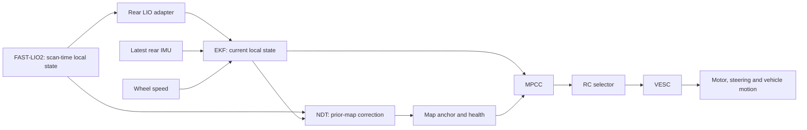

# System latency: measurement, estimation, control and vehicle response

**English** · [简体中文](system-latency.zh-CN.md) · [Documentation](README.md)

Reviewed **2026-10-15** against main source `098976b9` on the host and NX. This guide consolidates existing evidence; it changes no controller, filter, timing parameter or acquisition policy. Launch overrides and an immutable solver bundle can differ from source defaults: record the actual run configuration.

This guide maintains timestamp conventions, software timing and MPCC command-delivery statistics. [Vehicle response](vehicle-response.md) maintains actuator-response measurements, `D`/`τ` identification and controller-model assumptions.

## Contents

1. [Which “delay” are we discussing?](#1-which-delay-are-we-discussing)
2. [The parallel system and its rates](#2-the-parallel-system-and-its-rates)
3. [Timestamp and clock contracts](#3-timestamp-and-clock-contracts)
4. [FAST-LIO2, rear adapters and NDT](#4-fast-lio2-rear-adapters-and-ndt)
5. [EKF computation versus response lag](#5-ekf-computation-versus-response-lag)
6. [MPCC snapshot to command](#6-mpcc-snapshot-to-command)
7. [Selector, serial link and actuator response](#7-selector-serial-link-and-actuator-response)
8. [Acceleration observation](#8-acceleration-observation)
9. [Lessons from A2RL and Formula Student teams](#9-lessons-from-a2rl-and-formula-student-teams)
10. [Combining delays without double counting](#10-combining-delays-without-double-counting)
11. [A reproducible measurement contract](#11-a-reproducible-measurement-contract)
12. [Remaining measurements and investigation order](#12-remaining-measurements-and-investigation-order)
13. [Evidence and source index](#13-evidence-and-source-index)

## 1. Which “delay” are we discussing?

| Quantity | Definition | Common confusion |
| --- | --- | --- |
| Acquisition span | Time covered by one sensor measurement, e.g. a LiDAR scan | A scan is not an instantaneous observation of every point |
| Receipt age | Receipt time minus the observation's source timestamp, in comparable clock domains | Includes upstream work; not just the receiving callback's execution |
| Computation duration | End minus start of a particular operation, using a monotonic clock | Fast computation can still consume stale inputs |
| Queue/scheduling wait | Ready input or result waiting for a worker, lock, timer or transport | A publication period is not a guaranteed latency bound |
| State response lag | Phase/shape shift of an estimated signal relative to a reference | A newly stamped EKF state may still respond slowly to changing speed |
| Observable onset interval | Selected command boundary to a feedback change exceeding the detector threshold | Includes threshold, sampling and feedback-chain effects; not directly pure delay |
| Pure actuator delay `D` | Waiting before response in the selected dynamic model | Identify together with response buildup; publication does not prove physical execution |
| Response time constant `τ` | Response buildup after onset, in a chosen model | It is not another interval of complete inactivity |
| Jitter and tail delay | Variation, upper quantiles and observed outliers | A small average or P95 does not describe every callback |

P95 is a sample percentile: approximately 95% of recorded values are at or below it. It is neither a maximum nor a guaranteed bound. Report sample counts, the percentile method and excluded events.

## 2. The parallel system and its rates

NDT constrains `map → odom`; local EKF owns `odom → base_link`. MPCC uses local state and map alignment together. **Every EKF update and MPCC request does not wait for a new NDT alignment.** Conversely, an old global anchor can affect reference association while the local motion state remains current. See [architecture](architecture.md).

| Current source setting | Nominal period | What it actually means |
| --- | ---: | --- |
| Livox LiDAR, 10 Hz | 100 ms | Scan production cadence; not LIO computation time |
| EKF, 200 Hz | 5 ms | Requested output/prediction cadence, subject to scheduling |
| MPCC request cap, 20 Hz | 50 ms | Latest qualified snapshot is selected for each request |
| MPCC command timer, 50 Hz | 20 ms | Existing plan sampled between optimizations |
| MPCC handover lead | 20 ms | Forecast/takeover scheduling, not identified actuator dead time |
| RC selector, 100 Hz | 10 ms | Current forwarded `/vesc/command` cadence |
| VESC state/IMU polling, 100 Hz | 10 ms | Host request cadence, not a hardware sampling timestamp |
| NDT pose/TF timer, 50 Hz | 20 ms | Held correction publication; not 50 Hz registration |

These are source/configuration facts, not measured worst-case timing. The state-age and command watchdog limits are expiration rules, not waiting periods. For example, the current monitor allows anchor age up to 1 s, but that does not impose a 1 s localization delay. NDT's own maximum admitted source age is separately configured at 0.5 s. Check both layers and any overrides.

## 3. Timestamp and clock contracts

Use ROS/source time for sensor alignment and a monotonic clock for execution durations. Never directly subtract a UNIX/ROS timestamp from a monotonic timestamp. The controller maps ROS state age into its steady-clock history; retain the mapping and reset/clock epoch when joining records.

| Topic or record | Timestamp meaning / limitation |
| --- | --- |
| `/fastlio2/lio_odom`, `/fastlio2/body_cloud` | FAST-LIO2 uses the computed scan-end time, derived from the incoming header and point offsets |
| `/rear_axle/lio_odom` | Retains the LIO observation epoch; adapter waits for measured IMU coverage at that epoch |
| `/rear_axle/imu` | Retains the current input IMU stamp; does not wait for LIO or publish a predicted orientation |
| `/odometry/filtered` | Current EKF estimate epoch with `predict_to_current_time`; not the age of every contributing LIO measurement |
| `/sensors/core` | Driver sets the header to host `now()` when handling a Values packet; actual firmware sampling/averaging time is not carried in that header |
| `/vesc/command` | Selector sets a fresh forwarding stamp; upstream request/plan ancestry must be logged separately |
| NDT TF plus trusted anchor | TF publication stamp and last accepted observation stamp serve different purposes |
| Bag receive timestamp | Recorder-side receipt; cannot isolate middleware, callback wait and publisher computation by itself |
| MPCC `runtime.csv` | Steady-clock request/compute/delivery/activation/publication records with sequence and mapped source epoch |

Livox clock behavior also depends on its time-synchronization setup. Without PTP/GPS synchronization, the driver may use host packet-processing time; do not assume every incoming header is an independent hardware acquisition timestamp. Check the recorded setup and FAST-LIO threading notes（recorded workspace path：`src/FASTLIO2_ROS2/fastlio2/THREADING.md`）.

For example, a scan-time state for **10.000 s** may arrive at **10.170 s**. Rear odometry still represents 10.000 s, using measured IMU information at that time. EKF handles the delayed update and can produce a current estimate. The rear adapter does not turn the old LIO pose into a new observation by changing its timestamp. Current rear IMU remains a separate stream.

### Sensor-relative timing: the adopted measurement reference

Use **Livox IMU sample epochs and LiDAR scan-end epochs** as two reference streams. This is a measurement convention, not an instruction to overwrite other messages' timestamps or change the estimator. Keep the original device clock, ROS timestamp, host receipt time and sequence/scan identity wherever available.

| Reference | Definition | What it anchors |
| --- | --- | --- |
| `t_I(j)` | Source epoch of IMU sample `j` | IMU receipt/adapter/observer handling and updates consuming this sample |
| `t_C(k)` | Source end epoch of scan `k`, retaining start and per-point offsets | LIO, rear odometry and NDT events associated with that scan |
| `t_E` | Epoch represented by an EKF estimate | Prediction/estimate validity; retained alongside its contributing observation epochs |
| `t_U` | Identified command's publication/write epoch | Command delivery and subsequent physical response |

For a mapped host event `t_X`, report `A_I = t_X − t_I(j)` or `A_C = t_X − t_C(k)` only for the associated sample/scan. Also report local execution `T_compute = steady_end − steady_begin`. Source-relative age includes input delivery and waiting; it is not pure computation. A point cloud covers a scan interval: using its end epoch does not make all points simultaneous or remove acquisition time.

For example, scan `10.000 s → LIO publication 10.170 s → rear publication 10.172 s → EKF publication 10.178 s` gives scan-relative spans of 170, 172 and 178 ms **if this update actually consumed that scan**. They are cumulative spans; do not sum them. These are illustrative timestamps, not additional measurements. The EKF may already have incorporated newer IMU/wheel samples and represent the current epoch. Retain latest consumed IMU, wheel and LIO epochs separately; the stamp on `/odometry/filtered` cannot recover this ancestry. MPCC likewise needs the selected state/request/plan identity. Where lineage is not logged, mark a relationship unknown rather than choosing a nearby scan automatically.

### Future motion-capture comparison

Motion capture adds an independent physical reference. Before claiming sensor delay, map sensor, NX and capture clocks onto a common time axis, including offset, drift, resets and residual synchronization uncertainty. A local approximation `t_common = a·t_device + b` separates clock scale/drift from offset; a fitted signal shift alone can confound clock error with physical or filtering delay. Prefer available hardware synchronization/PTP and verify synchronization status; the particular capture system's capabilities are still unknown. [Livox's synchronization guide](https://github.com/Livox-SDK/livox_wiki_en/blob/master/source/tutorials/new_product/common/time_sync.rst) describes checking the active synchronization mode.

Record both capture/exposure epochs and host receipt. Capture processing/network latency must also be measured; capture receipt is not the physical event time. For example, supported OptiTrack/NatNet configurations expose camera, processing and transmission timestamps; this is an example to check against the installed system, not an assumption about our equipment. See [OptiTrack's latency definitions](https://docs.optitrack.com/v3.3/developer-tools/natnet-sdk/latency-measurements).

The comparisons answer different questions:

- **IMU versus capture:** compare angular velocity with differentiated capture orientation; compare accelerometer specific force with capture-derived acceleration at the IMU location, including frame alignment, gravity and lever-arm effects. Document differentiation/filter bandwidth and its own phase effects.
- **LIO versus capture:** compare poses at their stated epochs, then separately assess delivery age and temporal tracking mismatch. This measures the complete LIO estimate, not raw LiDAR hardware latency.
- **Raw cloud versus capture:** requires point times plus a defined geometric/motion reference and extrinsics. A cloud has no direct pose curve to cross-correlate. Scan integration, deskew and registration must be separated from device delivery.
- **Command versus capture:** measure actual motion after the identified command, separating electrical/actuator response from the estimator's response.

Static data establish noise and timestamp/receipt behavior, but cannot identify motion-response lag. Use varied repeatable motion when the capture experiment is arranged; account for occlusion, periodic-signal ambiguity and reference differentiation noise. Until clock/signal processing is calibrated, report **relative temporal mismatch**, not an independently identified sensor delay.

## 4. FAST-LIO2, rear adapters and NDT

### FAST-LIO2

The relevant stages are sensor/driver delivery → receive callback → scan queue → cloud conversion/sorting → IMU coverage wait → deskew/filter/map computation → odometry publication → subscriber receipt. `print_time_cost` times the core `MapBuilder::process()` only. It excludes several of those stages.

Current source has one long-lived worker and separate receive callbacks. The bounded scan queue can evict old pending candidates; IMU history across skipped scans is preserved. Core processing, OpenMP matching and map work still consume CPU. A thread removes a particular callback bottleneck; it does not establish a fixed deadline or eliminate sustained overload. Application queue capacity is also not the entire DDS/in-flight queue.

The 2026-10-10 field review reports LIO bag-receipt source-age P95 of approximately **190 / 206 / 165 ms** for the late v26/v35A/v35B runs. These are dated source-age measurements, **not 190–206 ms core solver timings or measurements of today's static vehicle**. The older 2026-10-04 incident reached roughly 1.2 s of LIO delay. See [field review](reports/2026-10-10-mpcc-field-review.md), [delay incident](reports/2026-10-04-lio-delay.md), and [worker evidence](reports/2026-10-05-fastlio-thread.md).

### Rear adapters

LIO rear-axle conversion may wait for measured angular-rate coverage at the LIO source time. That wait and the conversion are separate from LIO's own computation. The current IMU rear adapter rotates/scales specific force and applies its lever-arm processing without LIO attitude propagation. Its output orientation is unavailable, not a current orientation estimate. Neither adapter owns navigation prediction. See [source-time contract](reports/2026-10-11-rear-imu-source-time.md).

### NDT

Separate registration `align()` time, full scan handling, accepted-anchor source age, and TF delivery gaps. Current settings use a fixed map target with local cropping disabled and two NDT threads.

| NX 1× replay, fixed target, 2026-10-05 | A | B |
| --- | ---: | ---: |
| `align()` P95 | 53.19 ms | 79.63 ms |
| Full processing P95 | 60.04 ms | 321.01 ms |
| Maximum received map/odom TF gap | 25.74 ms | 24.33 ms |

B's poor-overlap section remained problematic. Full processing included additional preparation, scoring and handoff; the residual was not a separately measured fitness cost. Continued TF delivery did not prove a new match or correct global localization. Startup target warm-up also belongs to startup accounting, rather than every running scan. See [target audit and limitations](reports/2026-10-05-ndt-target-audit.md).

## 5. EKF computation versus response lag

The [2026-10-14 position and heading test](reports/2026-10-14-ekf-component-latency.md) adds current-config NX replays and comparisons with recorded V35 runs. Its primary checks are pose alignment against shared LIO input and short-time wheel/gyro motion consistency. Gyro-reference drift prevents an independently identified physical pose delay; motion capture remains necessary. Speed/rate fits provide auxiliary diagnosis. Exact results, reference checks and limits are maintained in that report.

Vehicle steering identification now targets IMU gyro-z to avoid absorbing EKF yaw-rate response into vehicle parameters; see the [2026-10-14 IMU steering report](reports/2026-10-14-imu-steering-model.md). Whole-curve best shifts from different runs are not universal fixed dead time. The six-state MPCC does not initialize an independent prediction state from EKF yaw rate; its fitted rate shift must not be assigned directly to yaw or takeover lead time.

The [Oct 15 covariance/FIR follow-up](reports/2026-10-15-estimator-replay-comparison.md) found no response gain from changing only LIO vx variance 0.04→0.01 on 38 calibration events (candidate/baseline vx differences about 0.0012 m/s RMS). The causal five-tap FIR adds about 10 ms coefficient-weighted sample age and improves smoothing without consistent forecast benefit. Neither result is a physical actuator-delay measurement.

Three different questions must have separate answers:

1. **How long does EKF work take?** Measure actual prediction/correction/history replay and publication wall durations. We do not yet have a clean, production, full-stack EKF compute P95 in the existing evidence.
2. **How old is the output when consumed?** Measure source/receipt ages. An earlier field record had output message-age P95 around 2.9 ms; this is not EKF computation duration.
3. **How quickly does the estimated speed follow changing wheel speed?** Compare signal response on a common source-time grid. This can lag even with fast computation and current timestamps.

The actual EKF replay experiment changed only `Q(vx)` from 0.025 to 0.4:

| Dated data segment | Original relative wheel-speed lag | Deployed candidate replay |
| --- | ---: | ---: |
| 2026-10-05 manual | 125 ms | 45 ms |
| 2026-10-05 automatic | 110 ms | 40 ms |
| Independent 2026-09-28 segment | 135 ms | 45 ms |

These are fitted relative phase shifts, not fixed pure delays or true-ground-speed latency. The installed replay differed by about 10 ms from initial manual screening. Faster response came with reduced smoothing. The metric used a 10 ms source-time grid, 5 ms lag search and moving wheel speeds above 0.35 m/s. See [EKF investigation](reports/2026-10-06-ekf-speed-response.md).

Current configuration requests 200 Hz, `smooth_lagged_data: true`, `history_length: 2.0`, `predict_to_current_time: true`, and `Q(vx)=0.4`. A 2 s history is stored coverage, not a deliberate 2 s wait. Delayed observations are handled at their old epochs and newer data replayed. More history can increase replay work when observations arrive late. Prediction helps time alignment but cannot guarantee that unobserved motion is predicted accurately. The [robot_localization parameter documentation](https://github.com/cra-ros-pkg/robot_localization/blob/3.5.4/doc/state_estimation_nodes.rst) defines these settings.

## 6. MPCC snapshot to command

**Interface boundary:** the 2026-10-10 bags below used `/ackermann_cmd` and a 200 Hz selector. Today's native `/vesc/command` selector is configured at 100 Hz. These are historical interface measurements; the current chain still needs equivalent measurement.

A saved reference is prepared offline. Online MPCC repeatedly optimizes the next **15 × 0.1 s = 1.5 s** of motion; it does not optimize the entire lap on each request. The prediction horizon is a future time interval, not computation time. Bundle generation/build and startup are also separate from a running control cycle.

The running chain is: **latest EKF/map conditions → request snapshot and motion prediction → acados solve and candidate checks → result delivery → scheduled takeover and execution checks → `/drive` → RC selector → `/vesc/command`**.

The two V35 NX field runs on 2026-10-10 ran FAST-LIO2, EKF and NDT concurrently. Rejoining the original logs by request sequence gives:

| Timing interval, P95 | V35 run A | V35 run B |
| --- | ---: | ---: |
| Native solver calls | 2.32 ms | 1.36 ms |
| Request snapshot → candidate delivery | 4.00 ms | 2.66 ms |
| Request snapshot → first `/drive` using the accepted new plan | 39.51 ms | 39.75 ms |
| Request snapshot → first matching `/ackermann_cmd` | 44.28 ms | 44.33 ms |
| EKF source timestamp → first matching `/ackermann_cmd` | 50.29 ms | 46.62 ms |

Request-to-candidate statistics cover **635 / 457 requests**. First-plan `/drive` statistics cover **531 / 442 accepted takeovers**. The `/ackermann_cmd` chains cover **428 / 427 unambiguously matched nonzero first commands**, excluding zero, repeated or ambiguous wire commands. Their EKF-source-to-command medians are **40.56 / 40.40 ms**, with observed maxima **55.67 / 60.81 ms**. These are observed samples, not guaranteed worst-case bounds; none of the 635 / 457 requests exceeded the configured delivery deadline.

Why does a few milliseconds of computation become tens of milliseconds of delivery? A request forecasts takeover at `submitted + 20 ms`; after that time, the next 20 ms output tick performs takeover checks and publishes the command. Computation overlaps the lead time, so **solver time + 20 ms + 20 ms is not a valid fixed sum**. The RC selector then forwards at a configured 200 Hz. For changed nonzero wire commands, measured `/drive`-to-`/ackermann_cmd` median delay was **5.13 / 4.98 ms**, P95 **6.31 / 6.03 ms**, across **1,094 / 1,100 matched pairs**. Independent stage percentiles cannot be added to obtain an end-to-end percentile.

The **50 ms `solver_timeout`** limits request-to-candidate delivery. It does not bound EKF-source-to-command delivery, receipt of an arbitrary new sensor sample, or physical vehicle response. Optimization requests are capped at 20 Hz: a newly arriving condition can wait for the next request, while existing plans continue producing commands at 50 Hz. The request always takes the latest qualified snapshot; the measurements above do not time every arriving input through a new solve.

Reproduction uses the original `controller/runtime.csv` files under the NX sessions `192955_v35_n15_accel1_cap4_lap01` and `193524_v35_n15_accel1_cap4_lap02`. Join `request`, accepted `activation`, and first `publish` on `sequence`; subtract `submitted` or `source_epoch` from that publication's `steady_s`. Match the recorded `/drive` and `/ackermann_cmd` by unique float32 wire speed/steering and message timestamps. The selector clears acceleration metadata in speed mode, so that field is not a matching key. Local analysis is retained under `/home/elesheep/aimsracer-data/sessions/2026-10-11/mpcc-command-latency/`; original data locations are documented in the [field review](reports/2026-10-10-mpcc-field-review.md).

**The endpoint here is command publication.** Driver/serial transport and the motor, servo and chassis response require separate measurements; `/ackermann_cmd` publication is not physical motion onset. EKF source age also does not account for the full age of every upstream LIO measurement.

Scheduling overlaps computation. Approximately,

\[
t_{\rm first\ drive}=\operatorname{next\ eligible\ output\ tick}
\bigl(\max(t_{\rm delivered},t_{\rm forecast})\bigr).
\]

Execution checks and scheduler contention can add time; plan expiry is separate from solver execution time. Source paths are [runtime node](../src/aims_mpcc_rt/src/node.cpp), [history propagation](../src/aims_mpcc_rt/include/aims_mpcc_rt/history.hpp), and [model generation](../src/controller/aims_mpcc/backend_models.py).

Latest request/delivery/activation timing is in the [Oct 15 multilap report](reports/2026-10-15-mpcc-multilap-review.md): 3,564 requests, delivery P95 2.159 ms and successful-activation P95 39.374 ms, with different endpoints and denominators. The [native-node migration](reports/2026-10-15-native-state-nodes.md) reports software parity, not a new end-to-end latency benchmark.

## 7. Selector, serial link and actuator response

### Electronic delivery

Current selector output is 100 Hz; the VESC serial configuration is 921600 baud with 100 Hz state/IMU polling. Commands can wait for DDS delivery, callback scheduling and the driver's serial-write mutex. Firmware processing/current or speed-loop update adds another interval. Serial write completion does not prove mechanical response.

At 8N1, `10 × bytes / baud` is a nominal UART serialization estimate only. It excludes USB buffering, host scheduling, queued packets and firmware execution. The system has no motor/servo execution acknowledgment topic. `/sensors/servo_position_command` is a command echo, not a measured wheel angle. See [native command contract](vesc-command.md) and driver stamping（recorded workspace path：`src/vesc/vesc_driver/src/vesc_driver.cpp`）.

The 100 ms command watchdog is an expiration limit, not a 100 ms processing delay. A fresh selector header likewise does not reveal how old the plan or original sensor condition was.

### Physical response

Command delivery ends at the selected publication/write boundary; the vehicle then responds through its electrical and mechanical dynamics. The physical onset depends on the detector and reference signal.

The response tables and fitting assumptions are maintained in [Vehicle response: recorded measurements](vehicle-response.md#what-the-recorded-measurements-support). The definitions and identification model for pure delay `D` and response constant `τ` are in [Pure delay and response constant](vehicle-response.md#pure-delay-response-constant-and-estimation-lag). Use those identified dynamics when evaluating a complete sensing-to-motion chain, accounting for the measurement conditions and any effects already included in a lumped fit.

The two 2026-10-13 calibration runs measured observable onset from publication of the new `/vesc/command` interface to driver receipt of raw RPM feedback. See [speed-command, RPM and IMU response](vehicle-response.md#2026-10-13-longitudinal-response) for the detector and results. This includes delivery, control/mechanical response and feedback transport; it does not replace UART-send or firmware-sampling timing, or decompose the complete `/drive → motion` chain.

## 8. Acceleration observation

The optional wheel + IMU observer is separate from navigation EKF. It estimates `d(body_vx)/dt`, not simply gravity-subtracted IMU acceleration, and introduces its own causal signal dynamics and event-replay costs.

In the 2026-10-12 **isolated installed NX DDS replay**, output averaged 199.84 Hz; instrumented IMU callback P95/max were **0.850/20.094 ms**, output interval P95/max **10.997/27.727 ms**, and latest IMU-source-to-estimate P95/max **14.421/36.816 ms**. Oracle/assertion overhead is included; these are not clean production callback costs or a full-stack field benchmark. See [runtime evidence](reports/2026-10-12-longitudinal-acc-runtime.md).

The held-out wheel + IMU observer's acceleration-onset medians were **−10/+5 ms**, while braking-onset medians were **+45/+55 ms**, relative to a **noncausal smoothed wheel-derived proxy**. Negative lag does not mean predicting a physical event before it happens. These signal-detection metrics are different from the DDS ages above. Thresholds, persistence, misses and reference construction are in [observer comparison](reports/2026-10-12-longitudinal-acc-observer.md).

Future current/acceleration feedback should account for actual Iq feedback age, the observer's response and any extra filtering. Passing acceleration through another filter can add lag; its effect needs measurement rather than assuming more smoothing is free.

The separate [pre-KF IMU/wheel comparison from 2026-10-13](vehicle-response.md#2026-10-13-longitudinal-response) measures main-waveform correlation alignment. It differs from the filtered-estimate onset lag above and cannot be added to threshold-based command-to-RPM onset. Specific force includes changing gravity projection and turning coupling, while differentiated wheel speed is an offline reference.

The 2026-10-14 [matched command-to-IMU/RPM onset follow-up](vehicle-response.md#matched-command-onset) now compares stationary launches, moving acceleration and deceleration using the same commands, receipt convention and persistence duration. It retains threshold sensitivity, misses and command-before triggers. Acceleration ordering changes with detection strength; neither discernible onset nor whole-waveform shift establishes independent IMU hardware delay.

## 9. Lessons from A2RL and Formula Student teams

These are published design practices, not claims that every leading team uses identical models or that their timing numbers transfer to NX.

| Primary source | Published consideration | Application here — engineering recommendation |
| --- | --- | --- |
| [TUM A2RL system, 2026, §2.1.2](https://arxiv.org/html/2602.08571v1) | Sensor synchronization and filter history compensate preprocessing/registration delay | Preserve scan epochs; handle old observations in the estimator, separately from current-state prediction |
| [AMZ/ETH full system, 2019, §4.2 and §7](https://arxiv.org/pdf/1905.05150) | Asynchronous sensing, observation/pose delay handling and full-pipeline delays; identifies latency as a performance bottleneck | Measure complete chains and load, rather than judging modules solely by update rates |
| [KIT/KA-RaceIng FSG stack, 2022, §IV-A and simulation](https://arxiv.org/pdf/2210.10933) | Identified second-order steering dynamics enter MPC; actuator delay is represented in simulation | Compare identified effective steering dynamics before choosing one `τ`, separate dead time, or a richer model |
| [Tobias Betz/TUM dissertation, 2025, §4.1 and §4.5](https://mediatum.ub.tum.de/doc/1785218/1785218.pdf) | End-to-end chains, trace points, scenario-dependent load and container/executor architecture | Trace both callback execution and waiting across node boundaries under the full localization/control workload |

The KIT model's damping-ratio symbol is not our pure-delay `D`; a PT2 lag model is not automatically a pure transport delay. Team architectures use different sensors, actuators and vehicles. Borrow their separation of timing problems and validation methods, then identify this car's values.

## 10. Combining delays without double counting

For causally matched events on one serial path, compute `t_end − t_start`. Local computation, waiting and transport intervals can then explain that same span. The system also contains parallel branches, periodic latest-value sampling and overlapping forecast work; a simple sum of module durations does not generally describe it.

Avoid these specific mistakes:

- Summing unrelated stage P95 values and calling the result end-to-end P95.
- Adding old actuator-response measurements to new command-delivery measurements and presenting a newly measured total.
- Adding a pure steering delay to the existing lumped 0.08 s model without refitting both.
- Adding EKF signal lag to EKF message age as though both were independent pure dead times.
- Treating the history length, watchdog, plan TTL, prediction horizon or TF timer period as an imposed delay.
- Counting the entire NDT runtime in every local control cycle.

For intuition only, stale constant-speed motion over `Δt` gives `Δs≈vΔt`; 50 ms corresponds to 0.125 m at 2.5 m/s and 0.25 m at 5 m/s. Yaw uncertainty similarly scales as `Δψ≈rΔt`. These are sensitivity calculations, not measured tracking errors. Prediction can reduce the effect; its residual error must still be assessed.

In frequency terms, pure delay contributes phase `−ωD`; a first-order lag contributes `−atan(ωτ)`. Aggressive feedback cannot make those phases disappear. This explains why raising weights or gains may expose oscillation when the state/actuator model is late.

## 11. A reproducible measurement contract

For each run, retain configuration/bundle hashes, software revisions, PID/firmware settings, voltage/load conditions, enabled recording/RViz, clock synchronization, CPU clocks/temperature, and simultaneous processes.

| Chain | Required event endpoints |
| --- | --- |
| LIO | Source scan start/end, host receipt, worker claim, IMU ready, core begin/end, odometry publication/receipt, queue/eviction counts |
| EKF | Each observation's source/receipt, prediction/correction/history-replay begin/end, output stamp/publication/receipt |
| NDT | Cloud epoch, registration begin/end, full-handler begin/end, accepted anchor epoch/sequence, TF publication/receipt |
| MPCC | EKF source/receipt, request sequence/submission, forecast epoch, native solve, candidate delivery, activation, first selected command |
| VESC/vehicle | Driver command receipt/write, firmware acceptance if available, feedback receipt, actual Iq/ERPM, defined acceleration/yaw onset |
| Acceleration observer | Wheel/IMU source/receipt, replay work, estimate epoch/publication/receipt, defined signal-response events |

Some endpoints already exist; others require future instrumentation. Absence of firmware timestamps or wheel-angle sensing must remain explicit, rather than assigning their delay to zero.

Use command/request lineage where available. For old bags without sequence IDs, retain the existing unique nonzero float32 speed/steering matching and exclude ambiguous/repeated matches; report exclusions. Threshold-based response onset must specify baseline, threshold, filtering, persistence and sampling resolution. Cross-correlation/shift fits must specify grid, search interval and gain/bias handling.

Report P50/P95/P99/max, sample count, drops, missed events and deadline exceedances per stage and for directly paired end-to-end chains. Separate startup, steady motion, turns, acceleration, braking and map failures. Millisecond spikes are invisible in one-second CPU logs. Latest-value sampling can discard intermediate observations; measure that separately from processing every message.

Current tools: MPCC `runtime.csv`, FAST-LIO `timing_trace_path`, [recording](operations/recording.md), and the official [ros2_tracing](https://github.com/ros2/ros2_tracing) framework. ROS callback traces alone still do not establish firmware or mechanical execution time. Callback groups/executor scheduling affect concurrency; see [ROS 2 executor documentation](https://docs.ros.org/en/humble/Concepts/Intermediate/About-Executors.html).

## 12. Remaining measurements and investigation order

1. **Clock/source provenance:** verify Livox acquisition stamping and distinguish host VESC receipt stamps from hardware sampling. Otherwise apparent queue/filter delays may include clock error.
2. **Current native command chain:** the two constant-speed calibration runs now provide observable `/vesc/command → RPM feedback` onset. Complete event correspondence and stage decomposition for `/drive → /vesc/command → serial → motion` with the current 100 Hz selector. Existing September/October legacy results are useful priors, not replacement acceptance.
3. **EKF execution tails under full load:** time replay/correction work separately from message age and relative speed lag.
4. **Remaining LIO source age:** use queue/coverage/core/publication tracing to locate waiting; count drops and preserve complete IMU history.
5. **Actuator models across operating conditions:** distinguish longitudinal PID dynamics, braking and steering effective dynamics; retain actual Iq and voltage. Direct steering-angle feedback would resolve a currently unmeasured mechanical boundary.
6. **Acceleration signal dynamics under field load:** compare source age and onset/forecast quality; do not infer control delay solely from isolated callback time.
7. **Combined-tail behavior:** check the actual FAST-LIO2 + EKF + NDT + controller workload with recording/RViz as used. Include scheduling jitter, locks and thermal behavior; test changes one at a time.

This order is a measurement proposal, not a parameter change or a new set of runtime gates. Compensation belongs where each delay occurs: source-time/history treatment in estimation, forecast/history in controller scheduling, identified response dynamics in vehicle prediction, and timestamped feedback for downstream observation.

## 13. Evidence and source index

| Reference | Use |
| --- | --- |
| [Vehicle response guide](vehicle-response.md) | Actuator-response fits, current model assumptions and physical-response evidence |
| [2026-09-28 speed-mode calibration](reports/2026-09-28-speed-mode-calibration.md) | Command-to-speed/IMU onset and source-time methods |
| [2026-09-28 vehicle response](reports/2026-09-28-vehicle-response.md) | Steering/yaw identification and regime limits |
| [2026-10-06 EKF response](reports/2026-10-06-ekf-speed-response.md) | Actual ROS replay and Q(vx) comparison |
| [2026-10-10 field review](reports/2026-10-10-mpcc-field-review.md) | Joint workload, source ages, solver results and physical run context |
| [2026-10-05 NDT audit](reports/2026-10-05-ndt-target-audit.md) | Registration versus full processing versus TF gaps |
| [2026-10-12 observer comparison](reports/2026-10-12-longitudinal-acc-observer.md) / [runtime](reports/2026-10-12-longitudinal-acc-runtime.md) | Signal lag versus instrumented DDS/runtime ages |
| [EKF YAML](../src/aims_racer_system/params/ekf_rear.yaml), [NDT YAML](../src/aims_racer_system/params/ndt_fastlio.yaml), [localization policy](../src/aims_racer_system/params/localization_monitor.yaml) | Current source settings; check actual run overrides |

Historical bags may have moved to the SHA-verified host archive: read each report's storage update. Raw bags and local measurement outputs are external data, not guaranteed fresh-checkout assets. Public papers are primary references linked in §9; no external team's measured delay is used as this vehicle's parameter.
