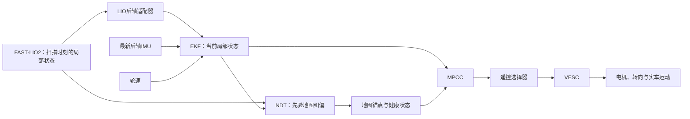

# 系统延迟：测量、状态估计、控制与车辆响应

[English](system-latency.md) · **简体中文** · [文档索引](README.zh-CN.md)

核对日期：**2026-10-15**。依据主机与 NX 的 main 源码 `098976b9`，汇总现有证据；本次不修改控制器、滤波参数、调度或采集逻辑。启动覆盖参数和不可变 solver bundle 可能不同于源码默认值，分析时必须记录实际运行配置。

本指南统一维护时间戳约定、软件链路计时与 MPCC 命令交付统计；[车辆响应](vehicle-response.zh-CN.md)统一维护执行器响应实测、`D/τ` 辨识与控制器模型假设。

## 索引

1. [“延迟”究竟指什么](#definitions)
2. [并行链路与各自频率](#rates)
3. [时间戳与时钟约定](#timestamps)
4. [FAST-LIO2、后轴适配器与 NDT](#localization)
5. [EKF 计算耗时与额外响应滞后](#ekf)
6. [MPCC 从条件快照到命令](#mpcc)
7. [选择器、串口与车辆实际响应](#actuation)
8. [加速度观测的延迟](#acceleration)
9. [A2RL 与 Formula Student 强队的考虑](#teams)
10. [如何组合延迟而不重复计算](#budget)
11. [可复现的测量约定](#measurement)
12. [尚缺的测量与调查顺序](#next)
13. [证据与源码索引](#evidence)

## 1. “延迟”究竟指什么

| 指标 | 定义 | 容易混淆的地方 |
| --- | --- | --- |
| 采样覆盖时长 | 一条测量覆盖的时间，如一帧激光扫描 | 扫描内所有点并不是同时采到的 |
| 接收时的源年龄 | 可比较时钟下，接收时刻减测量源时间 | 包含上游工作，不只是接收回调耗时 |
| 计算耗时 | 用单调时钟测某项操作结束减开始 | 算得快，也可能在处理很旧的数据 |
| 排队与调度等待 | 输入/结果已经就绪，却仍等待线程、锁、定时器或传输 | 发布周期不是延迟的保证上限 |
| 状态响应滞后 | 估计曲线相对参考曲线的相位/形状偏移 | EKF 刚发的新消息也可能缓慢跟随速度变化 |
| 可观测起响应间隔 | 指定命令边界到超过检测阈值的反馈变化 | 含阈值、采样与反馈链路影响，不直接等于纯延迟 |
| 执行器纯延迟 `D` | 所选动态模型中，响应开始前的等待时间 | 需结合响应建立过程辨识；发布命令不等于实车已经执行 |
| 响应时间常数 `τ` | 响应开始后，选定模型中的建立速度 | 不是另一个“完全没有动作”的等待时间 |
| 抖动与长尾 | 延迟变化、较高分位数和异常峰值 | 平均值/P95 很小不代表每次都快 |

P95 是样本分位数：约 95% 的记录不超过该值。它不是最大值，也不是保证值。报告中应保留样本数、分位数方法和排除事件。

## 2. 并行链路与各自频率

NDT 约束 `map → odom`，局部 EKF 拥有 `odom → base_link`；MPCC 同时使用局部状态与地图对齐。**不是每次 EKF 更新、每次 MPCC 请求都要等待新 NDT 配准。** 但地图锚点过旧仍会影响参考轨迹关联，即使局部运动状态看起来很新。见 [系统架构](architecture.zh-CN.md)。

| 当前源码配置 | 标称周期 | 实际含义 |
| --- | ---: | --- |
| Livox 点云 10 Hz | 100 ms | 点云生产节奏，不是 LIO 计算耗时 |
| EKF 200 Hz | 5 ms | 请求的输出/预测节奏，仍受调度影响 |
| MPCC 请求上限 20 Hz | 50 ms | 每次请求选择最新合格快照 |
| MPCC 命令定时器 50 Hz | 20 ms | 两次优化之间持续从已有计划取命令 |
| MPCC 接管提前量 | 20 ms | 预测/接管调度，不是实测执行器纯延迟 |
| 遥控选择器 100 Hz | 10 ms | 当前 `/vesc/command` 转发节奏 |
| VESC 状态/IMU 轮询 100 Hz | 10 ms | 主机请求节奏，不等于设备采样时间戳 |
| NDT pose/TF 定时器 50 Hz | 20 ms | 保持的纠偏结果发布，不等于 50 Hz 配准 |

上述是源码/配置事实，不是实测最坏时间。新鲜度与 watchdog 是失效条件，不是等待时间。例如定位监控允许锚点年龄达到 1 s，并不表示主动延迟 1 s；NDT 自身允许接受的源年龄另有 0.5 s 设置。两个层次及启动覆盖参数要分别检查。

## 3. 时间戳与时钟约定

传感器对齐使用 ROS/源时间，计算耗时使用单调时钟。不能直接用 UNIX/ROS 时间戳减单调时钟。控制器把 ROS 状态年龄映射到 steady 历史时间；关联记录时要保留这个映射以及时钟重置/epoch。

| 话题或记录 | 时间戳含义与限制 |
| --- | --- |
| `/fastlio2/lio_odom`、`/fastlio2/body_cloud` | 当前代码使用输入 header 加点时间偏移得到的扫描结束时刻 |
| `/rear_axle/lio_odom` | 保留 LIO 观测时刻；等待该时刻的实测 IMU 覆盖 |
| `/rear_axle/imu` | 保留最新输入 IMU 的时间戳；不等待 LIO，不发布预测姿态 |
| `/odometry/filtered` | `predict_to_current_time` 后的当前估计时刻，不是所有上游 LIO 测量的年龄 |
| `/sensors/core` | 驱动处理 Values 包时用主机 `now()` 打戳；header 没有给出固件真正的采样/平均窗口时间 |
| `/vesc/command` | 选择器按当前转发时刻打戳；原始请求和计划的来源要另行记录 |
| NDT TF 与可信锚点 | TF 发布时间和上次接受的观测时间是两件事 |
| bag 接收时间 | 录包端接收时刻，无法单独区分中间件、回调排队和上游计算 |
| MPCC `runtime.csv` | 带请求序号、映射源时刻的 steady 请求/计算/交付/接管/发布记录 |

Livox 时间戳还取决于设备同步设置。没有 PTP/GPS 同步时，驱动可能使用主机处理数据包的时间；不能默认所有 header 都是独立硬件采样时间。应核对录包时设置与 FAST-LIO 线程说明（记录中的工作区路径：`src/FASTLIO2_ROS2/fastlio2/THREADING.md`）。

例如 **10.000 s** 的扫描状态在 **10.170 s** 才到达：后轴 LIO 仍表示 10.000 s，配合的是该时刻的实测 IMU 信息。EKF 可以处理迟到更新，再给出当前估计。后轴适配器不会修改时间戳，把旧 LIO 变成新观测。最新后轴 IMU 是另一条独立流。

### 采用的测量基准：相对雷达源时间

采用 **Livox IMU 逐样本时刻、点云扫描结束时刻** 两条基准。这是测量约定，不是要求重写其他消息时间戳或修改估计器。尽可能保留原始设备时钟、ROS时间戳、主机接收时间以及样本/扫描序号。

| 基准 | 定义 | 对应链路 |
| --- | --- | --- |
| `t_I(j)` | 第 `j` 条 IMU 的源时刻 | 消费该样本的接收、适配、观测器与估计更新 |
| `t_C(k)` | 第 `k` 帧扫描的源结束时刻，同时保留开始与逐点偏移 | 对应该扫描的 LIO、后轴里程计与 NDT 事件 |
| `t_E` | EKF 输出表示的状态时刻 | 状态预测有效时刻；另存参与更新的各观测源时刻 |
| `t_U` | 已识别命令的发布/串口写入时刻 | 指令交付及其后的实车响应 |

将主机事件 `t_X` 映射到可比较时钟后，对**有来源关联**的样本/扫描计算 `A_I = t_X − t_I(j)` 或 `A_C = t_X − t_C(k)`；局部纯计算仍用 `T_compute = steady_end − steady_begin`。相对源时刻的年龄包含输入传输与等待，不等于纯计算。点云覆盖一段扫描时间，采用结束时刻并不会让所有点同时采样，也不会消除扫描采集时长。

例如 `扫描10.000 s → LIO发布10.170 s → 后轴发布10.172 s → EKF发布10.178 s`，**若该次更新确实消费这帧扫描**，相对扫描的跨度分别为170、172、178 ms。这些是累计跨度，不能相加；仅作示意，并非新增实测。EKF可能已经融合更新的IMU/轮速，并表示当前状态，应分别保留最近消费的IMU、轮速、LIO时刻。仅凭 `/odometry/filtered` 的输出时间戳无法还原来源；MPCC同样需要状态、请求与计划的对应关系。缺少记录时标为未知，不自动匹配一帧时间上最近的点云。

### 后续动捕对照

动捕提供独立的物理运动参考。宣称雷达延迟前，先将雷达、NX和动捕时钟映射到共同时间轴，核对固定偏移、时钟漂移、重置及剩余同步误差。局部可写 `t_common = a·t_device + b`，分别处理时钟比例/漂移与偏移。仅靠曲线拟合出的时间平移，会混合时钟误差、真实响应与滤波滞后。优先使用设备支持的硬件同步/PTP并验证锁定状态；目前尚不明确动捕设备的具体能力。[Livox同步说明](https://github.com/Livox-SDK/livox_wiki_en/blob/master/source/tutorials/new_product/common/time_sync.rst)说明了如何检查实际同步模式。

同时保存动捕曝光/采样时刻与主机接收时刻；动捕自己的处理和网络延迟也要测，不能把接收时间视为真实动作时间。例如部分OptiTrack/NatNet配置能提供相机、处理和发送边界时间戳；这只是待核对的设备能力示例，不假设本场地一定具备，见[官方延迟定义](https://docs.optitrack.com/v3.3/developer-tools/natnet-sdk/latency-measurements)。

不同对照回答不同问题：

- **IMU与动捕：** 陀螺仪对照动捕姿态差分的角速度；加速度计比力对照IMU安装点的动捕加速度，处理坐标外参、重力与杠杆臂。说明差分/滤波带宽及其相位影响。
- **LIO与动捕：** 先按各自表示的时刻比较位姿，再分别评估交付年龄和运动跟随的时间偏差。结果反映整条LIO估计链，不能直接称为原始雷达硬件延迟。
- **原始点云与动捕：** 需要逐点时间、明确的几何/运动参考及外参。点云没有可以直接做互相关的位姿曲线；扫描积分、去畸变、配准要与设备交付分开。
- **命令与动捕：** 对已识别指令测真实运动响应，区分电气/执行器响应与估计器的响应。

静止数据能评估噪声与时间戳/接收行为，但不能辨识运动响应滞后。安排动捕实验后，用可重复且有变化的运动，处理遮挡、周期信号多解与参考差分噪声。时钟和信号处理未标定前，结论应称为**相对时间偏差**，不能宣称已经独立测出了传感器延迟。

## 4. FAST-LIO2、后轴适配器与 NDT

### FAST-LIO2

要分开看：传感器/驱动交付 → 接收回调 → 扫描排队 → 点云转换/排序 → 等待 IMU 覆盖 → 去畸变/滤波/地图计算 → 里程计发布 → 下游接收。`print_time_cost` 只测核心 `MapBuilder::process()`，不包含整个过程。

当前代码采用长期工作线程和独立接收回调；有界扫描队列可以淘汰旧候选，同时保留跨跳帧的 IMU 历史。核心计算、OpenMP 匹配、地图维护仍消耗算力。线程能消除特定回调阻塞，但不能保证固定截止时间，也不能消除持续过载。应用队列容量也不等于全部 DDS/在途消息量。

2026-10-10 后期 v26/v35A/v35B 三轮，LIO 到 bag 接收时的源年龄 P95 约 **190 / 206 / 165 ms**。这是旧日期的源年龄实测，**不是核心求解耗时，也不是今天静止实车的新结果**。2026-10-04 的旧故障曾达到约 1.2 s。见 [外场复盘](reports/2026-10-10-mpcc-field-review.md)、[延迟事件](reports/2026-10-04-lio-delay.md)、[线程验证](reports/2026-10-05-fastlio-thread.md)。

### 后轴适配器

LIO 后轴转换可能等待 LIO 源时刻的实测角速度覆盖；这个等待和坐标转换应单独计时。当前实时 IMU 适配器转换/缩放比力并处理安装杠杆臂，不使用 LIO 姿态传播。输出 orientation 标记不可用，而不是一个当前姿态估计。两个适配器都不承担导航预测。见 [源时间契约](reports/2026-10-11-rear-imu-source-time.md)。

### NDT

必须区分 `align()` 配准耗时、整帧处理耗时、可信锚点源年龄、TF 接收间隔。当前采用固定地图 target，关闭运行期局部裁剪，NDT 使用两个线程。

| 2026-10-05 NX 1×回放，固定 target | A | B |
| --- | ---: | ---: |
| `align()` P95 | 53.19 ms | 79.63 ms |
| 完整处理 P95 | 60.04 ms | 321.01 ms |
| map/odom TF 最大接收间隔 | 25.74 ms | 24.33 ms |

B 的低重叠区仍有问题。完整处理包含准备、评分及交付等工作；不能把相减后的残差全部称为单独测出的 fitness 耗时。TF 持续发布既不证明有新配准，也不证明全局定位正确。target 预热属于启动阶段，不应计为每帧运行成本。见 [地图 target 审计与限制](reports/2026-10-05-ndt-target-audit.md)。

## 5. EKF 计算耗时与额外响应滞后

[2026-10-14位置与航向测试](reports/2026-10-14-ekf-component-latency.zh-CN.md)新增当前配置的NX回放与原始V35录制对照，以位姿相对同源LIO的对齐、短时间轮速/gyro运动一致性为核心。gyro参考的漂移使真实位姿延迟尚不能独立辨识，仍需动捕；速度/角速度拟合作为辅助诊断。精确结果、参考检查与限定条件统一维护在该报告。

车辆转向辨识改以 IMU gyro-z 为目标，以免把 EKF yaw-rate 跟随滞后吸收到车辆参数；见[2026-10-14 IMU 转向报告](reports/2026-10-14-imu-steering-model.zh-CN.md)。不同跑圈的全曲线最佳平移量不是通用固定纯延迟。当前六维 MPCC 不以 EKF yaw rate 初始化独立预测状态；不能把角速度的拟合偏移直接加到 yaw 或计划接管提前量上。

[15 日协方差/FIR 对照](reports/2026-10-15-estimator-replay-comparison.zh-CN.md)中，仅将 LIO vx 方差 0.04→0.01，在 38 个标定事件上未显示响应改善，候选相对重放基线的 vx 差约为 0.0012 m/s RMS。五抽头因果 FIR 增加约 10 ms 系数加权样本年龄，虽更平滑但预测收益不一致；两者均不是执行器物理延迟测量。

这三个问题必须分别回答：

1. **EKF 算一次多久？** 需要测预测、更新、历史回放与发布的实际墙钟耗时。现有证据还没有完整联合负载下、干净的生产 EKF 计算 P95。
2. **下游收到的消息有多旧？** 测源年龄与接收年龄。旧场地记录曾有消息年龄 P95 约 2.9 ms，这不是 EKF 计算耗时。
3. **估计速度多快跟随轮速变化？** 在统一源时间网格比较曲线。即使计算快、时间戳新，也可能存在响应滞后。

实际 EKF 回放中，只将 `Q(vx)` 从 0.025 调整至 0.4：

| 日期化数据段 | 原配置相对轮速滞后 | 部署候选回放 |
| --- | ---: | ---: |
| 2026-10-05 遥控 | 125 ms | 45 ms |
| 2026-10-05 自动 | 110 ms | 40 ms |
| 独立 2026-09-28 段 | 135 ms | 45 ms |

这里是拟合得到的相对相位偏移，不是固定纯延迟，也不是相对真实地速的总延迟。安装配置复测与初筛遥控结果相差约 10 ms。响应改善的代价是减少平滑。比较使用源时间 10 ms 网格、5 ms 偏移搜索，主要样本轮速大于 0.35 m/s。见 [EKF 调查](reports/2026-10-06-ekf-speed-response.md)。

当前配置是 200 Hz、`smooth_lagged_data: true`、`history_length: 2.0`、`predict_to_current_time: true`、`Q(vx)=0.4`。两秒历史是保留的数据覆盖，不是等待两秒。迟到测量在其旧时刻更新，然后回放后续数据；迟到很多时，历史回放本身可能增加工作量。预测解决时间对齐，但不保证未观测运动一定预测正确。[robot_localization 官方参数说明](https://github.com/cra-ros-pkg/robot_localization/blob/3.5.4/doc/state_estimation_nodes.rst) 给出了这些参数的语义。

## 6. MPCC 从条件快照到命令

**接口边界：** 下列2026-10-10录包使用 `/ackermann_cmd` 和200 Hz选择器；当前原生 `/vesc/command` 选择器为100 Hz。这些是历史接口实测，当前链路仍需同口径测量。

保存的参考轨迹在离线阶段准备。在线 MPCC 反复优化接下来 **15 × 0.1 s = 1.5 s** 的运动，不会在每次请求中优化整圈。预测时域表示未来时间范围，不是计算耗时。bundle 生成/编译及节点启动也与运行中的控制周期分开统计。

运行链路为：**最新 EKF/地图条件 → 请求快照与运动预测 → acados 求解与候选检查 → 结果交付 → 定时接管与执行检查 → `/drive` → RC 选择器 → `/vesc/command`**。

2026-10-10 的两轮 V35 NX 外场同时运行 FAST-LIO2、EKF 和 NDT。按请求编号重新串联原始日志得到：

| 计时区间，P95 | V35 第一次 | V35 第二次 |
| --- | ---: | ---: |
| 原生求解器调用 | 2.32 ms | 1.36 ms |
| 请求快照 → 候选结果交付 | 4.00 ms | 2.66 ms |
| 请求快照 → 首次使用已接管新计划发布 `/drive` | 39.51 ms | 39.75 ms |
| 请求快照 → 首个匹配的 `/ackermann_cmd` | 44.28 ms | 44.33 ms |
| EKF 源时间戳 → 首个匹配的 `/ackermann_cmd` | 50.29 ms | 46.62 ms |

请求到候选结果统计覆盖 **635 / 457 次请求**；新计划首次 `/drive` 统计覆盖 **531 / 442 次成功接管**；`/ackermann_cmd` 链路覆盖 **428 / 427 个能够无歧义匹配的非零首条命令**，排除了零值、重复或歧义线缆命令。后者从 EKF 源时间戳到命令的中位数为 **40.56 / 40.40 ms**，观测最大值为 **55.67 / 60.81 ms**。这些是观测样本，不是最坏情况保证；635 / 457 次请求均未超过配置的交付期限。

为什么几毫秒计算会变成几十毫秒交付？请求预测在 `submitted + 20 ms` 接管；达到该时刻后，由下一个 20 ms 输出节拍执行接管检查并发布命令。计算与提前量重叠，因此**求解时间 + 20 ms + 20 ms 不是固定的正确相加方式**。随后 RC 选择器按配置的 200 Hz 转发。发生变化的非零线缆命令中，`/drive` 到 `/ackermann_cmd` 的实测延迟中位数为 **5.13 / 4.98 ms**，P95 为 **6.31 / 6.03 ms**，覆盖 **1,094 / 1,100 对匹配命令**。不能把各阶段独立的分位数相加，当作端到端分位数。

**50 ms `solver_timeout`** 限制的是请求到候选结果交付，不是 EKF 源时间戳到命令、任意新传感器样本到达后到命令，或车辆物理响应的总时限。求解请求最高 20 Hz：新条件到达后可能等待下一次请求，已有计划继续按 50 Hz 输出。请求始终获取最新合格快照；上面没有对每条到达输入都跟踪一次新的求解。

复算使用 NX 会话 `192955_v35_n15_accel1_cap4_lap01` 与 `193524_v35_n15_accel1_cap4_lap02` 的原始 `controller/runtime.csv`。按 `sequence` 关联 `request`、成功的 `activation` 和首次 `publish`，用发布的 `steady_s` 减去 `submitted` 或 `source_epoch`。再按唯一的 float32 线缆速度/转向组合及消息时间戳匹配录包中的 `/drive` 与 `/ackermann_cmd`。速度模式下选择器清零加速度元数据，因此不使用该字段匹配。本地分析保存在 `/home/elesheep/aimsracer-data/sessions/2026-10-11/mpcc-command-latency/`；原始数据位置见[外场复盘](reports/2026-10-10-mpcc-field-review.md)。

**这里的终点是命令发布。** 驱动/串口传输、电机、舵机与底盘响应仍需分别测量；发布 `/ackermann_cmd` 不代表车辆已经开始响应。EKF 源状态年龄也不能代表所有上游 LIO 测量的完整年龄。

计算与接管提前量存在重叠，可近似理解为：

\[
t_{\rm first\ drive}=\operatorname{next\ eligible\ output\ tick}
\bigl(\max(t_{\rm delivered},t_{\rm forecast})\bigr).
\]

执行检查与调度竞争还可能增加耗时；计划过期与求解执行时间分别考虑。见 [运行时节点](../src/aims_mpcc_rt/src/node.cpp)、[历史预测](../src/aims_mpcc_rt/include/aims_mpcc_rt/history.hpp)、[模型生成](../src/controller/aims_mpcc/backend_models.py)。

最新请求/交付/激活统计见[15 日连续圈报告](reports/2026-10-15-mpcc-multilap-review.zh-CN.md)：3,564 次请求，交付 P95 2.159 ms、成功激活 P95 39.374 ms，终点和分母各不相同。[原生节点迁移](reports/2026-10-15-native-state-nodes.zh-CN.md)记录软件一致性，不是新的整链路延迟基准。

## 7. 选择器、串口与车辆实际响应

### 电子交付

当前选择器 100 Hz，VESC 串口 921600 baud，状态/IMU 轮询 100 Hz。命令仍可能等待 DDS、回调调度或驱动串口写锁；固件处理、电流环/速度环还会增加时间。串口写完成不证明机械响应已经发生。

8N1 时 `10 × 字节数 / 波特率` 只估计串口线上发送时间，不包含 USB 缓冲、主机调度、排队及固件执行。系统没有电机/舵机已执行的确认话题。`/sensors/servo_position_command` 是命令回显，不是车轮转角测量。见 [原生命令契约](vesc-command.zh-CN.md) 与 驱动时间戳代码（记录中的工作区路径：`src/vesc/vesc_driver/src/vesc_driver.cpp`）。

100 ms watchdog 是失效限制，不是主动处理 100 ms。选择器的新 header 也不能反映原始计划或传感器条件有多旧。

### 物理响应

指令交付终止于所选的发布/写入边界；此后车辆经过电气与机械动态产生响应。物理起响应时间取决于检测方法和参考信号。

响应数据表与拟合限定条件统一维护在[车辆响应：已有实测](vehicle-response.zh-CN.md#已有实测支持哪些结论)；纯延迟 `D`、响应时间常数 `τ` 的定义与辨识模型见[纯延迟与响应时间常数](vehicle-response.zh-CN.md#纯延迟响应时间常数与估计滞后)。评估完整传感器到实车运动链时，应使用对应工况的辨识结果，并核对集中拟合已经包含的影响。

新接口下的 2026-10-13 两轮标定已测量 `/vesc/command` 发布时间到驱动收到原始 RPM 反馈的可观测起点，方法、阈值与结果见[速度指令、RPM 与 IMU 响应](vehicle-response.zh-CN.md#2026-10-13-longitudinal-response)。它包含交付、控制/机械响应及反馈链路，不能替代单独的串口发送或固件采样计时；也没有测得完整 `/drive → 运动` 的阶段拆分。

## 8. 加速度观测的延迟

可选轮速＋IMU 观测器独立于导航 EKF，估计 `d(body_vx)/dt`，不是简单把 IMU 扣重力。它有自己的因果信号动态及事件回放成本。

2026-10-12 **隔离环境的 NX 已安装 DDS 回放**中，平均输出199.84 Hz；带仪器开销的 IMU 回调 P95/最大为 **0.850/20.094 ms**，输出间隔 **10.997/27.727 ms**，最新 IMU 源时刻到估计 **14.421/36.816 ms**。其中包含 oracle/断言开销，不是干净的生产回调耗时，也不是联合负载下的新实车数据。见 [运行验证](reports/2026-10-12-longitudinal-acc-runtime.zh-CN.md)。

留出两轮中，轮速＋IMU 的加速起点偏移中位数是 **−10/+5 ms**，制动是 **+45/+55 ms**，参考为**非因果平滑的轮速差分代理**。负值不表示提前知道真实物理事件；这些信号检测指标也不同于上面的 DDS 年龄。阈值、持续时间、漏检和参考构造见 [观测器比较](reports/2026-10-12-longitudinal-acc-observer.md)。

后续电流/加速度反馈还需考虑实际 Iq 遥测年龄、观测器响应和额外滤波。再加一道滤波可能继续增加滞后，不能把平滑看成没有代价。

2026-10-13 的[进入 KF 前的 IMU/轮速比较](vehicle-response.zh-CN.md#2026-10-13-longitudinal-response)另测了主波形的相关性对齐差。它与本节滤波后估计的起点滞后不同，也不能与指令→RPM 的阈值起点直接相加。IMU 比力受动态重力和转弯耦合影响，轮速微分是离线参考。

2026-10-14 已补齐[同批指令的 IMU/RPM 起点分组对照](vehicle-response.zh-CN.md#matched-command-onset)，按相同指令、接收口径和持续时间分别统计静止起步、行进中加速与减速，同时保留阈值敏感性、漏检和指令前触发。加速先后会随检测强度改变，不能把可辨认起点或整段波形偏移泛化为独立 IMU 硬件延迟。

## 9. A2RL 与 Formula Student 强队的考虑

下表是公开设计做法，不声称所有强队采用相同模型，也不把它们的延迟参数移植到 NX。

| 一手来源 | 公开考虑的问题 | 对本车的工程建议 |
| --- | --- | --- |
| [TUM A2RL系统，2026，§2.1.2](https://arxiv.org/html/2602.08571v1) | 传感器同步、滤波器历史补偿预处理/配准延迟 | 保留扫描源时间，在估计器处理迟到观测，与预测当前状态分开 |
| [AMZ/ETH完整系统，2019，§4.2及§7](https://arxiv.org/pdf/1905.05150) | 异步传感器、观测/位姿延迟处理、全链延迟；明确指出延迟是性能瓶颈 | 测整条链和联合负载，不能只按模块频率判断 |
| [KIT/KA-RaceIng FSG系统，2022，§IV-A及仿真](https://arxiv.org/pdf/2210.10933) | 把辨识的二阶转向动态加入 MPC，并在仿真考虑执行器延迟 | 根据实测决定单τ、独立纯延迟或更丰富的转向模型 |
| [Tobias Betz/TUM博士论文，2025，§4.1及§4.5](https://mediatum.ub.tum.de/doc/1785218/1785218.pdf) | 端到端链路、trace点、场景负载、容器/执行器架构 | 联合运行时同时追踪回调执行和跨节点等待 |

KIT 的阻尼比符号不是本文的纯延迟 `D`；PT2 二阶滞后也不自动等于纯传输延迟。各队传感器、执行器、车辆不同，应学习如何拆分问题和验证，再辨识本车数值。

## 10. 如何组合延迟而不重复计算

同一条串行路径、具有因果对应关系的事件，直接计算 `t_end−t_start`；各段计算、等待、传输用于解释同一个跨度。本系统还有并行分支、周期性取最新值、提前预测，不能简单相加各模块耗时。

尤其避免：

- 相加各阶段 P95，并称为端到端 P95。
- 将旧执行器响应与新接口下发测量相加，称为新测出的总延迟。
- 不重新拟合，直接在合并的0.08 s转向模型上再加纯延迟。
- 把 EKF 信号滞后与消息年龄当成两个独立纯延迟相加。
- 把历史长度、watchdog、计划 TTL、预测时域或 TF 周期当成主动延迟。
- 给每次局部控制周期都加上完整 NDT 耗时。

直观敏感度计算：`Δs≈vΔt`。50 ms 在2.5 m/s对应0.125 m，在5 m/s对应0.25 m；航向近似为 `Δψ≈rΔt`。这是敏感度计算，不是实际跟踪误差；预测可以减少影响，但仍要评估剩余预测误差。

频域中，纯延迟贡献相位 `−ωD`，一阶滞后贡献 `−atan(ωτ)`。加大反馈权重/增益不会使这些相位消失，因此状态或执行器模型落后时，提高增益可能暴露振荡。

## 11. 可复现的测量约定

每次保留配置/bundle哈希、代码版本、PID/固件设置、电压/载荷、录包/RViz开关、时钟同步、CPU频率/温度及同时运行的进程。

| 链路 | 需要保留的事件边界 |
| --- | --- |
| LIO | 扫描开始/结束、主机接收、worker领取、IMU就绪、核心开始/结束、里程计发布/接收、排队/淘汰数量 |
| EKF | 各观测源/接收时刻、预测/更新/历史回放开始结束、输出时间戳/发布/接收 |
| NDT | 点云时刻、配准与完整处理的开始结束、接受锚点的源时刻/序号、TF发布/接收 |
| MPCC | EKF源/接收、请求序号/提交、预测时刻、原生求解、候选交付、接管、首条最终命令 |
| VESC/车辆 | 驱动接收/串口写、可获取时的固件接收、反馈接收、实际Iq/ERPM、明确加速/yaw起点 |
| 加速度观测器 | 轮速/IMU源与接收、回放工作、估计时刻/发布/接收、明确定义的响应事件 |

部分边界已有记录，部分仍需补仪器。缺少固件时间戳或车轮角度传感器时，要明确写未知，不能把对应延迟写成零。

有请求/命令来源序号时优先使用它们；旧 bag 没有序号时，沿用非零且唯一的 float32 速度/转角匹配，剔除歧义与重复匹配并报告数量。响应起点检测应写清基线、阈值、滤波、持续时间和采样分辨率；相关性/偏移拟合应写清网格、搜索范围和增益/偏置处理。

每段及直接配对的端到端链均报告 P50/P95/P99/最大、样本数、丢帧、漏检与超时。分开启动、正常行驶、转弯、加速、制动和地图匹配失败。1 s CPU日志看不到毫秒尖峰；周期取最新值也可能跳过中间观测，要与“处理了每条消息”区分。

现有工具包括 MPCC `runtime.csv`、FAST-LIO `timing_trace_path`、[录包流程](operations/recording.zh-CN.md) 与官方 [ros2_tracing](https://github.com/ros2/ros2_tracing)。ROS回调trace仍不证明固件或机械执行时间；并发受回调组/执行器调度影响，见 [ROS 2执行器说明](https://docs.ros.org/en/humble/Concepts/Intermediate/About-Executors.html)。

## 12. 尚缺的测量与调查顺序

1. **时钟与来源：** 核实 Livox 采样时间戳，区分 VESC 主机接收与硬件采样；否则排队/滤波指标可能混入时钟误差。
2. **当前原生命令链：** 两轮恒速标定已有 `/vesc/command → RPM反馈` 的可观测起点；继续补齐100 Hz选择器下 `/drive → /vesc/command → 串口 → 运动` 的事件对应和阶段拆分。九月/十月旧接口结果可作先验，不能代替新验收。
3. **联合负载下 EKF 计算长尾：** 将回放/更新耗时与消息年龄、相对轮速滞后分开。
4. **LIO 剩余源年龄：** 用队列、覆盖等待、核心、发布的trace定位等待，统计跳帧并保留完整IMU历史。
5. **不同工况的执行器模型：** 分开纵向PID、制动与有效转向动态，保留实际Iq/电压；实测转角可解决目前未知的机械边界。
6. **外场负载下的加速度信号：** 同时比较源年龄、起点/预测质量，不能只用隔离回调耗时代表控制延迟。
7. **联合长尾：** 使用真实 FAST-LIO2＋EKF＋NDT＋控制器，并包含实际使用的录包/RViz，核对调度、锁和热状态；单变量对照。

这是测量建议，不是参数修改或新增运行门控。应在对应层处理各类延迟：估计器负责源时间/历史，控制器调度负责预测/命令历史，车辆预测使用辨识的响应动态，下游观测使用有来源时间的反馈。

## 13. 证据与源码索引

| 资料 | 用途 |
| --- | --- |
| [车辆响应指南](vehicle-response.zh-CN.md) | 执行器响应拟合、当前模型假设与物理响应证据 |
| [2026-09-28速度标定](reports/2026-09-28-speed-mode-calibration.md) | 命令到速度/IMU起点与源时间方法 |
| [2026-09-28车辆响应](reports/2026-09-28-vehicle-response.md) | 转向/yaw辨识与工况限制 |
| [2026-10-06 EKF响应](reports/2026-10-06-ekf-speed-response.md) | 实际ROS回放及Q(vx)对照 |
| [2026-10-10场地复盘](reports/2026-10-10-mpcc-field-review.md) | 联合负载、源年龄、求解与实车记录 |
| [2026-10-05 NDT审计](reports/2026-10-05-ndt-target-audit.md) | 配准、完整处理与TF间隔 |
| [2026-10-12观测器比较](reports/2026-10-12-longitudinal-acc-observer.md) / [运行验证](reports/2026-10-12-longitudinal-acc-runtime.zh-CN.md) | 信号滞后与带仪器开销的DDS/运行年龄 |
| [EKF配置](../src/aims_racer_system/params/ekf_rear.yaml)、[NDT配置](../src/aims_racer_system/params/ndt_fastlio.yaml)、[定位监控配置](../src/aims_racer_system/params/localization_monitor.yaml) | 当前源码设置；实际运行须核对覆盖参数 |

历史 bag 可能已移入哈希核验过的主机归档，请看各报告的存储更新。原始包与本地测量输出属于外部数据，不能假设新克隆仓库包含。第9节均链接一手论文，不把外部车队测出的延迟当作本车参数。
