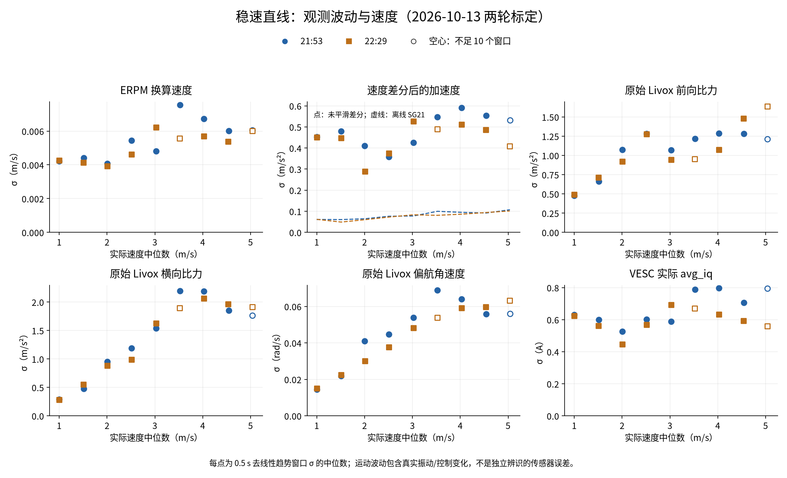
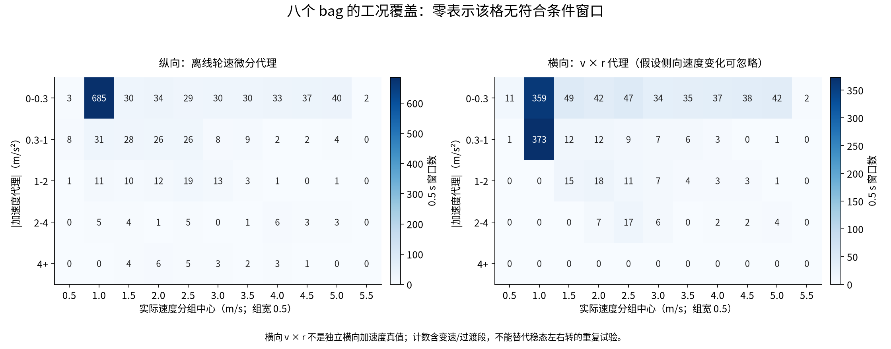

<a id="车辆响应与控制器假设"></a>
# Vehicle response and controller assumptions

**English** · [简体中文](vehicle-response.zh-CN.md) · [Documentation](README.md)

This guide connects the current V35 controller model to the recorded vehicle response. It separates **configured model parameters**, **dated measurements**, and **behavior that has not yet been identified**.

This guide maintains the vehicle model, actuator-response measurements and identification of `D`/`τ`. [System latency](system-latency.md) maintains source-time conventions, software timing and MPCC command-delivery statistics.

<a id="当前控制器建模了什么"></a>
The current interface is `/vesc/command` (100 Hz, `VescCommand`). The historical latency statistics and original bags documented in [System latency](system-latency.md#6-mpcc-snapshot-to-command) retain `/ackermann_cmd` and the historical 200 Hz configuration; they are not measurements of the new interface.

## What the current controller models

| Item | Current implementation | Meaning |
| --- | --- | --- |
| Longitudinal interface | MPCC speed command → RC selector → VESC speed PID | The optimizer's acceleration is integrated into a speed target; it is not a direct motor-acceleration command. |
| Longitudinal prediction | `dv/dt = a` | Ideal acceleration within the configured bounds; no separate speed-PID delay or response state. |
| Steering prediction | `dδ/dt = (δcmd − δ) / τ`, source `steering_tau: 0.1099010670` | 2026-10-14 IMU fit; used by the Oct 15 multilap bundle, while old bundles retain 0.08 s. No separate pure-delay state. |
| Yaw prediction | `dψ/dt = v tan(δ) / [L (1 + K v²)]` | Rear-axle model, `wheelbase: 0.36`, source `K=0.0416537059 s²/m²`; equivalent attenuation is not independently identified tyre slip. |
| Command publication / handover lead | 20 ms / 20 ms | Execution scheduling; neither value identifies actuator delay. |
| Acceleration / braking bounds | 1.0 / 1.0 m/s² | Configured prediction and command limits, not measured maximum traction or braking capability. |

`δ` is an **estimated effective steering state**, not a measured front-wheel angle. `/sensors/servo_position_command` reports the commanded servo position; receiving it does not prove that the wheels have reached that angle. The forwarded vehicle command is `/vesc/command`; `/drive` is the controller proposal before RC selection.

The current model and configuration are in [vehicle.yaml](../src/controller/config/vehicle.yaml), [the exported interval model](../src/controller/aims_mpcc/backend_models.py), and [native state propagation](../src/aims_mpcc_rt/src/core.cpp). See [MPCC implementation](../src/controller/docs/implementation.md) for states, controls and integration.

The [2026-10-14 IMU steering candidate](#2026-10-14-imu-steering-candidate) has been written to NX source/installed configuration and prepared as a new ARM bundle at the user's request. A subsequent [Oct 15 run](reports/2026-10-15-mpcc-multilap-review.md) completed 15 full laps with these parameters; no matched old/new control experiment establishes a causal tracking improvement. Changing source YAML does not replace a loaded old bundle. The earlier approximately 169 ms EKF-output fit is not a vehicle parameter.

### Longitudinal response depends on operating conditions

The speed-command response depends on the **VESC speed PID gains and controller settings**, **battery / DC-bus voltage**, current and power limits, current speed, vehicle load, and rolling resistance. Acceleration and braking can have different responses. A fitted delay and time constant therefore describe the recorded operating conditions; they are not universal vehicle constants.

The ERPM-to-speed conversion in [vesc.yaml](../src/aims_racer_system/params/vesc.yaml) sets the command/measurement scale. It does not identify the motor-controller PID tuning or the available torque. When comparing runs, record the VESC firmware configuration, PID gains, relevant limits, battery voltage and charge state, load, and speed range. The existing data do not establish a quantitative voltage-dependent response model.

<a id="纯延迟响应时间常数与估计滞后"></a>
## Pure delay, response constant, and estimation lag

For a delayed first-order response to a step command, a useful identification model is:

```text
t < D:   y(t) = y0
t ≥ D:   y(t) = y0 + (u − y0) [1 − exp(−(t − D)/τ)]
```

- **Pure delay `D`:** the interval before a response begins.
- **Response constant `τ`:** the rate of change after that delay. A first-order step reaches about 63.2% of its final change after one `τ` and about 90% after `2.3τ`.
- **Estimation lag:** the age and filtering/history effects of the state seen by the controller. This is separate from motor, servo and chassis response.

Both the historical **0.08 s** and new **0.109901 s** values are lumped fits without explicit `D`; neither means wheels wait one τ before moving, reach 90% in one τ, or identifies a separate servo constant. Adding onset delay without refitting `τ` may count the same lag twice.

The 50 Hz command timer samples the plan more frequently than the up-to-20 Hz optimization requests. It does not make the actuator respond instantaneously. Similarly, 200 Hz EKF publication does not make delayed LIO measurements current; source timestamps and delayed-measurement handling still matter.

<a id="已有实测支持哪些结论"></a>
## MPCC computation and command delivery

The complete request-to-command statistics, matching method, sample counts and scheduling analysis are maintained in [System latency: MPCC snapshot to command](system-latency.md#6-mpcc-snapshot-to-command). This guide maintains vehicle-response identification and model assumptions. Command publication and physical response are measured at separate endpoints.

<a id="recorded-response"></a>
## What the recorded measurements support

The following results come from the **2026-09-28 speed-mode calibration analysis**, mostly around 1 m/s. They are dated evidence, not a fresh high-speed identification:

| Measurement | Reported result | Interpretation |
| --- | --- | --- |
| Speed command → wheel speed fit | Approximately **40 ms pure delay + 0.16 s response constant** | Closed VESC speed loop and drivetrain response. The two fitted parameters are correlated. Neither is currently a longitudinal model parameter. |
| Sustained forward IMU acceleration onset | **45–60 ms**, median **52 ms**, 11 straight starts | A filtered onset detector; not the exact instant of first motor motion. |
| Single-lag steering fit | **0.0806 s** with wheel speed; **0.0798 s** with LIO speed | Supported the historical lumped `steering_tau: 0.08` approximation in the measured regime. |
| Isolated steering-step yaw response | Median onset **52 ms**, 50% **109 ms**, 90% **159 ms**, 10 events around **0.88–1.03 m/s** | Vehicle yaw response inferred from IMU and speed, not measured mechanical wheel-angle response. |

An earlier approximately **48 ms delay + 20–27 ms response constant** fit explained sharp steps under another model and selection; it must not be added unchanged to either the historical 0.08 s or new 0.109901 s lumped fit.

Yaw response includes the servo, tires, chassis and vehicle speed. Longer yaw settling at higher speed does not by itself prove a speed-dependent servo limit. The available records do not identify a complete acceleration/braking model across speed, battery state and load.

Read the original methods and qualifications in [speed-mode calibration](reports/2026-09-28-speed-mode-calibration.md) and [vehicle-response analysis](reports/2026-09-28-vehicle-response.md). The [2026-10-10 field review](reports/2026-10-10-mpcc-field-review.md) provides later tracking results, not a replacement actuator identification. Historical reports retain their original language and configuration context.

<a id="2026-10-14-imu-steering-candidate"></a>
### 2026-10-14: forwarded-command-to-IMU steering candidate

Refit six 2026-10-13 MPCC records using actual `/vesc/command`, measured wheel speed and native rear-IMU gyro-z, aligned by header source time:

```text
τ dq/dt + q = δ_applied
r_predicted = v tan(q) / [L (1 + K v²)]
dψ/dt = r_predicted
```

`q` is an equivalent state with command gain/bias fixed at 1/0. The joint candidate **`τ=0.109901 s`, `K=0.0416537 s²/m²`** was subsequently written to NX source/installed YAML on the same day, with a new ARM bundle generated, compiled and checked. That preparation did not start the controller. A later [Oct 15 session](reports/2026-10-15-mpcc-multilap-review.md) used the same model parameters; reference-relative lateral RMS remained 9.866 cm. See [NX preparation](reports/2026-10-14-imu-steering-model.md#nx-field-test-preparation).

Each validation fold leaves out an entire record and fits the other five:

| Model | Whole-driving yaw-rate RMSE, rad/s | Entry RMSE, rad/s |
| --- | ---: | ---: |
| Original `τ=0.08,K=0` | 0.167182 | 0.253725 |
| Refit `τ,K` | **0.069622** | **0.084972** |
| Refit `D,τ,K` | 0.069662 | 0.085010 |

A separate `D` does not improve validation across runs and is not adopted; this does not establish zero physical waiting time. `τ` combines post-publication actuator, tyre and body response rather than an independently measured servo constant. `K` is attenuation under the sampled scale/conditions, not proof of an understeer mechanism. Offline yaw-response validation using measured wheel speed does not qualify free trajectory forecasts or closed-loop tracking.

The earlier approximately **169 ms / 0.042** exploration used `/drive → EKF yaw rate`, including estimator response. This analysis refits `/vesc/command → IMU`; it neither subtracts a nominal 30–50 ms from 169 ms nor adds EKF signal lag to the vehicle model. The six-state MPCC uses EKF position, yaw and longitudinal speed, rather than EKF yaw rate as an independent prediction state.

The candidate shares NPU's steering-following/body-response approach. NPU additionally retains `vy,r,δc` and predicts body dynamics through tyre forces, mass and inertia. Our `q,τ,K` is an empirical simplification without independently represented lateral velocity or yaw inertia. See the [IMU steering-identification report](reports/2026-10-14-imu-steering-model.md) for full methods, parameter sensitivity, per-run results, figures and the NPU comparison. Software timing remains in [system latency](system-latency.md#5-ekf-computation-versus-response-lag).

### 2026-10-17 current-model selection

The user selected an uncompensated affine interval description, `a_bar = b + k * time_mean(measured avg_iq)`, fitted separately for B and C. Acceleration uses `k=0.105147, b=-1.370669` (10 completed settings at requested current ≤70 A); deceleration uses `k=0.129365, b=-1.250321` (9 settings after limiting braking magnitude to 45 A and excluding persistent-separation settings -40/-45 A). Leave-current-out RMSE is 0.04186 / 0.04959 m/s². Do not subtract basic current again when using these coefficients.

These are finite-domain interval descriptions of frozen body-Vx observations. A negative separation screen does not establish zero slip, independent truth or closed-loop acceptance. This documentation choice does not replace MPCC's existing speed interface or ideal acceleration model. See the [selection and source-evidence note (Chinese)](reports/2026-10-17-current-affine-selection.zh-CN.md) for support limits and exact literature equation/page locators. The following wheel-only analysis remains historical evidence from a different recording campaign.

### 2026-10-15 measured current response and wheel model

The [B/C calibration review](reports/2026-10-15-current-response-identification.md) adds measured `avg_iq` versus interval wheel-speed slope. B covered 146/146 items; only 122/183 C items succeeded. Offline reconstruction found 333 candidate current windows; 319 attempts contribute 985 overlapping intervals to the selected model, with each attempt summing to unit weight. Those are not 985 independent experiments.

Starting-speed-group holdout conditional RMSE is 0.370 / 1.684 / 2.404 m/s² for B low / B high / C, with trial-weight coverage 79.6% / 82.9% / 76.5%. Interval wheel-speed slope differs from instantaneous body acceleration; short high-current responses, reversal/slip and unsupported regions limit use. The model and forward/inverse query interface remain in an external analysis package and are not connected to vehicle control.

<a id="2026-10-13-longitudinal-response"></a>
### 2026-10-13: speed-command, RPM and IMU response

This **2026-10-14 offline analysis** uses the 21:53 and 22:29 constant-speed calibration runs recorded on October 13. Response onset and waveform alignment were measured separately. No controller, observer or NX runtime parameters were changed.

#### Observable onset from speed command to raw RPM

Compare forwarded `/vesc/command` with raw ERPM in `/sensors/core`, without wheel differentiation or filtered acceleration:

| Run | Moving acceleration: median / full range | Moving deceleration: median / full range | Stationary launch: sustained onset |
| --- | --- | --- | --- |
| 21:53 | **24.2 ms** / 14.1–44.5 ms, 19 events | **24.1 ms** / 13.7–24.3 ms, 12 events | **74.1 ms**, one event |
| 22:29 | **21.1 ms** / 20.6–41.0 ms, 19 events | **21.0 ms** / 13.1–22.1 ms, 12 events | **51.0 ms**, one event |

Each run contributes 32 isolated speed-mode-to-speed-mode steps of at least 0.4 m/s, with a constant target for 0.5 s before and 0.3 s after the step. Reject a changing baseline: equivalent-speed standard deviation must be at most 0.02 m/s, and its difference from the preceding target at most 0.1 m/s.

Use the preceding 0.2 s RPM median as baseline and standard deviation `σ`. Require a direction-consistent change of `max(69.3 ERPM, 3σ)`; 69.3 ERPM corresponds to 0.02 m/s using the recorded gain of 3465. Three consecutive telemetry samples must exceed the threshold within a 35 ms span. The table timestamps the first sample; **online confirmation requires the third sample, typically another 20 ms**. Stationary launches have noticeable short-term fluctuations; two examples cannot establish a general startup constant.

Timing is `t_RPM_header − t_command_header`. The command header is the selector's publication epoch; the RPM header is host `now()` when the driver receives the VESC Values packet, not the internal RPM-sampling epoch. This span includes ROS/driver delivery, VESC closed-loop control and mechanical response, and feedback transport. UART send, firmware receipt and internal sampling were not logged. Repeating the calculation with both bag-receipt times gives moving medians of about 21–25 ms. Approximately 100 Hz feedback limits onset resolution to roughly 10 ms.

**About 20–30 ms is observable onset under the specified threshold, not an independently identified constant pure delay `D`.** Reducing the threshold floor to 0.01 m/s gives acceleration medians of 14.1/21.0 ms; increasing it to 0.05 m/s gives 54.0/51.1 ms. First small movement, a larger change and target-speed settling are different metrics. This analysis did not refit `τ`; September's approximately 40 ms `D` plus 0.16 s `τ` used different events and fitting methods, so these results do not quantify an actuator-latency improvement caused by the new interface.

#### Pre-KF IMU versus wheel-derived acceleration waveform

Compare longitudinal specific force in `/rear_axle/imu` with a wheel-derived acceleration reference. **Positive alignment means the IMU waveform is later**:

| Run | Strong acceleration: median alignment | Strong braking: median alignment |
| --- | --- | --- |
| 21:53 | **+20 ms**, 9 events | **+60 ms**, 10 events |
| 22:29 | **+10 ms**, 9 events | **+50 ms**, 10 events |

Select transients that reached 3 m/s and had an absolute wheel-reference peak of at least 4 m/s². Use the active portion of the full event window extended by 0.25 s on each side. Resample wheel speed by header time to 100 Hz and differentiate with a centered, 21-point, third-order Savitzky–Golay window. This reference includes future samples and is only an offline evaluation proxy. Hold the latest valid IMU specific force already received, with maximum age 30 ms. The topic already applies mounting rotation, unit conversion and lever-arm processing; no extra low-pass filter or KF output was used here.

Search local Pearson correlation over ±200 ms in 10 ms steps: `δ = argmax corr(a_wheel(t), f_IMU(t + δ))`. This aligns the main waveform; **it is not an IMU first-change detector, message age or pure hardware delay**. IMU is approximately 200 Hz and wheel telemetry 100 Hz; the higher update rate did not produce an earlier main waveform in these events. Wheel speed is converted from VESC ERPM, not independent ground-speed truth; the no-slip assumption still needs separate validation.

All strong-acceleration windows satisfy `|yaw rate| < 0.3 rad/s`, giving clearer phase evidence. Most braking windows also enter a turn; changing pitch/gravity projection and turning coupling affect specific force, so the 50–60 ms alignment cannot all be assigned to IMU latency. Only one complete straight braking window exists per run, with 60/50 ms alignment; that is insufficient to generalize to all braking. Using 11/41-point differentiation windows gives acceleration medians around 10–40 ms and braking around 45–60 ms, with a similar overall direction. The two afternoon MPCC runs have weaker waveform correlation and inconsistent lead/lag signs; the finding does not generalize to every racing condition.

<a id="matched-command-onset"></a>
#### Follow-up: matched command-to-IMU/RPM onset by operating condition

**The preceding whole-waveform alignment does not replace this onset test.** The 2026-10-14 follow-up fixes the same 64 speed steps: one stationary launch, 19 moving acceleration events and 12 deceleration events per run. Both raw signals are measured from the same forwarded `/vesc/command` publication; IMU misses remain in the fixed denominators.

The primary rule uses each signal's bag-receipt time, its own baseline `3σ`, and at least **20 ms** of continuous threshold exceedance. Floors are 0.02 m/s equivalent speed for RPM and 0.5 m/s² specific-force change for IMU. Every native sample must qualify; a gap above 15 ms breaks persistence. Multiple IMU messages arriving together cannot manufacture elapsed time. RPM was also remeasured with actual persistence and receipt timing, so its values differ slightly from the preceding three-sample/header rule.

| Run | Condition | RPM median onset / detected | IMU median onset / detected |
| --- | --- | --- | --- |
| 21:53 | Moving acceleration | **26.5 ms**, 19/19 | **42.7 ms**, 14/19 |
| 21:53 | Moving deceleration | **24.3 ms**, 12/12 | **94.2 ms**, 12/12 |
| 21:53 | Stationary launch | **74.3 ms**, 1/1 | **96.6 ms**, 1/1 |
| 22:29 | Moving acceleration | **21.4 ms**, 19/19 | **41.3 ms**, 16/19 |
| 22:29 | Moving deceleration | **21.6 ms**, 12/12 | **100.8 ms**, 12/12 |
| 22:29 | Stationary launch | **52.4 ms**, 1/1 | **52.3 ms**, 1/1 |

IMU misses 5/19 and 3/19 acceleration events: no continuous crossing within 500 ms under this rule, not absence of physical response. Each median covers only its own detections. On events detected by both signals, median IMU-minus-RPM onset is **+12.8/+20.0 ms** for acceleration and **+69.9/+77.2 ms** for deceleration. These are medians of event-level differences, not differences between the overall column medians. One launch has IMU about 22 ms later; the other is practically simultaneous. Only two launches exist in this cohort.

**Detection strength changes acceleration ordering.** With an independent baseline from -500 to -300 ms and a command-before control window from -200 to 0 ms, the primary RPM rule triggers in **6/64** windows and IMU in **0/64**. These are diagnostic counts from shorter windows, not an estimated vehicle false-positive rate. Raising the RPM floor to 0.05 m/s gives 0/64 for both signals. Retaining 3σ, IMU then leads RPM by about 11.5/12.0 ms on paired acceleration detections, but the same IMU misses remain.

A further sensitivity setting uses **2σ, an RPM floor of 0.05 m/s, an IMU floor of 0.5 m/s², and 20 ms persistence**. Both signals detect every fixed event and still trigger in 0/64 command-before windows:

| Run | Condition | RPM median onset | IMU median onset | Detections per signal |
| --- | --- | --- | --- | --- |
| 21:53 | Moving acceleration | 54.5 ms | 41.5 ms | 19/19 |
| 22:29 | Moving acceleration | 51.4 ms | 30.9 ms | 19/19 |
| 21:53 | Moving deceleration | 24.3 ms | 72.3 ms | 12/12 |
| 22:29 | Moving deceleration | 31.4 ms | 81.2 ms | 12/12 |

This is not a new default profile or proof of equal or zero real false-positive rates. Speed and specific force have different units; a common numeric threshold is invalid, and a common noise multiplier does not equate physical onset detection. Onset timestamps the first sample of a sustained run retrospectively; online confirmation needs later samples satisfying at least 20 ms persistence. Receipt here is the recorder's boundary, not observer callback execution. First single-sample change, continuously discernible change, whole-waveform alignment and target-speed buildup remain separate metrics.

The supported conclusion is therefore: **acceleration onset ordering depends on detection thresholds; earlier discernible RPM change during deceleration is more consistent across the tested settings; stationary launches are too few to generalize.** This does not establish that RPM is physically faster than IMU in every regime. See matched command-to-IMU/RPM evidence (`$AIMSRACER_DATA/sessions/2026-10-13/longitudinal-acceleration-review/command-imu-rpm-matched/README.md`) for all ten sensitivity settings, misses and command-before triggers. An independent state machine verified 1280 signal/scenario cases, 1280 control cases and 640 event pairs, together with original input hashes.

#### Implications for controller and feedforward assumptions

1. Wheel-derived acceleration usually leads the complete main waveform in these calibration runs, but this does not establish onset ordering after the same command. “Fast IMU updates with slower wheel correction” describes an algorithm structure, not proof that IMU is always earlier. Compare forecast error, noise and misses when selecting fusion; see [longitudinal filter tuning](reports/2026-10-14-longitudinal-filter-tuning.md) for the actual estimator comparisons.
2. **Do not add command-to-RPM onset to IMU-versus-wheel waveform alignment** to obtain a command-to-IMU delay. The matched, grouped onset measurements above are now available directly. Preserve detector thresholds, receipt/source conventions, misses and command-before triggers with the paired results; physical first response and independent hardware pure delay remain unidentified.
3. Commands precede observable RPM changes, supporting command history as a prediction input, but 21–24 ms is not a validated fixed feedforward compensation. Check prediction residuals, response buildup and steady-state error on matched events, then identify dynamics for the relevant operating regime.
4. These runs mainly contain **speed commands**, not an independent current-step experiment. They do not identify current-command-to-actual-Iq loop delay or validate perfect current tracking. Iq/command feedforward must still account for timestamps, feedback age, saturation and model residuals.

Evidence is stored outside the repository on the analysis host; a fresh clone does not include it: command-to-RPM method and event results (`$AIMSRACER_DATA/sessions/2026-10-13/longitudinal-acceleration-review/command-rpm-response/README.md`), IMU/wheel alignment method and event results (`$AIMSRACER_DATA/sessions/2026-10-13/longitudinal-acceleration-review/imu-wheel-response/README.md`). Independent checks cover 192 threshold cases from 64 speed steps and 76 IMU alignment cases across two timestamp conventions. These checks verify calculations and input hashes, not independent physical ground truth.

<a id="sensor-fluctuation-profile"></a>
## Operating-condition fluctuations in IMU, ERPM and Iq

The 2026-10-14 initial profile covers six afternoon MPCC bags and the two constant-speed calibration runs from October 13: **eight bags and 5043 jointly valid, nonoverlapping 0.5 s windows**. Raw `/livox/imu` six-axis data and actual `avg_iq` were additionally extracted read-only on NX. Rear-adapted six-axis statistics remain separate. Original bag sizes/modification times did not change.

Each window retains actual speed, longitudinal wheel-differentiation and lateral `v × r` proxies, straight/turning and acceleration/deceleration/steady labels, actual Iq/Id, voltage, duty and faults. Groups retain 0.5 m/s speed bins and acceleration/current conditions, with means, total/linearly detrended standard deviations, MAD, six-axis residual covariance, autocorrelation and sample counts. The lateral proxy assumes negligible change in lateral velocity; IMU specific force includes gravity projection. Neither is independent acceleration truth.

**Observed fluctuations, real motion/vibration, closed-loop control and model residuals require separate interpretation.** A command-before detector trigger does not prove large RPM measurement noise. Moving-window residual variance cannot be assigned wholesale to KF measurement noise R.

The following steady-straight comparison first takes the median window standard deviation within each heavy-battery run, then lists the range of the two run medians. It is not a confidence interval:

| Actual speed group | ERPM-derived speed σ | Unsmoothed differentiated acceleration σ | Raw Livox forward specific-force σ | Raw yaw-rate σ | Actual Iq σ |
| --- | --- | --- | --- | --- | --- |
| Around 1 m/s | 0.0042–0.0043 m/s | 0.450–0.453 m/s² | 0.478–0.490 m/s² | 0.0145–0.0151 rad/s | 0.625–0.629 A |
| Around 5 m/s | 0.0060–0.0061 m/s | 0.409–0.532 m/s² | 1.212–1.638 m/s² | 0.0561–0.0633 rad/s | 0.559–0.796 A |

Speed fluctuation is small, but differentiation amplifies it. Raw IMU specific force/angular-rate fluctuations vary more visibly with speed, while Iq does not increase monotonically. Raw lateral specific-force σ is 0.280–0.287 m/s² near 1 m/s and 1.761–1.912 m/s² near 5 m/s; even these straight steady-state fluctuations are not identified lateral measurement errors. `σ_a = sqrt(2) σ_v / Δt` holds only under an independent white speed-noise approximation. The differentiated values here use actual samples/time intervals rather than blindly applying that formula.



**Coverage gaps:** each run has only nine strict steady-straight windows near 5 m/s, or 4.5 s. Eligible strong-yaw windows number 35 in the positive direction and zero in the negative direction, at about 0.98–2.84 m/s. No window at speed >=4 m/s also satisfies both steady-speed and strong-turn criteria. Further data need sustained turns in both directions at varied speeds/curvatures and repeated acceleration/deceleration strengths at matched speed. Zero denotes coverage after window selection, not proof that no brief maneuver occurred.



The initial Oct 14 profile preceded the B/C collection. The [Oct 15 review](reports/2026-10-15-current-response-identification.md) now records complete B plan coverage and partial C measurement coverage. Torque is currently labeled by **actual Iq (A) as a proxy**, with N·m fields missing. The earlier empirical Iq-to-acceleration coefficient is not independent motor Kt. B/C can supply vehicle-level effective gains/dynamics; absolute torque still needs the corresponding torque/drivetrain mapping. Approximately 100 Hz `avg_iq` telemetry is averaged with an undocumented window and cannot describe all high-frequency current-loop ripple.

See the condition-profile data entry (`$AIMSRACER_DATA/sessions/2026-10-13/longitudinal-acceleration-review/sensor-fluctuation-profile/README.md`) for speed/longitudinal/lateral acceleration/current summaries, raw/rear six-axis comparison, coverage cells, methodology and missing data. Groups below ten windows are marked sparse. No universal noise formula or online parameter change was introduced. Independent least-squares checks cover all windows, six-axis covariances and summaries; supplemented ERPM/voltage match the earlier extraction exactly. This validates the statistics, not independent noise or torque truth.

<a id="下一次调参如何利用这些信息"></a>
## How to use this in the next tuning session

1. Compare **forwarded `/vesc/command`** with source-stamped wheel speed, LIO/EKF motion and bias-corrected IMU yaw rate. Keep command publication, measurement time and receipt time distinct.
2. Separate stationary starts, acceleration, braking and steady cornering; compare prediction residuals within speed ranges and comparable PID, voltage and load conditions. A speed-scale error or stale state can resemble an actuator-model error.
3. Keep frame and unit conventions consistent. `base_link` is the rear-axle center; raw Livox acceleration uses `g` and the rear-axle adapter converts it to m/s². Angular velocity uses rad/s. See [architecture](architecture.md).
4. Use repeated measured mismatch to decide whether to refit the lumped steering lag, introduce a separate pure delay, or identify a longitudinal response model. The current speed-mode interface has its own closed-loop response even though the optimizer predicts ideal acceleration.
5. After changing a model parameter such as `steering_tau`, **export and build a new solver bundle** and launch with it. Editing source YAML does not change an already running immutable bundle. Record the bundle/configuration with the run; follow the [reference and bundle workflow](../src/controller/docs/usage.md).

[Back to the documentation index](README.md)

## Current and lateral-acceleration calibration

[Current calibration A/B/C and selected results](operations/calibration.md#current-calibration) · [Lateral AY validation and grip status](operations/lateral-acceleration-calibration.md). Source is unified under `src/calibration/`; use the restored C++ lateral entry. Historical Python commands are provenance only.
